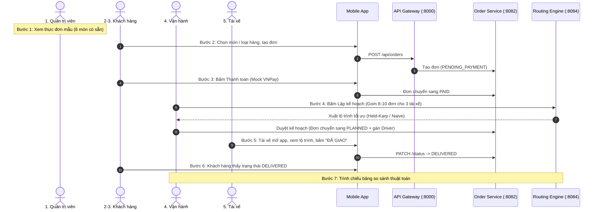

# SWIFTROUTE — KẾ HOẠCH TRIỂN KHAI DEMO THỨ BẢY (TỐI GIẢN & CHUẨN HÓA)
> **Cập nhật theo:** `ke-hoach-demo.md` (Đóng băng tính năng, tập trung 1 luồng trọn vẹn từ Đặt hàng $\rightarrow$ Giao xong).  
> **Thời gian:** Hoàn thiện trước Thứ Sáu để đóng băng code, Thứ Bảy chỉ chạy demo.

---

## 🧭 BẢN ĐỒ ĐỐI CHIẾU 7 BƯỚC DEMO (`ke-hoach-demo.md` $\leftrightarrow$ Codebase)

---

## 👥 PHÂN CHIA NHIỆM VỤ

| Vai trò | Phụ trách | Nhiệm vụ chính |
|---|---|---|
| 🤖 **AGENT (Chỉ tập trung CODE)** | Lập trình Backend & Mobile | • **Backend Order:** Migration V6, DTO/Entity loại hàng, API Mock Payment (`PAID`), API duyệt kế hoạch. • **Backend Routing:** FastAPI `/optimize/batch` gom 8-10 đơn chia cho 3 tài xế. • **Mobile App Khách:** Chọn món/loại hàng, nút thanh toán giả lập, live tracking. • **Mobile App Tài xế:** Thay màn hình placeholder bằng danh sách đơn được gán + nút bấm "ĐÃ GIAO". |
| 👤 **BẠN (Tự làm thủ công)** | Dữ liệu & Thao tác Demo | • Chạy lệnh nạp Seed Data mẫu (1 tenant, 6 món, 1 khách, 1 nhân viên, 3 tài xế, 8-10 đơn). • Bật Docker Compose (`postgres`, `rabbitmq`, `redis`). • Cầm điện thoại thao tác đặt đơn và bấm giao hàng. • Mở slide chiếu bảng so sánh thuật toán. |

---

## 🤖 DANH SÁCH VIỆC AGENT CẦN CODE (CHI TIẾT TỪNG PHẦN)

### 🟢 Phần 1: Backend Order Service & Payment
- [ ] **Task 1.1:** Tạo Flyway Migration `V6__add_package_details_to_orders.sql` (thêm `package_category`, `item_description`, `notes`).
- [ ] **Task 1.2:** Cập nhật Entity `Order.java` & DTO `CreateOrderRequest.java`, `OrderResponse.java`.
- [ ] **Task 1.3 [MỚI TỪ DEMO-PLAN]:** Thêm API Mock Payment `POST /api/orders/{id}/pay` chuyển trạng thái đơn từ `PENDING_PAYMENT` $\rightarrow$ `PAID` (phục vụ Bước 3 demo thanh toán).
- [ ] **Task 1.4 [MỚI TỪ DEMO-PLAN]:** Thêm API Duyệt kế hoạch `POST /api/orders/assign-batch` nhận danh sách `{order_id, driver_id, plan_id}` và chuyển trạng thái các đơn sang `PLANNED`.
- [ ] **Task 1.5:** Compile kiểm tra `order-service` (`mvn clean test-compile`).

### 🧠 Phần 2: Backend Routing Engine (FastAPI)
- [ ] **Task 2.1:** Tạo `api/schemas.py`: Request nhận danh sách 8-10 đơn hàng + 3 tài xế, Response trả về lộ trình cho từng tài xế.
- [ ] **Task 2.2:** Tạo `service/optimizer_service.py`: Phân cụm đơn cho 3 tài xế + chạy tối ưu Held-Karp / Nearest Neighbor cho từng cụm.
- [ ] **Task 2.3:** Tạo `api/routes.py` (`POST /api/v1/optimize/batch`, `GET /api/v1/health`).
- [ ] **Task 2.4:** Tạo `main.py` chạy trên cổng `8084` kèm CORS.
- [ ] **Task 2.5:** Cập nhật `api-gateway` route `/api/routing/**` trỏ về port `8084`.

### 📱 Phần 3: Mobile App Khách Hàng (Customer Flow)
- [ ] **Task 3.1:** Tạo widget `package_category_selector.dart` (Chọn Đồ ăn, Tài liệu, Hàng tiêu dùng...).
- [ ] **Task 3.2:** Cập nhật `create_order_screen.dart` cho phép chọn món/loại hàng + nhập ghi chú.
- [ ] **Task 3.3 [MỚI TỪ DEMO-PLAN]:** Thêm dialog / nút bấm "Thanh toán (Mock VNPay)" sau khi tạo đơn để đơn chuyển sang `PAID`.
- [ ] **Task 3.4:** Cập nhật `order_tracking_screen.dart` hiển thị thông tin món đồ đang giao và tự động cập nhật khi đơn sang `DELIVERED`.

### 🛵 Phần 4: Mobile App Tài Xế (Driver Flow - MỚI TỪ DEMO-PLAN)
- [ ] **Task 4.1:** Tạo màn hình `DriverOrdersScreen` thay thế `_DriverPlaceholderScreen` trong `main.dart`.
- [ ] **Task 4.2:** Gọi API `GET /api/orders/driver/assigned` hiển thị danh sách các đơn hàng được gán cho tài xế đăng nhập.
- [ ] **Task 4.3:** Thêm nút bấm **"Bắt đầu giao"** (`IN_TRANSIT`) và **"Đã giao thành công"** (`DELIVERED`) gọi API `PATCH /api/orders/{orderId}/status`.

---

## 👤 KỊCH BẢN SEED DATA DÀNH CHO BẠN (1 LỆNH DUY NHẤT)

Agent sẽ viết sẵn cho bạn file SQL `scripts/seed_demo_data.sql`. Bạn chỉ việc mở DBeaver/pgAdmin chạy file này để có sẵn:
- **1 Tenant:** `Bếp Nhà Swift (Nhà hàng / Shop)`
- **6 Món ăn / Hàng mẫu:** Cơm tấm sườn, Trà sữa trân châu, Bún bò Huế, Hồ sơ tài liệu, Hộp bánh kem, Thuốc y tế.
- **1 Tài khoản Khách hàng:** `customer@swiftroute.com` / `123456`.
- **1 Tài khoản Quản trị/Vận hành:** `admin@swiftroute.com` / `123456`.
- **3 Tài khoản Tài xế:**
  - `driver1@swiftroute.com` (Tài xế 1 - Xe máy 59-X1 111.11)
  - `driver2@swiftroute.com` (Tài xế 2 - Xe máy 59-X1 222.22)
  - `driver3@swiftroute.com` (Tài xế 3 - Xe máy 59-X1 333.33)
- **8 đến 10 đơn hàng mẫu:** Đã ở trạng thái `PAID`, phân bố quanh khu vực demo để sẵn sàng cho Bước 4 (Lập kế hoạch).
