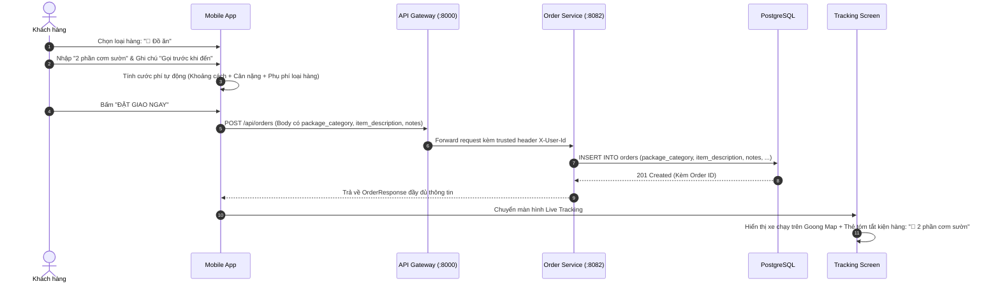

# Kế Hoạch Triển Khai Tính Năng: Phân Loại Hàng Hóa & Thông Tin Giao Hàng
**Dự án:** SwiftRoute
**Phạm vi:** Mobile App (Flutter) $\leftrightarrow$ API Gateway $\leftrightarrow$ Order Service (Spring Boot) $\leftrightarrow$ PostgreSQL
**Mục tiêu:** Bổ sung tính năng cho phép khách hàng chọn **Loại hàng hóa** (Đồ ăn, Tài liệu, Hàng tiêu dùng, Y tế, Dễ vỡ) và nhập **Tên hàng / Ghi chú cho tài xế**, đồng bộ từ giao diện Đặt hàng $\rightarrow$ Lưu Database $\rightarrow$ Hiển thị trên Live Tracking.

---

## 1. Tổng quan & Những gì hiện tại còn thiếu (Gap Analysis)

| Hạng mục | Hiện trạng codebase | Yêu cầu mới cần bổ sung |
|---|---|---|
| **Database `orders`** | Mới có tọa độ, địa chỉ, `weight_kg`, `priority`, `time_window` | **Thiếu 3 cột**: `package_category`, `item_description`, `notes` |
| **Backend DTO / Entity** | `CreateOrderRequest`, `Order`, `OrderResponse` chưa có thông tin món hàng | Tạo enum `PackageCategory`, cập nhật Entity và DTOs |
| **Giao diện Đặt hàng (Mobile)** | Chỉ có chọn Điểm đón/giao, nút bấm số kg, chọn Hỏa tốc | Thêm thanh chọn Loại hàng (Card/Chip có icon) + 2 ô input: Tên món đồ & Ghi chú |
| **Màn hình Live Tracking** | Mới hiện xe chạy và tên tài xế, chưa hiện thông tin gói hàng | Thêm banner tóm tắt: *"Đang giao: 🍲 Đồ ăn (Cơm tấm) • 1.5 kg"* |
| **Tính cước phí** | Chỉ tính theo cự ly km + cân nặng | Kết hợp phụ phí theo loại hàng (ví dụ: Hàng dễ vỡ +5.000đ phí bảo quản) |

---

## 2. Danh sách file cần thêm mới & sửa đổi (File Manifest)

### 🟢 A. Backend — `order-service` (Spring Boot Java 21)

| File | Hành động | Mục đích |
|---|:---:|---|
| `services/order-service/src/main/resources/db/migration/V6__add_package_details_to_orders.sql` | **Tạo mới** | Flyway migration thêm 3 cột: `package_category`, `item_description`, `notes`. |
| `services/order-service/src/main/java/com/swiftroute/orderservice/entity/enums/PackageCategory.java` | **Tạo mới** | Enum Java gồm: `DOCUMENT`, `FOOD`, `PARCEL`, `MEDICAL`, `FRAGILE`. |
| `services/order-service/src/main/java/com/swiftroute/orderservice/entity/Order.java` | **Sửa đổi** | Khai báo 3 trường mới tương ứng trong Entity JPA. |
| `services/order-service/src/main/java/com/swiftroute/orderservice/dto/request/CreateOrderRequest.java` | **Sửa đổi** | Nhận thêm `packageCategory`, `itemDescription`, `notes` từ client. |
| `services/order-service/src/main/java/com/swiftroute/orderservice/dto/response/OrderResponse.java` | **Sửa đổi** | Trả thêm 3 trường này về cho Mobile App và Web. |
| `services/order-service/src/main/java/com/swiftroute/orderservice/service/OrderService.java` | **Sửa đổi** | Ánh xạ các trường từ Request vào Entity khi lưu đơn. |

---

### 🔵 B. Frontend — `mobile-app` (Flutter Dart)

| File | Hành động | Mục đích |
|---|:---:|---|
| `mobile-app/lib/features/order/domain/enums/package_category.dart` | **Tạo mới** | Enum Flutter định nghĩa: Icon, Tên tiếng Việt, Phụ phí, Gợi ý trọng lượng. |
| `mobile-app/lib/features/order/presentation/widgets/package_category_selector.dart` | **Tạo mới** | Widget danh sách icon lướt ngang (Horizontal Cards) để người dùng chạm chọn. |
| `mobile-app/lib/features/order/application/order_form_provider.dart` | **Sửa đổi** | Cập nhật `OrderFormState` (lưu category, itemDescription, notes) & cập nhật công thức tính cước. |
| `mobile-app/lib/features/order/data/models/order_model.dart` | **Sửa đổi** | Bổ sung parse JSON cho các trường mới. |
| `mobile-app/lib/features/order/data/datasources/order_remote_data_source.dart` | **Sửa đổi** | Bổ sung các trường mới vào JSON payload khi gửi `POST /orders`. |
| `mobile-app/lib/features/order/presentation/screens/create_order_screen.dart` | **Sửa đổi** | Chèn widget chọn loại hàng và ô nhập ghi chú vào form đặt hàng. |
| `mobile-app/lib/features/order/presentation/screens/order_tracking_screen.dart` | **Sửa đổi** | Hiển thị thẻ tóm tắt loại hàng và ghi chú trên màn hình Live Tracking. |

---

## 3. Đặc tả chi tiết từng loại hàng hóa (Domain Specification)

Định nghĩa bộ danh mục chuẩn hóa theo đặc thù giao hàng xe máy tại Việt Nam:

```dart
enum PackageCategory {
  food(
    code: 'FOOD',
    label: 'Đồ ăn / Đồ uống',
    icon: Icons.restaurant,
    color: Colors.orange,
    maxWeightKg: 10.0,
    surchargeVnd: 0,
    description: 'Thức ăn nóng/lạnh, đồ uống, bánh kem (cần giao nhanh)',
  ),
  document(
    code: 'DOCUMENT',
    label: 'Tài liệu / Hợp đồng',
    icon: Icons.description,
    color: Colors.blue,
    maxWeightKg: 3.0,
    surchargeVnd: 0,
    description: 'Hồ sơ, hóa đơn, bưu phẩm giấy (cần chống nước)',
  ),
  parcel(
    code: 'PARCEL',
    label: 'Hàng tiêu dùng',
    icon: Icons.inventory_2,
    color: Colors.teal,
    maxWeightKg: 30.0,
    surchargeVnd: 0,
    description: 'Quần áo, mỹ phẩm, đồ gia dụng nhỏ',
  ),
  medical(
    code: 'MEDICAL',
    label: 'Thuốc / Y tế',
    icon: Icons.medication,
    color: Colors.redAccent,
    maxWeightKg: 5.0,
    surchargeVnd: 0,
    description: 'Dược phẩm, dụng cụ y tế khẩn cấp',
  ),
  fragile(
    code: 'FRAGILE',
    label: 'Hàng dễ vỡ',
    icon: Icons.warning_amber_rounded,
    color: Colors.deepOrange,
    maxWeightKg: 15.0,
    surchargeVnd: 5000,
    description: 'Đồ gốm sứ, kính, thiết bị điện tử nhạy cảm',
  );
}
```

---

## 4. Thiết kế Giao diện người dùng (UI/UX Design)

### 4.1. Màn hình Đặt đơn (`CreateOrderScreen`)
Thêm một khu vực trực quan ngay phía dưới phần chọn Điểm lấy/giao:

```
┌──────────────────────────────────────────────────────────┐
│ LOẠI HÀNG HÓA                                            │
│ ┌─────────┐  ┌─────────┐  ┌─────────┐  ┌─────────┐       │
│ │  🍲     │  │  📄     │  │  📦     │  │  💊     │  ...  │
│ │  Đồ ăn  │  │Tài liệu │  │ Tiêu dùng│ │  Y tế   │       │
│ └─────────┘  └─────────┘  └─────────┘  └─────────┘       │
│                                                          │
│ TÊN MÓN ĐỒ                                               │
│ [ Ví dụ: 2 cốc trà sữa trân châu, Hộp cơm trưa...      ] │
│                                                          │
│ GHI CHÚ CHO TÀI XẾ                                       │
│ [ Ví dụ: Gọi trước khi tới 5 phút, bấm chuông lầu 2... ] │
└──────────────────────────────────────────────────────────┘
```

### 4.2. Màn hình Live Tracking (`OrderTrackingScreen`)
Hiển thị thẻ tóm tắt thông tin gói hàng cạnh thông tin tài xế:
```
┌──────────────────────────────────────────────────────────┐
│ 🛵 TÀI XẾ ĐANG GIAO                                      │
│ Nguyễn Văn Tài Xế • 59-X1 888.88                         │
├──────────────────────────────────────────────────────────┤
│ 📦 THÔNG TIN KIỆN HÀNG                                   │
│ • Loại hàng: 🍲 Đồ ăn / Đồ uống                          │
│ • Chi tiết: 2 cốc trà sữa (1.5 kg)                       │
│ • Ghi chú: Gọi trước khi đến, gửi tại lễ tân lầu 1       │
└──────────────────────────────────────────────────────────┘
```

---

## 5. Đặc tả Kỹ thuật Backend (Database & DTOs)

### 5.1. Flyway Script: `V6__add_package_details_to_orders.sql`
```sql
-- Migration: V6__add_package_details_to_orders.sql
ALTER TABLE orders
    ADD COLUMN IF NOT EXISTS package_category VARCHAR(30) NOT NULL DEFAULT 'PARCEL',
    ADD COLUMN IF NOT EXISTS item_description VARCHAR(255),
    ADD COLUMN IF NOT EXISTS notes VARCHAR(500);

COMMENT ON COLUMN orders.package_category IS 'Category: DOCUMENT, FOOD, PARCEL, MEDICAL, FRAGILE';
COMMENT ON COLUMN orders.item_description IS 'Description of items (e.g. 2 bubble milk tea cups)';
COMMENT ON COLUMN orders.notes IS 'Instructions for delivery driver';
```

### 5.2. Payload JSON khi client gọi API:
```json
{
  "pickup_lat": 10.7769,
  "pickup_lng": 106.7009,
  "pickup_address": "Chợ Bến Thành, Quận 1, TP.HCM",
  "delivery_lat": 10.7925,
  "delivery_lng": 106.6912,
  "delivery_address": "Landmark 81, Bình Thạnh, TP.HCM",

  "package_category": "FOOD",
  "item_description": "2 phần cơm sườn nướng",
  "notes": "Giao cho bảo vệ sảnh tòa nhà giúp tôi",

  "weight_kg": 1.5,
  "priority": "URGENT",
  "time_window_start": "2026-10-28T07:00:00Z",
  "time_window_end": "2026-10-28T08:30:00Z"
}
```

---

## 6. Luồng Nghiệp Vụ Hoàn Chỉnh (Sequence Diagram)



---

## 7. Khả năng kết hợp với Thuật toán & Hệ thống (Synergies)

1. **Kết hợp với Routing Engine (Tối ưu hóa đa điểm TSP/VRP):**
   - Đơn hàng loại **`FOOD`** hoặc **`MEDICAL`** tự động được gán ràng buộc khung giờ giao hẹp (Ví dụ: phải giao trong vòng 45 - 60 phút, không để đồ ăn nguội/hỏng).
   - Khi chạy thuật toán gom đơn (Batch Optimization), bộ lọc sẽ ưu tiên đưa các điểm giao `FOOD` lên trước trong chuỗi hành trình.
2. **Kết hợp với Phân loại Tài xế (Driver Service):**
   - Tài xế có trang bị thùng giữ nhiệt sẽ được ưu tiên nhận đơn `FOOD`.
   - Tài xế đi xe tải nhỏ/xe bán tải sẽ nhận đơn hàng cồng kềnh `PARCEL` tải trọng lớn.
3. **Giá trị thuyết trình trong buổi bảo vệ Luận văn:**
   - Chứng minh hệ thống không chỉ giải bài toán hình học Euclid khô khan mà hiểu rõ **nghiệp vụ Logistics thực tế** (Mỗi loại hàng hóa có yêu cầu vận chuyển và ràng buộc thời gian khác nhau).

---

## 8. Lộ trình Thực hiện theo Thứ tự (Implementation Steps)

- [ ] **Bước 1 (Backend Database & Entities):**
  - Tạo file migration `V6__add_package_details_to_orders.sql` trong `order-service`.
  - Tạo enum `PackageCategory.java`.
  - Cập nhật `Order.java`, `CreateOrderRequest.java`, `OrderResponse.java` và `OrderService.java`.
  - Kiểm tra compile: `mvn clean test-compile` trên `order-service`.
- [ ] **Bước 2 (Frontend Domain & Widget):**
  - Tạo enum `package_category.dart` với đầy đủ icon và màu sắc.
  - Tạo widget `package_category_selector.dart` giao diện dạng chip bo tròn hiện đại.
  - Thêm state `packageCategory`, `itemDescription`, `notes` vào `order_form_provider.dart`.
- [ ] **Bước 3 (Ghép Giao diện & Gọi API):**
  - Ghép widget chọn loại hàng và ô nhập ghi chú vào `create_order_screen.dart`.
  - Cập nhật `order_remote_data_source.dart` và `order_model.dart` để gửi nhận các trường mới.
  - Cập nhật `order_tracking_screen.dart` để hiển thị thẻ tóm tắt kiện hàng khi xe đang chạy.
- [ ] **Bước 4 (Kiểm thử thực tế):**
  - Mở App $\rightarrow$ Chọn đồ ăn $\rightarrow$ Nhập tên món $\rightarrow$ Bấm đặt đơn $\rightarrow$ Kiểm tra Database thấy đúng chữ `FOOD` và tên món $\rightarrow$ Xem thẻ hiển thị trên màn hình Live Tracking.

