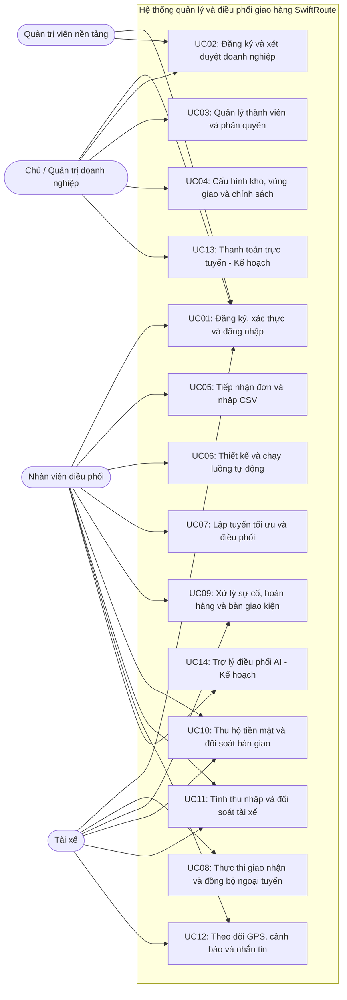
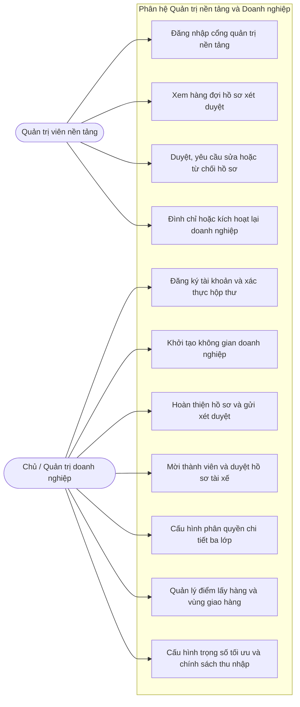
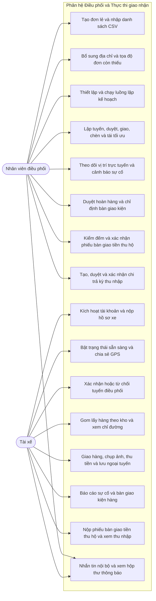
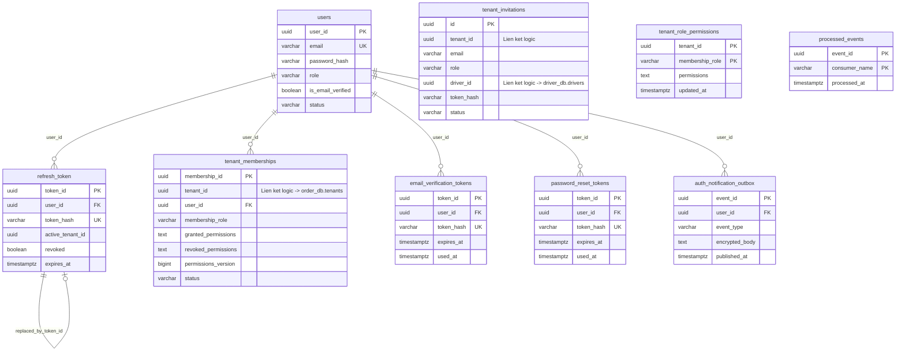
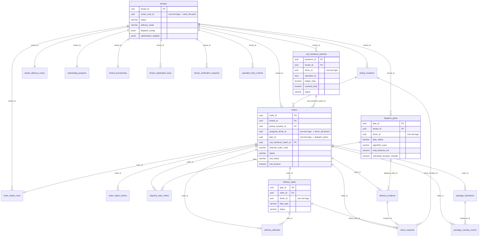
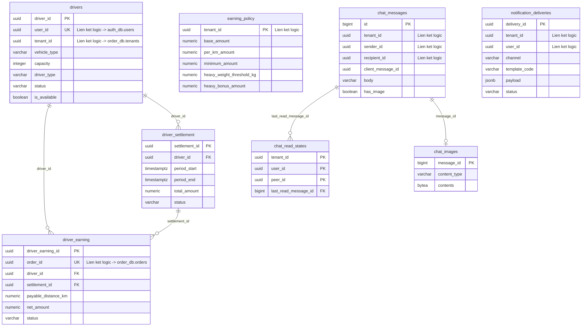
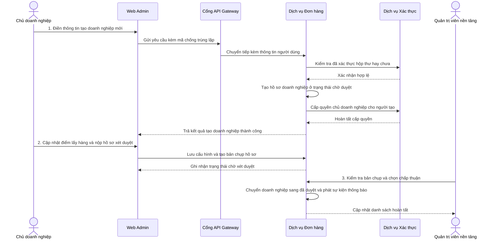
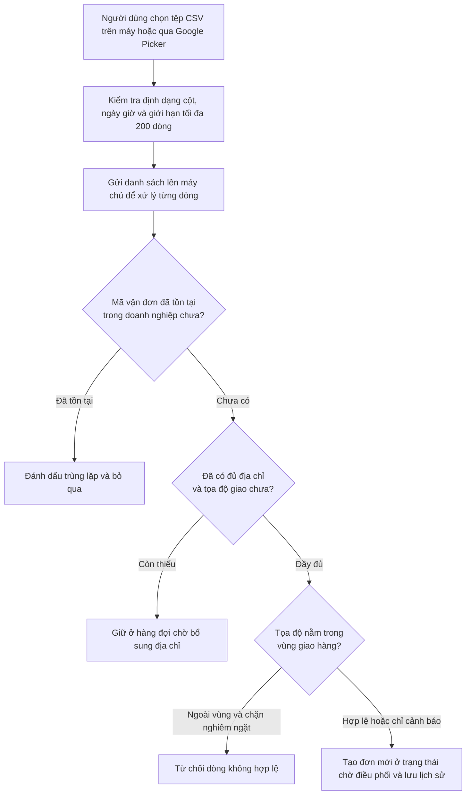
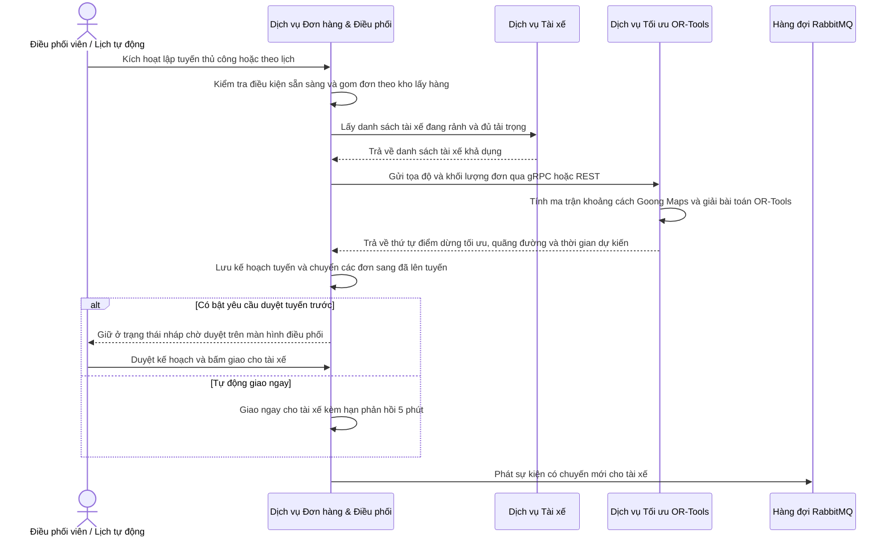
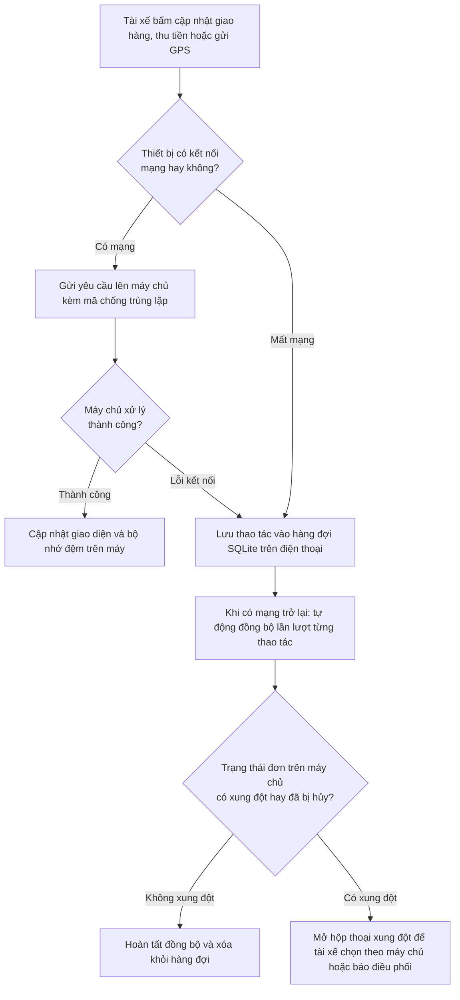

# BÁO CÁO LUẬN VĂN TỐT NGHIỆP ĐẠI HỌC

> **Thông tin đối chiếu mã nguồn:** Kho lưu trữ `swiftroute`, nhánh `main`, commit `2ad3661`, đối chiếu ngày `2026-11-16`, bao gồm cả các thay đổi chưa commit đang có trong thư mục làm việc tại thời điểm đối chiếu.
> **Ghi chú định dạng:** Tài liệu được biên soạn theo cấu trúc của mẫu báo cáo luận văn đại học Trường Công nghệ Thông tin và Truyền thông – Đại học Cần Thơ và tham chiếu cách trình bày từ luận văn mẫu `B2203495`. Các vị trí cần chèn ảnh chụp màn hình hoặc sơ đồ được đánh dấu rõ; số trang trong Mục lục và các Danh mục sẽ được cập nhật tự động sau khi xuất sang Word hoặc PDF.

---

## TRANG BÌA

TRƯỜNG ĐẠI HỌC CẦN THƠ
TRƯỜNG CÔNG NGHỆ THÔNG TIN VÀ TRUYỀN THÔNG
KHOA `[Cần cung cấp: Tên Khoa, ví dụ: Công nghệ phần mềm]`

**LUẬN VĂN TỐT NGHIỆP ĐẠI HỌC**
**NGÀNH `[Cần cung cấp: Tên Ngành, ví dụ: Kỹ thuật phần mềm]`**

**Đề tài**
**`[Cần cung cấp: Tên đề tài chính thức — Xây dựng hệ thống quản lý và điều phối giao hàng đa doanh nghiệp SwiftRoute]`**

- **Sinh viên thực hiện:** `[Cần cung cấp: Họ và tên sinh viên]`
- **Mã số sinh viên:** `[Cần cung cấp: MSSV]`
- **Khóa:** `[Cần cung cấp: Khóa học]`

Cần Thơ, Tháng 11/2026

---

## TRANG PHỤ BÌA

TRƯỜNG ĐẠI HỌC CẦN THƠ
TRƯỜNG CÔNG NGHỆ THÔNG TIN VÀ TRUYỀN THÔNG
KHOA `[Cần cung cấp: Tên Khoa]`

**LUẬN VĂN TỐT NGHIỆP ĐẠI HỌC**
**NGÀNH `[Cần cung cấp: Tên Ngành]`**

**Đề tài**
**`[Cần cung cấp: Tên đề tài chính thức — Xây dựng hệ thống quản lý và điều phối giao hàng đa doanh nghiệp SwiftRoute]`**

| Giảng viên hướng dẫn | Sinh viên thực hiện |
|---|---|
| `[Cần cung cấp: Học vị, họ và tên GVHD]` | `[Cần cung cấp: Họ và tên sinh viên]` |
| | MSSV: `[Cần cung cấp: MSSV]` |
| | Khóa: `[Cần cung cấp: Khóa học]` |

Cần Thơ, Tháng 11/2026

---

## LỜI CẢM ƠN

`[Phần này do sinh viên tự biên soạn.]`

---

## LỜI CAM KẾT

Tôi xin cam kết luận văn tốt nghiệp với đề tài “`[Cần cung cấp: Tên đề tài chính thức — Xây dựng hệ thống quản lý và điều phối giao hàng đa doanh nghiệp SwiftRoute]`” được hoàn thành dựa trên kết quả nghiên cứu và xây dựng hệ thống của bản thân dưới sự hướng dẫn của `[Cần cung cấp: Học vị, họ và tên GVHD]`.

Các số liệu, phân tích hiện trạng, nội dung thiết kế và kết quả kiểm thử trình bày trong luận văn là trung thực, được ghi nhận trực tiếp từ mã nguồn hệ thống tại ngày đối chiếu. Các tài liệu tham khảo được sử dụng đều đã được trích dẫn rõ ràng trong phần Tài liệu tham khảo.

Cần Thơ, ngày … tháng … năm 2026

`[Chữ ký và họ tên sinh viên]`

---

## DANH MỤC HÌNH ẢNH

> *Ghi chú:* Số trang tương ứng sẽ được cập nhật tự động sau khi xuất tài liệu sang Word hoặc PDF.

- Hình 1.1. Sơ đồ ca sử dụng tổng quát của hệ thống SwiftRoute
- Hình 1.2. Sơ đồ ca sử dụng nhóm tác nhân quản trị nền tảng và quản trị doanh nghiệp
- Hình 1.3. Sơ đồ ca sử dụng nhóm tác nhân điều phối viên và tài xế
- Hình 2.1. Kiến trúc tổng thể hệ thống SwiftRoute
- Hình 2.2. Mô hình dữ liệu mức vật lý của cơ sở dữ liệu xác thực
- Hình 2.3. Mô hình dữ liệu mức vật lý các bảng cốt lõi của cơ sở dữ liệu đơn hàng và điều phối
- Hình 2.4. Mô hình dữ liệu mức vật lý của cơ sở dữ liệu tài xế và thông báo
- Hình 2.5. Sơ đồ tuần tự chức năng đăng ký doanh nghiệp và xét duyệt hồ sơ
- Hình 2.6. Sơ đồ hoạt động chức năng nhập vận đơn hàng loạt từ tệp CSV
- Hình 2.7. Sơ đồ tuần tự luồng lập tuyến và điều phối giao hàng
- Hình 2.8. Sơ đồ hoạt động đồng bộ ngoại tuyến và xử lý xung đột trên ứng dụng tài xế

---

## DANH MỤC BẢNG

- Bảng 1.1. Tổng hợp hiện trạng triển khai các chức năng chính của hệ thống SwiftRoute
- Bảng 1.2. Đặc tả trường hợp sử dụng Đăng ký tài khoản và đăng nhập hệ thống
- Bảng 1.3. Đặc tả trường hợp sử dụng Đăng ký doanh nghiệp và xét duyệt hồ sơ
- Bảng 1.4. Đặc tả trường hợp sử dụng Quản lý thành viên và phân quyền doanh nghiệp
- Bảng 1.5. Đặc tả trường hợp sử dụng Cấu hình điểm lấy hàng, vùng giao hàng và chính sách điều phối
- Bảng 1.6. Đặc tả trường hợp sử dụng Tạo đơn lẻ và nhập hàng loạt từ tệp CSV
- Bảng 1.7. Đặc tả trường hợp sử dụng Thiết kế và vận hành luồng lập kế hoạch tự động
- Bảng 1.8. Đặc tả trường hợp sử dụng Lập tuyến tối ưu và điều phối chuyến giao
- Bảng 1.9. Đặc tả trường hợp sử dụng Thực thi giao nhận trên di động và đồng bộ ngoại tuyến
- Bảng 1.10. Đặc tả trường hợp sử dụng Xử lý sự cố, hoàn hàng và bàn giao kiện hàng
- Bảng 1.11. Đặc tả trường hợp sử dụng Thu hộ tiền mặt và đối soát bàn giao
- Bảng 1.12. Đặc tả trường hợp sử dụng Tính thu nhập tài xế và đối soát kỳ thanh toán
- Bảng 1.13. Đặc tả trường hợp sử dụng Theo dõi vị trí trực tuyến, cảnh báo và nhắn tin nội bộ
- Bảng 1.14. Đặc tả trường hợp sử dụng Thanh toán trực tuyến — Trạng thái kế hoạch
- Bảng 1.15. Đặc tả trường hợp sử dụng Trợ lý trí tuệ nhân tạo hỗ trợ điều phối — Trạng thái kế hoạch
- Bảng 2.1. Danh sách các thành phần và vai trò trong kiến trúc hệ thống SwiftRoute
- Bảng 2.2. Từ điển dữ liệu bảng tài khoản người dùng `users`
- Bảng 2.3. Từ điển dữ liệu bảng tư cách thành viên doanh nghiệp `tenant_memberships`
- Bảng 2.4. Từ điển dữ liệu bảng phiên làm mới mã đăng nhập `refresh_token`
- Bảng 2.5. Từ điển dữ liệu bảng hồ sơ doanh nghiệp `tenants`
- Bảng 2.6. Từ điển dữ liệu bảng vận đơn `orders`
- Bảng 2.7. Từ điển dữ liệu bảng kế hoạch điều phối `dispatch_plans` và chi tiết điểm dừng `dispatch_plan_orders`
- Bảng 2.8. Từ điển dữ liệu bảng nhiệm vụ giao hàng, lịch sử giữ kiện hàng và phiếu bàn giao tiền thu hộ
- Bảng 2.9. Từ điển dữ liệu bảng tài xế, thu nhập từng đơn và kỳ thanh toán
- Bảng 2.10. Từ điển dữ liệu bảng thông báo và tin nhắn nội bộ
- Bảng 2.11. Thành phần giao diện và dữ liệu sử dụng của chức năng đăng ký doanh nghiệp và xét duyệt
- Bảng 2.12. Thành phần giao diện và dữ liệu sử dụng của chức năng nhập vận đơn hàng loạt
- Bảng 2.13. Thành phần giao diện và dữ liệu sử dụng của chức năng lập tuyến và điều phối
- Bảng 2.14. Thành phần giao diện và dữ liệu sử dụng của chức năng thực thi giao nhận và đồng bộ ngoại tuyến
- Bảng 2.15. Thành phần giao diện và dữ liệu sử dụng của chức năng đối soát tiền thu hộ
- Bảng 3.1. Thông số môi trường và công cụ kiểm thử thực tế ngày `2026-11-16`
- Bảng 3.2. Kết quả thực thi các bộ kiểm thử tự động ngày `2026-11-16`
- Bảng 3.3. Danh mục kịch bản kiểm thử theo các chức năng chính
- Bảng 3.4. Bảng chi tiết các trường hợp kiểm thử tiêu biểu
- Bảng 3.5. Tổng hợp kết quả kiểm thử theo từng kịch bản
- Bảng PL.1. Danh mục toàn bộ 43 bảng dữ liệu trên bốn cơ sở dữ liệu PostgreSQL
- Bảng PL.2. Danh mục định tuyến cổng API Gateway

---

## DANH MỤC THUẬT NGỮ CHUYÊN NGÀNH

| Thuật ngữ | Diễn giải dễ hiểu trong phạm vi hệ thống SwiftRoute |
|---|---|
| **Đa doanh nghiệp** | Mô hình phần mềm cho phép nhiều doanh nghiệp dùng chung hạ tầng nhưng dữ liệu đơn hàng, kho bãi, tài xế và tài chính được cách ly hoàn toàn. |
| **Quyền cấp nền tảng** | Vai trò toàn hệ thống của một tài khoản nhằm phân biệt quản trị viên nền tảng với người dùng thông thường, độc lập với vai trò làm việc bên trong từng doanh nghiệp. |
| **Tư cách thành viên doanh nghiệp** | Quyền hạn của một tài khoản khi tham gia làm việc trong một doanh nghiệp cụ thể, gồm chủ doanh nghiệp, quản trị doanh nghiệp, nhân viên điều phối, tài xế và người xem. |
| **Sẵn sàng vận hành** | Trạng thái cho biết doanh nghiệp không chỉ đã được duyệt hồ sơ hành chính mà còn đáp ứng đủ điều kiện thực tế như có điểm lấy hàng hợp lệ và có tài xế đang sẵn sàng nhận chuyến. |
| **Tiền thu hộ COD** | Khoản tiền mặt tài xế thu giúp doanh nghiệp khi giao đơn hàng có thu hộ; khoản tiền này thuộc về doanh nghiệp, hoàn toàn không phải thu nhập của tài xế. |
| **Phiếu bàn giao tiền thu hộ** | Chứng từ gom các khoản tiền thu hộ tài xế đang tạm giữ để nộp lại cho thủ quỹ hoặc điều phối viên kiểm đếm và xác nhận hoàn tất. |
| **Thu nhập tài xế** | Khoản thù lao trả cho tài xế trên mỗi đơn giao thành công dựa theo chính sách tính cước của doanh nghiệp, tách biệt hoàn toàn với tiền thu hộ và cước thu khách hàng. |
| **Quyền giữ kiện hàng** | Cơ chế ghi nhận xuyên suốt người đang trực tiếp chịu trách nhiệm giữ kiện hàng từ lúc lấy tại kho, chuyển giao giữa các tài xế cho đến khi giao xong hoặc trả về kho. |
| **Cổng API** | Thành phần đứng ở lớp ngoài cùng tiếp nhận mọi yêu cầu từ trang quản trị và ứng dụng di động, thực hiện kiểm tra vé đăng nhập và điều hướng tới đúng dịch vụ bên trong. |
| **Hộp thư gửi sự kiện tin cậy** | Kỹ thuật lưu sự kiện nghiệp vụ ngay trong cùng giao dịch cơ sở dữ liệu trước khi gửi qua hàng đợi thông điệp nhằm tránh mất dữ liệu khi sự cố mạng xảy ra. |
| **Chống xử lý trùng lặp** | Cơ chế đảm bảo một thao tác hoặc một thông điệp nếu bị gửi lặp nhiều lần do mạng chậm vẫn chỉ cho một kết quả duy nhất, không tạo đơn hay cộng tiền hai lần. |
| **Bộ giải tối ưu tuyến OR-Tools** | Thư viện tối ưu hóa mã nguồn mở của Google được dùng để tìm thứ tự điểm dừng tối ưu cho bài toán một xe và phân chia chuyến hợp lý cho nhiều xe theo tải trọng. |

---

## TÓM TẮT

Trong hoạt động giao hàng chặng cuối tại các doanh nghiệp vừa và nhỏ, việc tiếp nhận đơn hàng rời rạc, sắp xếp lộ trình thủ công theo kinh nghiệm, thiếu theo dõi trách nhiệm giữ kiện hàng khi phát sinh sự cố và dễ nhầm lẫn giữa tiền thu hộ với thù lao tài xế thường gây chậm trễ giao nhận và sai lệch số liệu tài chính. Đề tài **“Xây dựng hệ thống quản lý và điều phối giao hàng đa doanh nghiệp SwiftRoute”** được thực hiện nhằm xây dựng một nền tảng phần mềm khép kín cho phép nhiều doanh nghiệp vận hành độc lập từ khâu khởi tạo hồ sơ, tiếp nhận đơn, tối ưu lộ trình đến thực thi giao nhận ngoài thực địa và đối soát tài chính.

Hệ thống được phát triển theo kiến trúc các dịch vụ nhỏ liên kết qua sự kiện, gồm một cổng điều hướng trung tâm và năm dịch vụ chuyên trách: dịch vụ xác thực và phân quyền người dùng ba lớp, dịch vụ lõi quản lý doanh nghiệp và đơn hàng cùng điều phối và sổ cái tiền thu hộ, dịch vụ quản lý đội ngũ tài xế cùng định vị và tính thu nhập, dịch vụ tính toán tối ưu tuyến đường trên nền tảng Python với Google OR-Tools kết hợp dữ liệu bản đồ Goong Maps, và dịch vụ thông báo qua thư điện tử, cảnh báo trực tiếp cùng nhắn tin nội bộ. Dữ liệu được tách biệt hoàn toàn trên bốn cơ sở dữ liệu PostgreSQL độc lập và truyền thông điệp tin cậy qua RabbitMQ. Ở phía người dùng, hệ thống cung cấp trang quản trị web viết bằng Next.js dành cho chủ doanh nghiệp, điều phối viên và quản trị viên nền tảng, cùng ứng dụng di động viết bằng Flutter cho tài xế với khả năng lưu tạm thao tác ngoại tuyến bằng SQLite và xử lý xung đột khi có mạng trở lại.

Kết quả kiểm tra trực tiếp trên kho mã nguồn ngày `2026-11-16` cho thấy hầu hết các bộ kiểm thử đơn vị và kiểm tra biên dịch đều đạt kết quả tốt: cổng API đạt 13/13 ca, dịch vụ xác thực đạt 45/45 ca, dịch vụ thông báo đạt 27/27 ca, dịch vụ đơn hàng đạt 149/149 ca không phụ thuộc cơ sở dữ liệu cục bộ cùng 7 ca tích hợp cơ sở dữ liệu bị bỏ qua, dịch vụ tối ưu tuyến đạt 31/31 ca, trang web quản trị đạt 12/12 ca kiểm thử đơn vị cùng kiểm tra lỗi mã nguồn và đóng gói thành công toàn bộ 30 trang, ứng dụng di động đạt 19/19 ca và không có lỗi phân tích tĩnh; đồng thời phát hiện 1 lỗi lệch dấu kiểm tra phiên bản cơ sở dữ liệu ở dịch vụ tài xế trên môi trường cục bộ cần xử lý. Hai phân hệ Thanh toán trực tuyến và Trợ lý trí tuệ nhân tạo hiện được chuẩn hóa đầy đủ ở mức đặc tả kế hoạch để phục vụ giai đoạn cài đặt tiếp theo.

---

## ABSTRACT

In last-mile delivery operations for small and medium enterprises, fragmented order intake, manual route planning, lack of package custody accountability during exceptions, and confusion between Cash-on-Delivery collections and driver earnings frequently cause delivery delays and financial discrepancies. The thesis **“Developing SwiftRoute: A Multi-Tenant Delivery Management and Dispatch Platform”** aims to build a unified multi-tenant software platform covering tenant onboarding, order standardization, route optimization, field execution, and financial reconciliation.

The system is designed around an event-driven microservices architecture consisting of an API Gateway and five domain services for identity and three-layer permissions, tenant and order lifecycle with dispatch orchestration and embedded Cash-on-Delivery ledger, driver management with Redis location tracking and earnings calculation, Python FastAPI route optimization powered by Google OR-Tools and Goong Maps with Haversine fallback, and notifications with email, Server-Sent Events alerts, and WebSocket chat. Data is isolated across four dedicated PostgreSQL databases with reliable asynchronous messaging through RabbitMQ. End-user clients include a Next.js Web Admin portal and a Flutter driver mobile application supporting SQLite offline queuing and conflict resolution.

Direct verification on the source repository on `2026-11-16` confirmed passing automated checks across the API Gateway at 13/13, authentication service at 45/45, notification service at 27/27, order service at 149/149 executed unit tests with 7 PostgreSQL tests skipped, routing engine at 31/31, web admin at 12/12 unit tests with clean lint and 30-route build, and mobile app at 19/19 tests with zero analyzer warnings, while identifying one local Flyway checksum mismatch error in the driver service. Online payment gateway integration and AI dispatch agents remain specified in the Planned state for subsequent implementation.

---

## MỤC LỤC

- TRANG BÌA
- TRANG PHỤ BÌA
- LỜI CẢM ƠN
- LỜI CAM KẾT
- DANH MỤC HÌNH ẢNH
- DANH MỤC BẢNG
- DANH MỤC THUẬT NGỮ CHUYÊN NGÀNH
- TÓM TẮT
- ABSTRACT
- **PHẦN 1: GIỚI THIỆU**
  - 1. Đặt vấn đề
  - 2. Lịch sử giải quyết vấn đề
  - 3. Mục tiêu đề tài
  - 4. Đối tượng và phạm vi nghiên cứu
  - 5. Nội dung nghiên cứu và công nghệ sử dụng
  - 6. Những đóng góp của đề tài
  - 7. Bố cục quyển luận văn
- **PHẦN 2: NỘI DUNG**
  - **CHƯƠNG 1: MÔ TẢ BÀI TOÁN**
    - 1. Mô tả chi tiết bài toán và hiện trạng chức năng
    - 2. Các yêu cầu chức năng
    - 3. Yêu cầu phi chức năng
    - 4. Các quy tắc nghiệp vụ
  - **CHƯƠNG 2: THIẾT KẾ VÀ CÀI ĐẶT GIẢI PHÁP**
    - 1. Kiến trúc hệ thống
    - 2. Thiết kế dữ liệu
    - 3. Thiết kế giải thuật lập tuyến và điều phối
    - 4. Thiết kế chi tiết các chức năng tiêu biểu
  - **CHƯƠNG 3: KIỂM THỬ VÀ ĐÁNH GIÁ**
    - 1. Giới thiệu kiểm thử
    - 2. Chi tiết kế hoạch và môi trường kiểm thử
    - 3. Kịch bản kiểm thử
    - 4. Các trường hợp kiểm thử
    - 5. Đánh giá kết quả kiểm thử và kế hoạch đánh giá thuật toán lập tuyến
- **PHẦN 3: KẾT LUẬN**
  - 1. Kết quả đạt được
  - 2. Hạn chế và khó khăn
  - 3. Hướng phát triển
- TÀI LIỆU THAM KHẢO
- PHỤ LỤC
  - Phụ lục A. Bảng đối chiếu toàn bộ cơ sở dữ liệu và bảng hiện hành
  - Phụ lục B. Danh mục nhóm giao diện lập trình qua cổng API Gateway
  - Phụ lục C. Hướng dẫn cấu hình và khởi chạy hệ thống cục bộ

---

# PHẦN 1: GIỚI THIỆU

Phần này trình bày bối cảnh thực tế của bài toán quản lý và điều phối giao hàng cho nhiều doanh nghiệp độc lập, điểm qua các cách tiếp cận hiện có cùng những hạn chế còn tồn tại, từ đó xác định mục tiêu, đối tượng, phạm vi và nội dung nghiên cứu của đề tài. Tiếp theo, phần này giới thiệu các công nghệ thực tế được lựa chọn để xây dựng hệ thống **SwiftRoute**, nêu những đóng góp đạt được và tóm tắt bố cục toàn bộ quyển luận văn.

## 1. Đặt vấn đề

Cùng với sự mở rộng của thương mại điện tử và hoạt động bán hàng đa kênh, nhu cầu giao nhận hàng hóa chặng cuối tại các doanh nghiệp vừa và nhỏ như cửa hàng bán lẻ, nhà thuốc, quán ăn hay chuỗi đồ uống ngày càng gia tăng. Dù số lượng đơn hàng hằng ngày ngày một nhiều, khâu tiếp nhận đơn, phân công người giao và đối soát tiền mặt cuối ngày tại không ít đơn vị vẫn thực hiện thủ công bằng sổ sách, trao đổi rời rạc qua tin nhắn hoặc lưu trữ trên nhiều tệp bảng tính khác nhau. Cách vận hành này khiến nhân viên điều phối mất nhiều thời gian tổng hợp, dễ phát sinh sai sót như nhập trùng mã đơn hàng, thiếu thông tin địa chỉ giao chính xác, chia đơn chưa hợp lý giữa các tài xế và khó nắm bắt tiến độ giao hàng theo thời gian thực.

Bên cạnh bài toán sắp xếp tuyến đường, hoạt động giao hàng thực địa còn đặt ra nhiều yêu cầu khắt khe về quản trị dữ liệu và minh bạch tài chính. Khi tài xế di chuyển ở khu vực có sóng di động yếu hoặc mất kết nối tạm thời, việc bấm xác nhận đã lấy hàng, chụp ảnh bằng chứng giao hàng hay gửi báo cáo sự cố rất dễ bị gián đoạn nếu ứng dụng không lưu giữ thao tác cục bộ và tự động đồng bộ lại khi có mạng. Ngoài ra, nếu hệ thống không phân biệt rõ ràng giữa trách nhiệm giữ kiện hàng thực tế, khoản tiền mặt thu hộ cho doanh nghiệp và tiền công trả cho tài xế, doanh nghiệp sẽ gặp nhiều rủi ro thất thoát hàng hóa cũng như sai lệch số liệu khi bàn giao tiền cuối ca.

Xuất phát từ thực tế đó, đề tài **“Xây dựng hệ thống quản lý và điều phối giao hàng đa doanh nghiệp SwiftRoute”** được thực hiện nhằm xây dựng một nền tảng phần mềm dùng chung cho nhiều doanh nghiệp nhưng cách ly hoàn toàn về dữ liệu và quy trình vận hành. Thông qua hệ thống, mỗi doanh nghiệp có thể tự thiết lập kho lấy hàng, khu vực giao hàng, tiếp nhận và chuẩn hóa đơn hàng, tính toán lộ trình tối ưu tự động, theo dõi vị trí tài xế trực tuyến, quản lý sự cố phát sinh và đối soát minh bạch cả tiền thu hộ lẫn thu nhập của tài xế.

## 2. Lịch sử giải quyết vấn đề

Ở giai đoạn đầu, nhiều doanh nghiệp giao nhận quy mô nhỏ thường dùng bảng tính văn phòng kết hợp liên lạc điện thoại để điều phối đơn hàng. Ưu điểm của cách làm này là chi phí thấp và dễ bắt đầu, nhưng khi lượng đơn tăng lên trong giờ cao điểm, người điều phối không thể tự kiểm tra trùng lặp dữ liệu, không biết vị trí hiện tại của từng tài xế trên bản đồ và khó sắp xếp thứ tự điểm giao sao cho quãng đường di chuyển ngắn nhất.

Khi các phần mềm quản lý vận tải và dịch vụ giao nhận theo yêu cầu phát triển mạnh, nhiều ứng dụng đã hỗ trợ tạo đơn trực tuyến và theo dõi trạng thái cơ bản. Tuy nhiên, phần lớn các hệ thống thương mại hiện nay phục vụ mô hình sàn giao nhận tập trung hoặc chỉ dừng ở mức ghi nhận đơn giản, chưa giải quyết trọn vẹn các nhu cầu đặc thù của doanh nghiệp tự quản lý đội ngũ tài xế như: xét duyệt và kiểm tra điều kiện sẵn sàng vận hành cho từng doanh nghiệp, phân quyền chi tiết nhiều cấp cho nhân sự nội bộ, theo dõi chặt chẽ trách nhiệm bàn giao kiện hàng khi tài xế gặp sự cố giữa đường, duy trì thao tác ngoại tuyến có xử lý xung đột dữ liệu trên điện thoại và tách bạch hoàn toàn sổ cái tiền thu hộ với sổ cái thu nhập tài xế.

Đối với bài toán tối ưu thứ tự giao hàng, kinh điển nhất là bài toán người du lịch cho một xe và bài toán định tuyến nhiều xe có giới hạn tải trọng. Trong quá trình nghiên cứu đặc tả ban đầu của dự án, nhóm từng cân nhắc kết hợp phương pháp quy hoạch động với kỹ thuật học máy để cắt tỉa nhánh tìm kiếm. Tuy nhiên, khi triển khai thực tế và kiểm chứng độ ổn định của hệ thống, đề tài đã lựa chọn giải pháp đáng tin cậy và dễ kiểm soát hơn là sử dụng bộ giải tối ưu **Google OR-Tools** kết hợp tìm kiếm cục bộ dẫn hướng cho cả bài toán một xe và nhiều xe, sử dụng dữ liệu khoảng cách đường bộ từ Goong Maps kèm phương án tính khoảng cách đường chim bay dự phòng khi mất kết nối bên ngoài.

> *Ghi chú đối chiếu học thuật:* Việc đối chiếu chi tiết với các công trình nghiên cứu trước đây trong Khoa, trong nước hoặc các sản phẩm thương mại cùng lĩnh vực ngoài kho lưu trữ hiện chưa được thực hiện; cần bổ sung nguồn trích dẫn độc lập nếu đưa vào bảng so sánh cụ thể.

## 3. Mục tiêu đề tài

Mục tiêu chính của đề tài là thiết kế và xây dựng hoàn chỉnh hệ thống quản lý và điều phối giao hàng đa doanh nghiệp **SwiftRoute** bảo đảm tính cách ly dữ liệu giữa các doanh nghiệp, sự nhất quán trạng thái trong xử lý phân tán và khả năng vận hành ổn định trong thực tế. Đề tài tập trung vào năm mục tiêu cụ thể sau:

1. **Xây dựng nền tảng đa doanh nghiệp an toàn và phân quyền rõ ràng:** Hỗ trợ đăng ký tài khoản, xác thực qua thư điện tử, quy trình hoàn thiện hồ sơ doanh nghiệp, xét duyệt từ quản trị viên nền tảng, chuyển đổi doanh nghiệp làm việc, mời nhân sự tham gia và cấu hình phân quyền chi tiết ba lớp, đồng thời ngăn chặn mọi hành vi truy cập chéo dữ liệu giữa các doanh nghiệp khác nhau.
2. **Chuẩn hóa quy trình tiếp nhận đơn hàng và cấu hình vận hành:** Hỗ trợ tạo từng đơn lẻ và nhập hàng loạt từ tệp bảng tính CSV thông qua tải tệp từ máy tính hoặc chọn thủ công trên Google Drive và Google Sheets, cung cấp hàng đợi bổ sung địa chỉ cho các đơn thiếu tọa độ, quản lý nhiều điểm lấy hàng, thiết lập vùng giao hàng theo bán kính và thiết kế luồng lập kế hoạch định kỳ trên giao diện trực quan.
3. **Tối ưu hóa lộ trình và tự động hóa công tác điều phối:** Tích hợp dịch vụ tính toán định tuyến sử dụng Google OR-Tools nhằm cân bằng giữa quãng đường và thời gian di chuyển, hỗ trợ bước duyệt tuyến trước khi giao cho tài xế, chèn thêm đơn mới vào tuyến đang chạy và tự động tính lại chặng đường còn lại khi phát hiện nguy cơ giao trễ.
4. **Hỗ trợ tài xế thực thi giao nhận tin cậy ngoài thực địa:** Xây dựng ứng dụng di động trên Flutter giúp tài xế nhận tuyến, lấy hàng theo từng kho, xem chỉ đường trên bản đồ, chụp ảnh xác nhận đã giao, ghi nhận tiền thu hộ, báo cáo sự cố, chuyển giao kiện hàng và vẫn thao tác được khi mất mạng nhờ bộ nhớ đệm cục bộ có phát hiện xung đột dữ liệu.
5. **Minh bạch hóa tài chính và tăng cường tương tác thời gian thực:** Tách biệt hoàn toàn sổ cái theo dõi tiền thu hộ của doanh nghiệp với sổ cái tính thù lao và kỳ thanh toán cho tài xế; cập nhật vị trí đội xe liên tục trên bản đồ, gửi cảnh báo sự cố tức thì và hỗ trợ nhắn tin trực tiếp giữa điều phối viên với tài xế.

## 4. Đối tượng và phạm vi nghiên cứu

### 4.1. Đối tượng nghiên cứu

- **Quy trình nghiệp vụ giao nhận đa doanh nghiệp:** Nghiên cứu toàn bộ vòng đời từ khởi tạo và xét duyệt doanh nghiệp, tiếp nhận đơn hàng, gom chuyến, kiểm soát trách nhiệm giữ kiện hàng, xử lý sự cố và hoàn hàng, đến bàn giao tiền thu hộ và thanh toán thu nhập cho tài xế.
- **Các công nghệ và mô hình kiến trúc được sử dụng:**
  - *Kiến trúc phần mềm và giao tiếp:* Kiến trúc phân tách theo từng dịch vụ nghiệp vụ kết hợp trao đổi sự kiện bất đồng bộ qua RabbitMQ, điều hướng tập trung qua cổng API, giao tiếp tốc độ cao giữa dịch vụ đơn hàng và dịch vụ định tuyến qua giao thức gRPC, đẩy dữ liệu một chiều từ máy chủ về trình duyệt qua kênh sự kiện SSE và nhắn tin hai chiều qua WebSocket.
  - *Xử lý phía máy chủ và cơ sở dữ liệu:* Nền tảng Spring Boot trên Java cho các dịch vụ nghiệp vụ, FastAPI trên Python kèm Google OR-Tools cho tính toán tuyến đường, bốn cơ sở dữ liệu PostgreSQL độc lập quản lý nâng cấp tự động bằng Flyway, cùng Redis dùng để lưu tạm vị trí trực tuyến của đội xe.
  - *Giao diện người dùng và dịch vụ bên ngoài:* Next.js và TypeScript cho cổng quản trị web, Flutter cho ứng dụng di động tài xế kết hợp cơ sở dữ liệu nhẹ SQLite, tích hợp dịch vụ bản đồ Goong Maps, lưu trữ ảnh Cloudinary, trình chọn tệp Google Picker và gửi thư điện tử qua giao thức SMTP.

### 4.2. Phạm vi nghiên cứu

Phạm vi của báo cáo được xác định chặt chẽ theo hiện trạng mã nguồn thực tế trong kho lưu trữ `swiftroute` tại ngày đối chiếu `2026-11-16`:

- **Phạm vi đã cài đặt và kiểm chứng trong hệ thống:**
  - Toàn bộ khối máy chủ gồm cổng API và năm dịch vụ chuyên trách: xác thực người dùng, quản lý đơn hàng và điều phối, quản lý tài xế và thu nhập, tính toán lộ trình, gửi thông báo và nhắn tin.
  - Hai ứng dụng đầu cuối gồm trang quản trị web dành cho quản trị viên nền tảng, chủ doanh nghiệp, quản trị doanh nghiệp, nhân viên điều phối, người xem và ứng dụng di động dành cho tài xế.
  - Các nghiệp vụ xuyên suốt từ đăng ký doanh nghiệp, nhập đơn, lập tuyến bằng OR-Tools, giao nhận ngoại tuyến, xử lý sự cố, hoàn hàng, bàn giao kiện hàng, đối soát tiền thu hộ đến tính thù lao tài xế và nhắn tin nội bộ.
- **Phạm vi chưa hoàn chỉnh và chỉ trình bày ở mức đặc tả kế hoạch mở rộng:**
  - Chức năng thanh toán trực tuyến qua cổng trung gian như VNPay hoặc MoMo hiện chưa có mã nguồn cài đặt.
  - Chức năng trợ lý trí tuệ nhân tạo hỗ trợ điều phối và dịch vụ huấn luyện mô hình học máy chưa được triển khai trong mã nguồn hiện tại.
  - Luồng nhập đơn tự động định kỳ từ Google Drive và Google Sheets hiện mới dừng ở bước lưu cấu hình bản nháp và cho phép người dùng chọn tệp thủ công trên trình duyệt, chưa có tác vụ tự chạy ngầm trên máy chủ.
  - Hệ thống chưa xây dựng ứng dụng di động riêng dành cho khách hàng đặt đơn lẻ.

## 5. Nội dung nghiên cứu và công nghệ sử dụng

### a) Nội dung nghiên cứu

`[Nếu là đề tài thực hiện theo nhóm, sinh viên bổ sung tên thành viên phụ trách từng hạng mục bên dưới; hiện tại trình bày theo trình tự thực hiện toàn hệ thống]`

1. Khảo sát bài toán quản lý và điều phối giao hàng cho nhiều doanh nghiệp, chuẩn hóa bảng thuật ngữ nghiệp vụ và phân tách rõ quyền hạn nhân sự, trách nhiệm giữ hàng, tiền thu hộ và thù lao tài xế.
2. Phân tích yêu cầu chức năng thông qua sơ đồ ca sử dụng tổng quát, sơ đồ theo từng nhóm người dùng và bảng đặc tả chi tiết các trường hợp sử dụng cùng các yêu cầu phi chức năng.
3. Thiết kế kiến trúc tổng thể tách biệt bốn cơ sở dữ liệu độc lập, thiết kế sơ đồ thực thể kết hợp và từ điển dữ liệu cho các bảng cốt lõi.
4. Thiết kế và cài đặt thuật toán tối ưu thứ tự điểm giao cho một xe và chia tải cho nhiều xe bằng Google OR-Tools, kết hợp ma trận khoảng cách Goong Maps và phương án dự phòng khi mất kết nối.
5. Xây dựng hoàn chỉnh cổng API, năm dịch vụ phía máy chủ, trang quản trị web và ứng dụng di động cho tài xế hỗ trợ lưu đệm ngoại tuyến.
6. Chuẩn hóa đặc tả trước ở mức kế hoạch cho hai phân hệ mở rộng gồm thanh toán trực tuyến và trợ lý điều phối thông minh.
7. Chạy kiểm thử tự động trên từng phân hệ, ghi nhận trung thực các ca đạt, ca lỗi và phần chưa thực thi để đề xuất hướng khắc phục.

### b) Công nghệ được sử dụng

Qua đối chiếu trực tiếp các tệp cấu hình dự án, hệ thống sử dụng thực tế các công nghệ sau:

- **Khối máy chủ và cổng điều hướng:**
  - **Spring Cloud Gateway trên Java:** Đóng vai trò điểm tiếp nhận duy nhất ở cổng `8000`, kiểm tra tính hợp lệ của thẻ phiên đăng nhập, ngăn chặn giả mạo mã doanh nghiệp và chuyển tiếp kết nối nhắn tin thời gian thực.
  - **Spring Boot phiên bản 4.1.1 trên Java 21:** Xây dựng bốn dịch vụ nghiệp vụ gồm xác thực, đơn hàng – điều phối, tài xế – thu nhập và thông báo – nhắn tin.
  - **FastAPI trên Python 3.13 và Google OR-Tools:** Xây dựng dịch vụ tính toán tối ưu lộ trình hỗ trợ đồng thời giao diện gọi hàm nhị phân gRPC và dịch vụ web REST.
- **Khối giao diện người dùng:**
  - **Next.js phiên bản 16.3.5, React 19 và TypeScript:** Xây dựng giao diện quản trị web với thiết kế lưu đồ trực quan cho luồng điều phối và bản đồ tương tác hiển thị điểm dừng.
  - **Flutter phiên bản 3.41.7 và ngôn ngữ Dart:** Xây dựng ứng dụng di động cho tài xế kết hợp quản lý trạng thái, lưu trữ khóa đăng nhập an toàn, cơ sở dữ liệu cục bộ SQLite cho thao tác ngoại tuyến và hiển thị bản đồ điều hướng. Riêng thư viện nền tảng Firebase hiện mới chỉ được khởi tạo mặc định trong mã nguồn mà chưa kết nối dịch vụ thông báo đẩy hay xác thực đám mây.
- **Lưu trữ dữ liệu và truyền thông điệp:**
  - **PostgreSQL 16 và Flyway:** Tách bốn cơ sở dữ liệu riêng biệt giúp mỗi dịch vụ làm chủ hoàn toàn cấu trúc dữ liệu của mình.
  - **Redis 7:** Lưu trữ tạm thời tọa độ di chuyển mới nhất của đội ngũ tài xế theo thời gian sống ngắn nhằm giảm tải ghi xuống cơ sở dữ liệu chính.
  - **RabbitMQ 3:** Truyền các sự kiện nghiệp vụ giữa các dịch vụ bảo đảm không mất thông điệp nhờ cơ chế xác nhận xuất bản và hàng đợi xử lý sự kiện lỗi.
- **Các dịch vụ bên ngoài tích hợp:**
  - **Goong Maps:** Cung cấp ma trận khoảng cách đường bộ, chỉ đường chi tiết cho xe máy và tìm kiếm chuẩn hóa địa chỉ giao hàng tại Việt Nam.
  - **Cloudinary:** Lưu trữ an toàn hình ảnh bằng chứng giao hàng, ảnh sự cố và ảnh hoàn hàng.
  - **Google Picker, Drive và Sheets:** Cho phép nhân viên điều phối chọn thủ công tệp danh sách đơn hàng từ kho lưu trữ cá nhân trên trình duyệt.
  - **Dịch vụ gửi thư điện tử SMTP:** Gửi thư xác thực tài khoản, đặt lại mật khẩu và thư mời kích hoạt tài xế.

## 6. Những đóng góp của đề tài

- **Về mặt nghiệp vụ và ứng dụng thực tiễn:** Hệ thống mang lại một quy trình số hóa liền mạch từ lúc doanh nghiệp đăng ký sử dụng cho đến khi hoàn tất giao hàng và chốt sổ tài chính. Việc tách bạch rõ ràng trách nhiệm giữ kiện hàng, tiền mặt thu hộ và thu nhập tài xế giúp giảm hẳn tình trạng thất thoát hàng hóa, nhầm lẫn tiền bạc cuối ngày và tạo sự minh bạch giữa điều phối viên, thủ quỹ và tài xế. Khả năng lưu tạm và đồng bộ lại thao tác ngoại tuyến giúp ứng dụng tài xế hoạt động bền bỉ ngay cả ở khu vực sóng yếu.
- **Về mặt kỹ thuật:** Đề tài đã áp dụng thành công kiến trúc nhiều dịch vụ tách biệt dữ liệu, cơ chế đảm bảo tin nhắn không bị thất lạc hay xử lý lặp lại, cơ chế khóa chống xung đột khi nhiều người hoặc nhiều tiến trình cùng lập tuyến, lưu vết vị trí tốc độ cao trên bộ nhớ đệm và giải thuật tối ưu lộ trình sử dụng công cụ chuẩn công nghiệp Google OR-Tools. Bên cạnh đó, việc đặc tả trước hai phân hệ kế hoạch giúp mở rộng hệ thống thuận lợi trong tương lai mà không làm xáo trộn cấu trúc hiện có.

## 7. Bố cục quyển luận văn

Bố cục quyển luận văn gồm 3 phần chính cùng danh mục tài liệu tham khảo và phụ lục:

- **Phần 1 – Giới thiệu:** Trình bày bối cảnh đặt vấn đề, lịch sử giải quyết bài toán, mục tiêu, đối tượng, phạm vi, nội dung thực hiện, các công nghệ sử dụng thực tế, đóng góp của đề tài và bố cục báo cáo.
- **Phần 2 – Nội dung:**
  - *Chương 1 – Mô tả bài toán:* Trình bày quy trình nghiệp vụ tổng quát, bảng tổng hợp hiện trạng chức năng, các tác nhân và sơ đồ ca sử dụng, đặc tả chi tiết 14 trường hợp sử dụng gồm 12 chức năng đã triển khai và 2 chức năng ở trạng thái kế hoạch, cùng yêu cầu phi chức năng và các quy tắc nghiệp vụ cốt lõi.
  - *Chương 2 – Thiết kế và cài đặt giải pháp:* Trình bày kiến trúc tổng thể hệ thống, mô hình dữ liệu mức vật lý và từ điển dữ liệu cho các bảng cốt lõi, thiết kế giải thuật lập tuyến tối ưu bằng Google OR-Tools và thiết kế chi tiết từng luồng chức năng tiêu biểu.
  - *Chương 3 – Kiểm thử và đánh giá:* Trình bày mục tiêu, phạm vi, môi trường kiểm thử, kết quả thực thi thực tế các bộ kiểm thử tự động, danh mục kịch bản và các trường hợp kiểm thử tiêu biểu, cùng đề xuất kế hoạch đánh giá định lượng thuật toán định tuyến.
- **Phần 3 – Kết luận:** Đánh giá kết quả đạt được so với mục tiêu ban đầu, chỉ ra các hạn chế kỹ thuật và khoảng trống kiểm thử đã ghi nhận, đồng thời đề xuất hướng phát triển tiếp theo.
- **Tài liệu tham khảo và Phụ lục:** Liệt kê tài liệu nội bộ cùng tài liệu công nghệ chính thức đã đối chiếu, kèm danh mục đầy đủ toàn bộ bảng dữ liệu, danh mục định tuyến cổng API và hướng dẫn cấu hình khởi chạy hệ thống.

---

# PHẦN 2: NỘI DUNG

# CHƯƠNG 1: MÔ TẢ BÀI TOÁN

Chương này trình bày chi tiết bài toán quản lý và điều phối giao hàng đa doanh nghiệp của hệ thống SwiftRoute theo ngôn ngữ nghiệp vụ rõ ràng, tổng hợp bảng bằng chứng hiện trạng các chức năng đã đối chiếu từ mã nguồn, giới thiệu các nhóm tác nhân, sơ đồ ca sử dụng, đặc tả chi tiết từng trường hợp sử dụng, yêu cầu phi chức năng và các quy tắc nghiệp vụ nền tảng.

## 1. Mô tả chi tiết bài toán và hiện trạng chức năng

### 1.1. Mô tả quy trình nghiệp vụ tổng quát

SwiftRoute được xây dựng theo mô hình phần mềm dịch vụ đa doanh nghiệp. Mỗi doanh nghiệp đăng ký tham gia sẽ sở hữu một không gian làm việc độc lập về đơn hàng, điểm lấy hàng, phạm vi giao hàng, đội ngũ tài xế và số liệu tài chính. Quy trình vận hành tổng thể trong hệ thống diễn ra qua bảy giai đoạn chính:

1. **Khởi tạo tài khoản và xét duyệt doanh nghiệp:** Người dùng mới đăng ký tài khoản bằng địa chỉ thư điện tử và phải nhấn vào liên kết xác thực gửi qua hộp thư trong vòng 24 giờ. Sau khi xác thực xong, chủ doanh nghiệp khởi tạo không gian doanh nghiệp mới, điền thông tin cơ bản, thiết lập điểm lấy hàng mặc định, lựa chọn mô hình sử dụng đội xe riêng hoặc kết hợp xe ngoài — hiện mô hình đội xe dùng chung toàn sàn vẫn đang khóa chưa mở — rồi gửi hồ sơ đề nghị xét duyệt. Quản trị viên nền tảng đăng nhập tại cổng quản trị riêng để xem hồ sơ và quyết định chấp thuận, yêu cầu bổ sung thông tin hoặc từ chối.
2. **Quản trị nhân sự, phân quyền và cấu hình giao nhận:** Chủ doanh nghiệp hoặc quản trị doanh nghiệp gửi thư mời tham gia qua hộp thư điện tử cho nhân viên điều phối, người xem báo cáo và tài xế, đồng thời có thể tùy chỉnh quyền hạn theo từng vai trò hoặc theo từng cá nhân. Riêng tài xế sau khi kích hoạt tài khoản cần điền thông tin phương tiện và tải trọng để quản trị viên duyệt đưa vào trạng thái sẵn sàng hoạt động. Doanh nghiệp cũng thiết lập vùng giao hàng hình tròn theo bán kính từ 0,5 đến 100 km cùng tùy chọn chặn đơn ngoài vùng hoặc chỉ cảnh báo, cấu hình mức độ ưu tiên giữa tiết kiệm thời gian với tiết kiệm quãng đường và quy tắc tính thù lao cho tài xế.
3. **Tiếp nhận đơn hàng và chuẩn hóa địa chỉ:** Nhân viên điều phối có thể tạo từng đơn lẻ trên màn hình quản trị hoặc nhập nhanh hàng loạt tối đa 200 đơn từ tệp bảng tính CSV tải lên từ máy tính hoặc chọn thủ công từ Google Drive hay Google Sheets. Hệ thống tự động kiểm tra tránh trùng mã vận đơn trong phạm vi cùng một doanh nghiệp; những dòng chưa đủ địa chỉ hoặc thiếu tọa độ chính xác được đưa vào hàng đợi riêng để điều phối viên tìm kiếm bổ sung tọa độ hoặc hủy bỏ trước khi lập tuyến.
4. **Lập kế hoạch tự động và điều phối tuyến giao:** Doanh nghiệp có thể tự thiết lập lịch lập tuyến định kỳ trên giao diện kéo thả trực quan hoặc bấm kích hoạt điều phối thủ công khi có đơn sẵn sàng. Hệ thống gom các đơn hợp lệ theo từng kho lấy hàng, đối chiếu danh sách tài xế đang rảnh có đủ tải trọng, rồi gửi bài toán sang bộ tối ưu lộ trình để sắp xếp thứ tự điểm dừng hợp lý nhất. Nếu doanh nghiệp bật chế độ duyệt trước khi giao, kế hoạch tuyến được lưu ở trạng thái nháp để điều phối viên kiểm tra trên bản đồ rồi mới giao chính thức cho tài xế với thời hạn xác nhận trong 5 phút. Ngoài ra, điều phối viên còn có thể chèn thêm đơn mới phát sinh vào tuyến đang chạy, gán đơn thủ công hoặc tính lại chặng đường còn lại khi hệ thống cảnh báo có đơn bị trễ từ 15 phút trở lên.
5. **Thực thi giao nhận, bàn giao kiện hàng và xử lý sự cố:** Tài xế dùng ứng dụng di động để bật trạng thái sẵn sàng nhận việc, chia sẻ vị trí liên tục, chấp nhận hoặc từ chối tuyến được phân công, xác nhận lấy hàng theo từng kho, xem lộ trình dẫn đường trên bản đồ, chụp ảnh bằng chứng giao hàng và ghi nhận kết quả giao thành công hoặc thất bại. Khi tài xế hoạt động ở nơi mất sóng mạng, ứng dụng vẫn cho phép thao tác bình thường nhờ lưu tạm vào bộ nhớ máy và tự động đồng bộ lại ngay khi có mạng, đồng thời hiện thông báo để tài xế xử lý nếu đơn hàng trên máy chủ đã bị điều phối viên thay đổi trạng thái trước đó. Trường hợp gặp sự cố giữa đường như hỏng xe hay khách từ chối nhận hàng, hệ thống áp dụng bộ quy tắc đề xuất phương án xử lý tiếp theo, hỗ trợ quy trình hoàn hàng về kho hoặc bàn giao kiện hàng sang tài xế khác một cách có kiểm soát.
6. **Đối soát tiền thu hộ và tính thu nhập tài xế tách biệt:** Đối với các đơn có thu tiền mặt khi giao, chỉ sau khi đơn hoàn tất giao thành công thì tài xế mới ghi nhận số tiền đã thu đúng bằng giá trị trên đơn. Cuối ca làm việc, tài xế gom các khoản đang giữ thành một phiếu bàn giao tiền mặt để thủ quỹ hoặc điều phối viên kiểm đếm xác nhận, ghi rõ nếu phát sinh chênh lệch thực tế. Hoàn toàn tách biệt với dòng tiền thu hộ này, mỗi đơn giao thành công tự động phát sinh một khoản thu nhập tài xế tính theo quãng đường thực tế và chính sách đã cấu hình, sau đó được tổng hợp thành từng kỳ đối soát để chủ doanh nghiệp duyệt và xác nhận đã chi trả.
7. **Theo dõi trực tuyến, cảnh báo và nhắn tin nội bộ:** Tọa độ của tài xế được cập nhật liên tục về màn hình điều phối giúp người quản lý quan sát đội xe theo thời gian thực. Các sự kiện quan trọng như cảnh báo trễ tuyến hay sự cố ngoài đường được đẩy ngay lên thanh thông báo và gửi qua hộp thư điện tử khi cần thiết. Đồng thời, điều phối viên và tài xế trong cùng một doanh nghiệp có thể nhắn tin văn bản và gửi hình ảnh trao đổi trực tiếp ngay trong hệ thống.

### 1.2. Bảng bằng chứng hiện trạng các chức năng

Bảng 1.1 tổng hợp hiện trạng thực tế của từng chức năng chính dựa trên kết quả kiểm tra trực tiếp mã nguồn, cơ sở dữ liệu và kết quả chạy kiểm thử ngày `2026-11-16`.

*Bảng 1.1. Tổng hợp hiện trạng triển khai các chức năng chính của hệ thống SwiftRoute*

| STT | Chức năng | Người dùng chính | Đường dẫn / Giao diện chính | Xử lý và lưu trữ chính | Tình trạng kiểm thử ngày 2026-11-16 | Trạng thái |
|---|---|---|---|---|---|---|
| 1 | Đăng ký, xác thực hộp thư, đăng nhập, quên mật khẩu và chuyển doanh nghiệp | Tất cả người dùng | Web quản trị đăng nhập, đăng ký, đổi doanh nghiệp; Màn hình đăng nhập trên di động | Dịch vụ xác thực quản lý tài khoản, thẻ phiên đăng nhập, mã băm phiên làm mới và gửi thư điện tử xác thực qua dịch vụ thông báo | Bộ kiểm thử dịch vụ xác thực đạt 45/45 ca; cổng API đạt 13/13 ca; kiểm thử kết nối web đạt 3/3 ca | **Đã triển khai** |
| 2 | Đăng ký doanh nghiệp, hoàn thiện hồ sơ và xét duyệt nền tảng | Chủ doanh nghiệp, Quản trị viên nền tảng | Trang chọn doanh nghiệp, trang thiết lập hồ sơ doanh nghiệp, cổng duyệt hồ sơ nền tảng | Lưu hồ sơ doanh nghiệp, điểm lấy hàng, trạng thái từng bước thiết lập, bản chụp hồ sơ xét duyệt và đồng bộ quyền chủ doanh nghiệp | Bộ kiểm thử dịch vụ doanh nghiệp đạt 3/3 ca; chưa chạy kiểm thử bấm trực tiếp trên trình duyệt | **Đã triển khai** |
| 3 | Quản lý thành viên, thư mời và phân quyền ba lớp | Chủ doanh nghiệp, Quản trị doanh nghiệp | Trang quản lý nhân sự, trang nhận lời mời và kích hoạt tài khoản tài xế | Lưu danh sách thành viên, thư mời, quyền theo vai trò kết hợp quyền cấp thêm/thu hồi và đồng bộ tức thời sang các dịch vụ | Kiểm thử phân quyền ở dịch vụ xác thực và ứng dụng di động đều đạt | **Đã triển khai** |
| 4 | Cấu hình điểm lấy hàng, vùng giao hàng và chính sách điều phối | Chủ doanh nghiệp, Quản trị doanh nghiệp, Điều phối viên | Trang quản lý kho lấy hàng và trang cài đặt vận hành | Lưu nhiều kho lấy hàng, vùng giao hàng hình tròn, trọng số tối ưu thời gian/chi phí và quy tắc gom chuyến | Các bộ kiểm thử cấu hình kho, vùng giao hàng và cài đặt đều đạt | **Đã triển khai** |
| 5 | Tạo đơn lẻ và nhập hàng loạt từ tệp CSV hoặc chọn thủ công trên Drive/Sheets | Chủ doanh nghiệp, Quản trị doanh nghiệp, Điều phối viên | Trang quản lý đơn hàng kèm bảng nhập CSV và hàng đợi bổ sung địa chỉ | Kiểm tra định dạng, giới hạn 200 dòng, chặn trùng mã đơn, kiểm tra vùng giao hàng và tách đơn thiếu tọa độ vào hàng đợi | Kiểm thử phân tích CSV và Google Picker trên web đạt 6/6 ca; unit test dịch vụ đơn đạt; 7 ca tích hợp PostgreSQL bị bỏ qua | **Đã triển khai** *(Chọn Drive/Sheets ở mức thủ công)* |
| 6 | Nhập đơn định kỳ tự động từ Google Drive hoặc Sheets | Điều phối viên, Quản trị doanh nghiệp | Trang thiết kế luồng vận hành nhánh nhập đơn | Hiện mới lưu được cấu hình sơ đồ bản nháp và cảnh báo rõ luồng chưa hỗ trợ tự động chạy ngầm theo lịch | Kiểm thử kiểm tra hợp lệ đồ thị trên web đạt 2/2 ca | **Triển khai một phần** |
| 7 | Thiết lập và chạy tự động luồng lập kế hoạch điều phối | Điều phối viên, Quản trị doanh nghiệp | Trang thiết kế luồng vận hành nhánh lập kế hoạch và bảng lịch sử chạy | Cho phép lên lịch theo giờ Việt Nam hoặc lặp theo chu kỳ giờ, dùng khóa chống chạy trùng và ghi nhật ký từng lần chạy | Bộ kiểm thử điều phối đạt 16/16 ca; 4 ca tích hợp PostgreSQL của bản nháp bị bỏ qua | **Đã triển khai** |
| 8 | Tối ưu lộ trình bằng OR-Tools, duyệt tuyến, chèn đơn và tái tối ưu | Điều phối viên, Quản trị doanh nghiệp | Trang điều phối bản đồ tuyến giao | Gom đơn theo kho, đối chiếu tài xế rảnh đủ tải trọng, giải bài toán một xe hoặc nhiều xe qua Google OR-Tools và quản lý duyệt/giao tuyến | Dịch vụ tối ưu lộ trình đạt 31/31 ca kiểm thử Python; chưa thực hiện đo thử hiệu năng trên tập dữ liệu lớn | **Đã triển khai** |
| 9 | Hồ sơ tài xế, thực thi giao nhận và đồng bộ ngoại tuyến | Tài xế, Điều phối viên, Quản trị doanh nghiệp | Trang quản lý tài xế; Năm màn hình chính và điều hướng trên ứng dụng di động | Quản lý duyệt hồ sơ xe, xác nhận nhận tuyến, lấy hàng, chụp ảnh giao hàng, lưu hàng đợi SQLite ngoại tuyến và xử lý xung đột | Ứng dụng di động đạt 19/19 ca test và không lỗi phân tích; dịch vụ tài xế đạt 33/34 ca với 1 lỗi lệch checksum migration DB | **Đã triển khai** *(Cần xử lý lại DB cục bộ)* |
| 10 | Xử lý sự cố, hoàn hàng và bàn giao kiện hàng giữa tài xế | Tài xế, Điều phối viên | Trang xử lý vận hành ngoại lệ gồm ba tab sự cố, hoàn hàng và bàn giao kiện; màn hình báo sự cố và bàn giao trên di động | Tự động gợi ý hướng xử lý sự cố theo quy tắc, quản lý yêu cầu hoàn kho và chuỗi giữ kiện hàng chặt chẽ | Các unit test quy tắc phục hồi, xử lý sự cố, giữ kiện và lưu trữ ảnh Cloudinary đều đạt | **Đã triển khai** |
| 11 | Sổ cái tiền thu hộ, nộp phiếu bàn giao và đối soát thủ quỹ | Tài xế, Điều phối viên, Thủ quỹ | Tab tiền thu hộ trên trang vận hành; tab tiền thu hộ trên ứng dụng tài xế | Lưu vết tiền thu hộ theo từng mã thao tác chống trùng, lập phiếu nộp tiền và kiểm đếm xử lý chênh lệch tiền mặt | Unit test sổ cái tiền thu hộ và mô hình dữ liệu trên di động đều đạt | **Đã triển khai** |
| 12 | Tính thu nhập tài xế và quản lý kỳ thanh toán | Tài xế, Chủ doanh nghiệp, Quản trị doanh nghiệp | Tab kỳ thanh toán trên trang tài xế; tab thu nhập trên ứng dụng di động | Tự động tính thù lao khi nhận sự kiện giao thành công theo đường đi Goong Maps hoặc geodesic, tạo và duyệt chi trả theo kỳ | Unit test tính thu nhập và kiểm tra phân quyền duyệt kỳ thanh toán đều đạt | **Đã triển khai** |
| 13 | Theo dõi vị trí trực tuyến, cảnh báo và nhắn tin nội bộ | Tài xế, Điều phối viên, Quản trị doanh nghiệp | Bản đồ điều phối trực tuyến, chuông thông báo, trang tin nhắn web và màn hình chat di động | Lưu tọa độ tài xế trên Redis, đẩy vị trí và cảnh báo qua luồng sự kiện máy chủ SSE và nhắn tin kèm ảnh qua WebSocket | Unit test Redis Lua script, Outbox và toàn bộ 27/27 ca của dịch vụ thông báo đều đạt | **Đã triển khai** |
| 14 | Thanh toán trực tuyến qua VNPay hoặc MoMo | Chủ doanh nghiệp, Khách hàng trả cước | Chưa có giao diện và mã xử lý trong kho mã nguồn | Tài liệu thiết kế lịch sử từng nhắc tới mô-đun thanh toán riêng, hiện chưa triển khai cổng thanh toán trực tuyến nào | Chưa có mã nguồn và chưa có kiểm thử | **Kế hoạch** *(Chưa triển khai)* |
| 15 | Trợ lý trí tuệ nhân tạo hỗ trợ điều phối và học máy | Điều phối viên, Quản trị doanh nghiệp | Chưa có giao diện và điểm gọi dịch vụ | Thư mục huấn luyện mô hình học máy trong dự án hiện đang trống và chưa tích hợp SDK trí tuệ nhân tạo | Chưa có mã nguồn và chưa có kiểm thử | **Kế hoạch** *(Chưa triển khai)* |

---

## 2. Các yêu cầu chức năng

### 2.1. Sơ đồ ca sử dụng

Qua đối chiếu thực tế các màn hình giao diện và quy định phân quyền trên hệ thống, SwiftRoute phục vụ bốn nhóm tác nhân chính:

1. **Quản trị viên nền tảng:** Đăng nhập qua cổng quản trị riêng biệt để theo dõi toàn bộ hồ sơ đăng ký doanh nghiệp mới, thực hiện xét duyệt hoặc yêu cầu chỉnh sửa bổ sung, cũng như tạm đình chỉ hay kích hoạt lại hoạt động của doanh nghiệp vi phạm.
2. **Chủ doanh nghiệp và Quản trị doanh nghiệp:** Đăng ký khởi tạo không gian doanh nghiệp mới, hoàn thiện thông tin hồ sơ vận hành, mời nhân viên và tài xế tham gia, thiết lập quyền hạn chi tiết, duyệt hồ sơ phương tiện tài xế, cấu hình kho lấy hàng, vùng giao hàng, chính sách tối ưu tuyến và chính sách tính thu nhập tài xế.
3. **Nhân viên điều phối và Người xem:** Nhân viên điều phối đảm nhận các tác vụ vận hành hằng ngày gồm tạo đơn lẻ, nhập danh sách đơn từ tệp CSV, bổ sung tọa độ đơn còn thiếu, vận hành luồng lập kế hoạch tự động, lập và duyệt tuyến giao hàng, theo dõi đội xe trên bản đồ, nhắn tin trao đổi với tài xế, xử lý sự cố phát sinh, duyệt hoàn hàng, xác nhận bàn giao tiền thu hộ và lập kỳ đối soát thu nhập. Riêng nhóm Người xem chỉ được phép quan sát số liệu mà không thực hiện các thao tác thay đổi dữ liệu.
4. **Tài xế:** Kích hoạt tài khoản qua lời mời, cập nhật hồ sơ phương tiện để chờ duyệt, bật hoặc tắt trạng thái sẵn sàng làm việc, gửi tọa độ vị trí định kỳ, xác nhận hoặc từ chối tuyến được giao, nhận hàng tại kho, thực hiện giao hàng và tải ảnh bằng chứng kể cả khi mất mạng, ghi nhận tiền thu hộ, nộp phiếu bàn giao tiền mặt hoặc kiện hàng, báo cáo sự cố, nhắn tin với điều phối viên và theo dõi thu nhập cá nhân.

#### 2.1.1. Sơ đồ ca sử dụng tổng quát



*Hình 1.1. Sơ đồ ca sử dụng tổng quát của hệ thống SwiftRoute*

#### 2.1.2. Sơ đồ ca sử dụng nhóm tác nhân quản trị nền tảng và quản trị doanh nghiệp



*Hình 1.2. Sơ đồ ca sử dụng nhóm tác nhân quản trị nền tảng và quản trị doanh nghiệp*

#### 2.1.3. Sơ đồ ca sử dụng nhóm tác nhân điều phối viên và tài xế



*Hình 1.3. Sơ đồ ca sử dụng nhóm tác nhân điều phối viên và tài xế*

### 2.2. Chi tiết các trường hợp sử dụng

#### 2.2.1. Chức năng UC01 — Đăng ký tài khoản, xác thực hộp thư và đăng nhập

*Bảng 1.2. Đặc tả trường hợp sử dụng Đăng ký tài khoản và đăng nhập hệ thống*

| Mục | Nội dung chi tiết |
|---|---|
| **Mã và tên ca sử dụng** | **UC01** — Đăng ký tài khoản, xác thực hộp thư, đăng nhập và chuyển doanh nghiệp |
| **Tác nhân** | Tất cả người dùng gồm quản trị viên nền tảng, chủ doanh nghiệp, điều phối viên và tài xế |
| **Mức độ cần thiết** | Bắt buộc |
| **Kích hoạt** | Người dùng mở trang đăng ký, đăng nhập, xác thực hộp thư trên web quản trị hoặc màn hình đăng nhập trên ứng dụng di động |
| **Tiền điều kiện** | Hệ thống hoạt động bình thường; dịch vụ gửi thư điện tử sẵn sàng để gửi liên kết xác thực |
| **Luồng xử lý chính** | 1. Người dùng điền họ tên, địa chỉ hộp thư và mật khẩu trên biểu mẫu đăng ký rồi nhấn tạo tài khoản.<br>2. Hệ thống kiểm tra trùng lặp địa chỉ hộp thư, mã hóa mật khẩu an toàn và lưu tài khoản mới ở trạng thái chưa xác thực.<br>3. Hệ thống tạo mã xác thực dùng một lần có thời hạn 24 giờ và gửi thư điện tử chứa liên kết kích hoạt đến người dùng.<br>4. Người dùng mở thư và nhấn vào liên kết xác thực; hệ thống đánh dấu mã đã dùng và chuyển tài khoản sang trạng thái đã xác thực.<br>5. Khi đăng nhập thành công, hệ thống cấp thẻ phiên làm việc kèm quyền hạn theo doanh nghiệp đang chọn.<br>6. Nếu tài khoản làm việc ở nhiều doanh nghiệp khác nhau, người dùng chọn chuyển đổi doanh nghiệp để cập nhật phạm vi dữ liệu tương ứng. |
| **Luồng rẽ nhánh và lỗi** | - Nếu địa chỉ hộp thư đã đăng ký trước đó, hệ thống thông báo từ chối tạo tài khoản trùng.<br>- Nếu liên kết xác thực hết hạn hoặc đã sử dụng, hệ thống từ chối và cho phép yêu cầu gửi lại thư mới cách nhau tối thiểu 60 giây.<br>- Nếu nhập sai mật khẩu hoặc tài khoản không tồn tại, hệ thống trả về cùng một thông báo lỗi chung để tránh lộ thông tin tài khoản.<br>- Nếu tài khoản không phải tài xế nhưng đăng nhập vào ứng dụng di động, ứng dụng tự động thoát phiên và thông báo không đúng vai trò.<br>- Nếu phát hiện thẻ làm mới phiên cũ bị dùng lại trái phép, hệ thống thu hồi toàn bộ chuỗi phiên đăng nhập liên quan. |
| **Hậu điều kiện** | Tài khoản được xác thực hợp lệ và người dùng sở hữu phiên làm việc gắn đúng phạm vi doanh nghiệp đang thao tác |

#### 2.2.2. Chức năng UC02 — Đăng ký doanh nghiệp và xét duyệt hồ sơ

*Bảng 1.3. Đặc tả trường hợp sử dụng Đăng ký doanh nghiệp và xét duyệt hồ sơ*

| Mục | Nội dung chi tiết |
|---|---|
| **Mã và tên ca sử dụng** | **UC02** — Đăng ký doanh nghiệp, hoàn thiện hồ sơ và xét duyệt kích hoạt |
| **Tác nhân** | Chủ doanh nghiệp và Quản trị viên nền tảng |
| **Mức độ cần thiết** | Bắt buộc |
| **Kích hoạt** | Chủ doanh nghiệp tạo mới doanh nghiệp và hoàn thiện các bước thiết lập ban đầu; quản trị viên nền tảng mở danh sách hồ sơ chờ duyệt |
| **Tiền điều kiện** | Tài khoản chủ doanh nghiệp đã đăng nhập và hoàn tất bước xác thực hộp thư |
| **Luồng xử lý chính** | 1. Chủ doanh nghiệp nhập tên doanh nghiệp, loại hình kinh doanh, số điện thoại liên hệ và gửi yêu cầu khởi tạo kèm mã chống gửi trùng.<br>2. Hệ thống kiểm tra trạng thái xác thực hộp thư, tạo hồ sơ doanh nghiệp mới ở trạng thái chờ thiết lập, đồng thời tự động cấp quyền chủ doanh nghiệp cho người tạo.<br>3. Trên giao diện hướng dẫn từng bước, chủ doanh nghiệp bổ sung thông tin chi tiết, tạo ít nhất một điểm lấy hàng có tọa độ hợp lệ và chọn mô hình đội xe riêng hoặc kết hợp.<br>4. Chủ doanh nghiệp nhấn gửi hồ sơ xét duyệt; hệ thống lưu lại một bản chụp cố định toàn bộ thông tin tại thời điểm nộp.<br>5. Quản trị viên nền tảng mở hàng đợi xét duyệt, đối chiếu thông tin trên bản chụp và chọn chấp thuận kích hoạt doanh nghiệp. |
| **Luồng rẽ nhánh và lỗi** | - Nếu tài khoản chưa xác thực hộp thư hoặc thiếu thông tin bắt buộc, hệ thống không cho phép khởi tạo doanh nghiệp.<br>- Nếu thao tác gửi bị lặp lại do mạng chập chờn, hệ thống nhận diện mã chống trùng và trả về đúng doanh nghiệp vừa tạo mà không nhân bản.<br>- Nếu người dùng chọn mô hình đội xe dùng chung toàn sàn, hệ thống chặn lại vì mô hình này chưa triển khai.<br>- Nếu quản trị viên yêu cầu bổ sung hoặc từ chối hồ sơ, hệ thống bắt buộc nhập rõ lý do phản hồi để chủ doanh nghiệp chỉnh sửa và nộp lại phiên bản hồ sơ mới. |
| **Hậu điều kiện** | Doanh nghiệp chuyển sang trạng thái đã duyệt kèm đầy đủ lịch sử xét duyệt; khả năng tạo đơn và lập tuyến tiếp theo vẫn tuân theo kiểm tra sẵn sàng vận hành |

#### 2.2.3. Chức năng UC03 — Quản lý thành viên và phân quyền doanh nghiệp

*Bảng 1.4. Đặc tả trường hợp sử dụng Quản lý thành viên và phân quyền doanh nghiệp*

| Mục | Nội dung chi tiết |
|---|---|
| **Mã và tên ca sử dụng** | **UC03** — Mời thành viên, kích hoạt tài khoản và phân quyền chi tiết ba lớp |
| **Tác nhân** | Chủ doanh nghiệp, Quản trị doanh nghiệp và Người được mời |
| **Mức độ cần thiết** | Bắt buộc |
| **Kích hoạt** | Quản trị viên doanh nghiệp mở trang quản lý nhân sự để mời người mới hoặc điều chỉnh quyền; người được mời mở liên kết tham gia |
| **Tiền điều kiện** | Doanh nghiệp đã hoàn tất cấp không gian làm việc; người thao tác có quyền quản lý thành viên |
| **Luồng xử lý chính** | 1. Quản trị viên nhập địa chỉ hộp thư, chọn vai trò làm việc gồm quản trị doanh nghiệp, điều phối viên, tài xế hoặc người xem và gửi lời mời.<br>2. Nếu vai trò được mời là tài xế, hệ thống đồng thời tạo sẵn một hồ sơ tài xế nháp bên phân hệ quản lý đội xe.<br>3. Hệ thống lưu thông tin lời mời bảo mật và gửi thư điện tử mời tham gia.<br>4. Người được mời mở liên kết, điền họ tên cùng mật khẩu để chấp nhận lời mời; hệ thống kích hoạt tư cách thành viên và liên kết với hồ sơ tài xế nếu có.<br>5. Quản trị viên có thể tùy chỉnh bộ quyền mặc định theo từng vai trò hoặc cấp thêm, thu hồi riêng từng quyền cho một thành viên cụ thể.<br>6. Mỗi khi quyền thay đổi, hệ thống phát sự kiện cập nhật sang các dịch vụ liên quan để áp dụng tức thì mà không phải đợi người dùng đăng nhập lại. |
| **Luồng rẽ nhánh và lỗi** | - Hệ thống chặn hành động mời thêm chủ sở hữu khác hoặc tự xóa bỏ vai trò chủ doanh nghiệp duy nhất hiện có.<br>- Nếu địa chỉ hộp thư được mời đã có tài khoản từ trước, hệ thống yêu cầu đăng nhập đúng tài khoản đó để xác nhận tham gia doanh nghiệp mới.<br>- Nếu mã lời mời đã hết hạn hoặc bị thu hồi trước đó, hệ thống từ chối kích hoạt và thông báo cho người dùng. |
| **Hậu điều kiện** | Thành viên tham gia làm việc đúng vai trò với quyền hiệu lực được đồng bộ thống nhất trên toàn bộ hệ thống |

#### 2.2.4. Chức năng UC04 — Cấu hình điểm lấy hàng, vùng giao hàng và chính sách điều phối

*Bảng 1.5. Đặc tả trường hợp sử dụng Cấu hình điểm lấy hàng, vùng giao hàng và chính sách điều phối*

| Mục | Nội dung chi tiết |
|---|---|
| **Mã và tên ca sử dụng** | **UC04** — Quản lý điểm lấy hàng, thiết lập vùng giao hàng và chính sách điều phối |
| **Tác nhân** | Chủ doanh nghiệp, Quản trị doanh nghiệp và Nhân viên điều phối |
| **Mức độ cần thiết** | Bắt buộc |
| **Kích hoạt** | Người dùng mở trang quản lý điểm lấy hàng hoặc trang cài đặt vận hành trên web quản trị |
| **Tiền điều kiện** | Người dùng đã đăng nhập trong phạm vi doanh nghiệp và có quyền cấu hình kho bãi hoặc chính sách |
| **Luồng xử lý chính** | 1. Tại trang điểm lấy hàng, người dùng tạo mới hoặc cập nhật tên kho, địa chỉ, tọa độ bản đồ, người liên hệ và có thể đặt làm kho lấy hàng mặc định.<br>2. Tại trang cài đặt, người dùng chọn nhanh bộ thông số gợi ý theo ngành nghề như nhà hàng, quán cà phê, nhà thuốc, bán lẻ hoặc tự điều chỉnh mức ưu tiên giữa thời gian và chi phí quãng đường.<br>3. Người dùng thiết lập số đơn tối đa mỗi tài xế từ 1 đến 20 đơn, ngưỡng gom đơn, thời gian chờ tối đa và chế độ có yêu cầu duyệt tuyến trước khi giao hay không.<br>4. Người dùng khoanh vùng giao hàng hình tròn bằng tâm kho và bán kính từ 0,5 đến 100 km, kèm tùy chọn chặn đơn ngoài vùng hoặc chỉ hiển thị cảnh báo. |
| **Luồng rẽ nhánh và lỗi** | - Nếu tổng trọng số ưu tiên thời gian và chi phí không bằng 1, hệ thống báo lỗi và từ chối lưu cài đặt.<br>- Nếu bán kính vùng giao hàng nằm ngoài khoảng hợp lệ hoặc thiếu tọa độ tâm, hệ thống yêu cầu nhập lại.<br>- Nếu người dùng cố xóa điểm lấy hàng mặc định duy nhất còn hoạt động, hệ thống yêu cầu chỉ định kho thay thế trước. |
| **Hậu điều kiện** | Toàn bộ cấu hình kho bãi, vùng phục vụ và quy tắc điều phối được lưu lại và áp dụng cho các đơn hàng mới |

#### 2.2.5. Chức năng UC05 — Tạo đơn lẻ và nhập hàng loạt từ tệp CSV

*Bảng 1.6. Đặc tả trường hợp sử dụng Tạo đơn lẻ và nhập hàng loạt từ tệp CSV*

| Mục | Nội dung chi tiết |
|---|---|
| **Mã và tên ca sử dụng** | **UC05** — Tạo đơn hàng lẻ và nhập hàng loạt từ tệp bảng tính CSV |
| **Tác nhân** | Chủ doanh nghiệp, Quản trị doanh nghiệp và Nhân viên điều phối |
| **Mức độ cần thiết** | Bắt buộc |
| **Kích hoạt** | Người dùng mở trang quản lý đơn hàng, nhấn tạo đơn mới hoặc mở bảng nhập đơn hàng loạt |
| **Tiền điều kiện** | Doanh nghiệp đã được xét duyệt và đáp ứng đủ điều kiện khởi tạo đơn như có điểm lấy hàng hợp lệ |
| **Luồng xử lý chính** | 1. **Khi tạo đơn lẻ:** Người dùng nhập thông tin người nhận, tìm kiếm và chọn địa chỉ giao trên bản đồ, điền khung giờ giao, khối lượng, tiền thu hộ, cước giao, mức ưu tiên rồi xác nhận tạo đơn.<br>2. **Khi nhập hàng loạt:** Người dùng chọn tệp CSV từ máy tính hoặc chọn thủ công tệp từ Google Drive hay một trang tính Google Sheets thông qua trình chọn tệp trên trình duyệt.<br>3. Trình đọc trên web kiểm tra mã hóa văn bản, giới hạn tối đa 200 dòng mỗi lần, kiểm tra định dạng ngày giờ hợp lệ và hỗ trợ tra cứu bổ sung tọa độ cho các dòng mới có địa chỉ chữ.<br>4. Hệ thống xử lý độc lập từng dòng: đối chiếu trùng mã vận đơn trong doanh nghiệp, kiểm tra tọa độ so với vùng giao hàng và lưu các đơn hợp lệ vào trạng thái sẵn sàng điều phối.<br>5. Những dòng hợp lệ về mã đơn nhưng còn thiếu địa chỉ hoặc tọa độ được tách sang hàng đợi chờ bổ sung để điều phối viên cập nhật địa chỉ sau hoặc hủy bỏ. |
| **Luồng rẽ nhánh và lỗi** | - Nếu khung giờ giao kết thúc sớm hơn thời điểm bắt đầu, hệ thống từ chối tạo đơn.<br>- Nếu địa chỉ giao nằm ngoài vùng phục vụ khi đang bật chế độ chặn nghiêm ngặt, hệ thống không nhận đơn; nếu ở chế độ chỉ cảnh báo thì vẫn cho tạo kèm ghi chú.<br>- Nếu mã vận đơn đã tồn tại trong cùng doanh nghiệp, hệ thống bỏ qua dòng trùng lặp.<br>- Nếu phiên đăng nhập Google hết hạn hoặc người dùng chưa cấp quyền xem tệp Drive, giao diện thông báo yêu cầu cấp lại quyền thủ công. |
| **Hậu điều kiện** | Các đơn hợp lệ chuyển sang trạng thái chờ điều phối; các dòng thiếu địa chỉ nằm gọn trong hàng đợi chờ hoàn thiện |

#### 2.2.6. Chức năng UC06 — Thiết kế và vận hành luồng lập kế hoạch tự động

*Bảng 1.7. Đặc tả trường hợp sử dụng Thiết kế và vận hành luồng lập kế hoạch tự động*

| Mục | Nội dung chi tiết |
|---|---|
| **Mã và tên ca sử dụng** | **UC06** — Thiết kế sơ đồ luồng vận hành và thiết lập lịch lập tuyến tự động |
| **Tác nhân** | Chủ doanh nghiệp, Quản trị doanh nghiệp và Nhân viên điều phối |
| **Mức độ cần thiết** | Trung bình |
| **Kích hoạt** | Người dùng mở trang thiết kế luồng vận hành trên web quản trị |
| **Tiền điều kiện** | Doanh nghiệp đang hoạt động; để kích hoạt luồng lập kế hoạch tự động thì doanh nghiệp phải đạt trạng thái sẵn sàng điều phối |
| **Luồng xử lý chính** | 1. Người dùng chọn loại luồng lập kế hoạch điều phối hoặc luồng nhập đơn trên bảng vẽ sơ đồ trực quan.<br>2. Hệ thống tải bản nháp thiết kế gần nhất kèm trạng thái kích hoạt lịch chạy hiện tại.<br>3. Đối với luồng lập kế hoạch, người dùng kết nối tuần tự các khối đặt lịch, lọc đơn theo điểm lấy hàng và lập kế hoạch giao, chọn lịch chạy cố định hằng ngày theo múi giờ Việt Nam hoặc lặp lại theo chu kỳ nhiều giờ.<br>4. Người dùng lưu bản nháp và bật kích hoạt lịch chạy, hoặc nhấn nút chạy thử ngay lập tức.<br>5. Định kỳ mỗi phút, tiến trình nền trên máy chủ kiểm tra các lịch đến hạn, dùng cơ chế khóa tránh chạy trùng, thực thi gom đơn tạo tuyến và ghi lại nhật ký lịch sử chạy giúp người dùng mở nhanh kết quả sang màn hình điều phối. |
| **Luồng rẽ nhánh và lỗi** | - Nếu người dùng nối các khối không đúng thứ tự hợp lệ hoặc nối nhầm khối giữa hai loại luồng khác nhau, giao diện không cho phép lưu hoặc kích hoạt.<br>- Nếu hai điều phối viên cùng chỉnh sửa một bản nháp đồng thời, hệ thống phát hiện lệch phiên bản và yêu cầu tải lại bản mới nhất.<br>- Đối với luồng nhập đơn từ Google Drive và Sheets, hệ thống hiện chỉ cho phép lưu sơ đồ cấu hình và bấm chọn tệp thủ công, chưa hỗ trợ tự chạy ngầm theo lịch. |
| **Hậu điều kiện** | Cấu hình lịch chạy tự động được lưu trữ an toàn và lịch sử các lần chạy được hiển thị minh bạch trên web quản trị |

#### 2.2.7. Chức năng UC07 — Lập tuyến tối ưu và điều phối chuyến giao

*Bảng 1.8. Đặc tả trường hợp sử dụng Lập tuyến tối ưu và điều phối chuyến giao*

| Mục | Nội dung chi tiết |
|---|---|
| **Mã và tên ca sử dụng** | **UC07** — Lập tuyến tối ưu lộ trình, duyệt kế hoạch, chèn đơn và tái tối ưu |
| **Tác nhân** | Chủ doanh nghiệp, Quản trị doanh nghiệp và Nhân viên điều phối |
| **Mức độ cần thiết** | Bắt buộc |
| **Kích hoạt** | Điều phối viên nhấn lập tuyến tại màn hình điều phối, chọn gán lô thủ công hoặc hệ thống kích hoạt theo lịch tự động |
| **Tiền điều kiện** | Doanh nghiệp sẵn sàng vận hành; có đơn đang chờ điều phối tại cùng một điểm lấy hàng và có ít nhất một tài xế đã duyệt đang rảnh với tải trọng phương tiện lớn hơn 0 |
| **Luồng xử lý chính** | 1. Hệ thống lấy danh sách đơn chờ điều phối theo từng kho lấy hàng và lấy danh sách tài xế đủ điều kiện kèm giới hạn số đơn mỗi tài xế.<br>2. Hệ thống gửi tọa độ kho, tọa độ các điểm giao và khối lượng đơn sang dịch vụ định tuyến để tính ma trận khoảng cách đường bộ và chạy giải thuật Google OR-Tools tối ưu thứ tự dừng cho một hoặc nhiều xe.<br>3. Hệ thống tạo các kế hoạch tuyến kèm danh sách điểm dừng theo thứ tự, tổng quãng đường và thời gian dự kiến, chuyển các đơn liên quan sang trạng thái đã lên tuyến.<br>4. Nếu doanh nghiệp yêu cầu duyệt tuyến, kế hoạch nằm ở trạng thái chờ duyệt để điều phối viên kiểm tra trực quan trên bản đồ trước khi giao cho tài xế; ngược lại hệ thống tự động giao ngay với hạn xác nhận 5 phút.<br>5. Trong lúc tuyến đang thực thi, điều phối viên có thể kiểm tra chèn thêm một đơn phát sinh mới hoặc chạy tái tối ưu phần điểm giao còn lại khi phát hiện tài xế bị chậm từ 15 phút trở lên. |
| **Luồng rẽ nhánh và lỗi** | - Nếu không có tài xế nào rảnh hoặc đủ tải trọng, hệ thống không lập tuyến và giữ nguyên đơn ở trạng thái chờ điều phối.<br>- Nếu dịch vụ bản đồ hoặc dịch vụ định tuyến gặp sự cố kết nối, hệ thống tự động dùng công thức tính khoảng cách thẳng dự phòng để đảm bảo vẫn giao được tuyến.<br>- Nếu quá hạn 5 phút tài xế chưa phản hồi nhận tuyến, tiến trình giám sát tự động kiểm tra: nếu tài xế đã bắt đầu thao tác thì ngầm xác nhận đã nhận, ngược lại thu hồi gán lại cho tài xế rảnh khác tối đa 3 lần trước khi hủy kế hoạch tuyến. |
| **Hậu điều kiện** | Kế hoạch tuyến và danh sách nhiệm vụ giao hàng được phân công rõ ràng cho từng tài xế |

#### 2.2.8. Chức năng UC08 — Thực thi giao nhận trên di động và đồng bộ ngoại tuyến

*Bảng 1.9. Đặc tả trường hợp sử dụng Thực thi giao nhận trên di động và đồng bộ ngoại tuyến*

| Mục | Nội dung chi tiết |
|---|---|
| **Mã và tên ca sử dụng** | **UC08** — Thực thi giao nhận trên ứng dụng di động và đồng bộ dữ liệu ngoại tuyến |
| **Tác nhân** | Tài xế đã được duyệt hồ sơ |
| **Mức độ cần thiết** | Bắt buộc |
| **Kích hoạt** | Tài xế nhận được phân công chuyến mới hoặc mở danh sách nhiệm vụ trên ứng dụng di động |
| **Tiền điều kiện** | Tài xế đã đăng nhập ứng dụng di động bằng tài khoản hợp lệ và đang được gán ít nhất một chuyến giao hàng |
| **Luồng xử lý chính** | 1. Tài xế xem chi tiết tuyến đường được giao và vuốt xác nhận nhận chuyến.<br>2. Tại kho lấy hàng, tài xế vuốt xác nhận đã lấy hàng theo từng kho; hệ thống ghi nhận trách nhiệm giữ kiện hàng về cho tài xế và chuyển đơn sang trạng thái đang giao.<br>3. Tài xế mở bản đồ dẫn đường trên điện thoại để di chuyển lần lượt qua từng điểm dừng theo thứ tự tối ưu.<br>4. Tại điểm giao, tài xế chụp ảnh bằng chứng giao hàng, tải ảnh lên kho lưu trữ và xác nhận giao thành công; hệ thống giải phóng trách nhiệm giữ kiện hàng, ghi nhận lần giao thành công và hoàn tất kế hoạch tuyến khi toàn bộ điểm dừng đã xong.<br>5. Khi mất kết nối mạng ngoài thực địa, ứng dụng tự động lưu lại các thao tác cùng mã chống trùng lặp vào cơ sở dữ liệu SQLite cục bộ trên điện thoại và tự động gửi đồng bộ lên máy chủ ngay khi có mạng trở lại. |
| **Luồng rẽ nhánh và lỗi** | - Nếu tài xế từ chối nhận tuyến trước khi lấy hàng, tuyến bị hủy và đơn quay lại trạng thái chờ điều phối; tuy nhiên hệ thống chặn thao tác từ chối nếu tài xế đã xác nhận lấy kiện hàng.<br>- Nếu giao không thành công do khách không nghe máy hoặc sai địa chỉ, tài xế chọn báo giao thất bại kèm lý do cụ thể.<br>- Khi đồng bộ lại lúc có mạng, nếu đơn hàng trên máy chủ đã bị điều phối viên hủy hoặc chuyển trạng thái trước đó, ứng dụng đánh dấu xung đột và hiện hộp thoại để tài xế chọn cập nhật theo máy chủ hoặc gửi cảnh báo xung đột cho điều phối viên. |
| **Hậu điều kiện** | Tiến độ giao nhận, hình ảnh bằng chứng và lịch sử giữ kiện hàng được đồng bộ chính xác về trung tâm |

#### 2.2.9. Chức năng UC09 — Xử lý sự cố, hoàn hàng và bàn giao kiện hàng

*Bảng 1.10. Đặc tả trường hợp sử dụng Xử lý sự cố, hoàn hàng và bàn giao kiện hàng*

| Mục | Nội dung chi tiết |
|---|---|
| **Mã và tên ca sử dụng** | **UC09** — Báo cáo và xử lý sự cố, hoàn hàng về kho và bàn giao kiện hàng giữa tài xế |
| **Tác nhân** | Tài xế và Nhân viên điều phối |
| **Mức độ cần thiết** | Bắt buộc |
| **Kích hoạt** | Tài xế gửi báo cáo sự cố hoặc yêu cầu chuyển kiện trên điện thoại; điều phối viên mở màn hình xử lý ngoại lệ trên web quản trị |
| **Tiền điều kiện** | Đơn hàng hợp lệ thuộc doanh nghiệp; riêng nghiệp vụ chuyển kiện giữa hai tài xế đòi hỏi người gửi yêu cầu phải đang trực tiếp giữ kiện hàng đó |
| **Luồng xử lý chính** | 1. **Xử lý sự cố:** Tài xế chọn loại sự cố, mức độ, chụp ảnh hiện trường và ghi chú khả năng tiếp tục giao hay cần hỗ trợ khẩn cấp. Bộ quy tắc tự động đánh giá tình huống để gợi ý phương án tiếp tục giao, giao lại hoặc hoàn về kho nếu hàng hư hỏng hay đã giao thất bại từ 3 lần trở lên, đồng thời đẩy cảnh báo ngay lên màn hình điều phối.<br>2. Điều phối viên xem chi tiết sự cố và chốt phương án xử lý chính thức.<br>3. **Hoàn hàng về kho:** Khi quyết định hoàn hàng được duyệt, hệ thống sinh nhiệm vụ trả hàng để tài xế mang kiện hàng về lại điểm lấy hàng; nhân viên kho xác nhận đã nhận đủ hàng hoàn để khép lại vòng đời đơn.<br>4. **Bàn giao kiện hàng giữa tài xế:** Khi cần đổi người giao giữa chừng, tài xế đang giữ hàng tạo yêu cầu bàn giao, điều phối viên chỉ định tài xế tiếp nhận và tài xế mới xác nhận đã nhận kiện tận tay. Hệ thống tự động chuyển giao trách nhiệm giữ kiện và cập nhật đơn sang tuyến của tài xế mới. |
| **Luồng rẽ nhánh và lỗi** | - Hệ thống không cho phép điều phối viên gán thẳng đơn cho tài xế khác nếu tài xế cũ vẫn đang giữ kiện hàng mà chưa làm thủ tục bàn giao hoặc trả kho.<br>- Nếu tài xế được chỉ định nhận kiện từ chối hoặc yêu cầu bàn giao bị hủy, quyền giữ kiện và trách nhiệm vẫn nằm ở tài xế ban đầu. |
| **Hậu điều kiện** | Chuỗi lịch sử giữ kiện hàng và phương án khắc phục sự cố được ghi nhận đầy đủ, tránh thất lạc hàng hóa |

#### 2.2.10. Chức năng UC10 — Thu hộ tiền mặt và đối soát bàn giao

*Bảng 1.11. Đặc tả trường hợp sử dụng Thu hộ tiền mặt và đối soát bàn giao*

| Mục | Nội dung chi tiết |
|---|---|
| **Mã và tên ca sử dụng** | **UC10** — Ghi nhận tiền thu hộ khi giao hàng, nộp phiếu bàn giao và kiểm đếm đối soát |
| **Tác nhân** | Tài xế và Nhân viên điều phối hoặc Thủ quỹ |
| **Mức độ cần thiết** | Bắt buộc |
| **Kích hoạt** | Tài xế giao xong đơn có thu hộ tiền mặt hoặc nộp tiền cuối ca; thủ quỹ kiểm đếm trên tab đối soát tiền thu hộ |
| **Tiền điều kiện** | Đơn hàng có giá trị tiền thu hộ lớn hơn 0 và đã hoàn tất giao hàng thành công |
| **Luồng xử lý chính** | 1. Sau khi giao hàng thành công, tài xế xác nhận đã thu đúng số tiền thu hộ của đơn hàng kèm mã giao dịch chống trùng lặp; trạng thái tiền thu hộ chuyển sang tài xế đang tạm giữ.<br>2. Cuối ca, tài xế xem danh sách các đơn mình đang giữ tiền, tích chọn các đơn cần nộp, nhập tổng số tiền mặt thực nộp và gửi phiếu bàn giao.<br>3. Hệ thống cộng tổng số tiền sổ sách từ các đơn đã chọn và lập phiếu bàn giao ở trạng thái chờ thủ quỹ xác nhận.<br>4. Thủ quỹ hoặc điều phối viên nhận tiền mặt thực tế, nhập số tiền kiểm đếm được vào hệ thống để đối chiếu với tổng sổ sách.<br>5. Nếu số tiền khớp nhau, phiếu hoàn tất đối soát; nếu lệch số tiền, hệ thống yêu cầu ghi chú lý do và chọn trách nhiệm xử lý chênh lệch trước khi chốt phiếu. Toàn bộ các đơn trong phiếu chuyển sang đã bàn giao tiền về doanh nghiệp. |
| **Luồng rẽ nhánh và lỗi** | - Hệ thống từ chối ghi nhận thu tiền nếu đơn hàng chưa ở trạng thái đã giao hoặc số tiền thu khác với giá trị thu hộ trên đơn.<br>- Nếu tài xế gửi lặp thao tác do rớt mạng, mã chống trùng lặp đảm bảo không bị ghi nhận thu tiền hai lần.<br>- Nếu tổng tiền tài xế khai báo nộp khác với số liệu sổ sách nhưng bỏ trống phần ghi chú, hệ thống yêu cầu bổ sung giải trình.<br>- Hệ thống chặn tài xế tự xác nhận phiếu bàn giao do chính mình nộp và chặn hai thủ quỹ cùng chốt một phiếu tại cùng thời điểm. |
| **Hậu điều kiện** | Dòng tiền thu hộ được kiểm soát khép kín từ tài xế về doanh nghiệp và hoàn toàn độc lập với bảng tính thu nhập tài xế |

#### 2.2.11. Chức năng UC11 — Tính thu nhập tài xế và đối soát kỳ thanh toán

*Bảng 1.12. Đặc tả trường hợp sử dụng Tính thu nhập tài xế và đối soát kỳ thanh toán*

| Mục | Nội dung chi tiết |
|---|---|
| **Mã và tên ca sử dụng** | **UC11** — Tự động tính thu nhập tài xế theo đơn hoàn tất và đối soát chi trả theo kỳ |
| **Tác nhân** | Hệ thống tự động, Tài xế, Nhân viên điều phối và Chủ/Quản trị doanh nghiệp |
| **Mức độ cần thiết** | Bắt buộc |
| **Kích hoạt** | Có đơn hàng vừa giao thành công hoặc người quản lý mở bảng đối soát thu nhập để chốt kỳ thanh toán |
| **Tiền điều kiện** | Doanh nghiệp có cấu hình chính sách thu nhập hoặc dùng mức mặc định của hệ thống |
| **Luồng xử lý chính** | 1. Ngay khi một đơn hàng giao thành công, phân hệ tính thu nhập nhận sự kiện thông báo tự động từ phân hệ đơn hàng.<br>2. Hệ thống kiểm tra chống tính trùng cho cùng một đơn, truy vấn quãng đường chạy thực tế theo đường bộ của đơn hàng và áp dụng công thức cước cơ bản cộng đơn giá theo kilômét cộng phụ phí hàng nặng nếu vượt ngưỡng, làm tròn đến hàng nghìn đồng và không thấp hơn mức tối thiểu.<br>3. Khoản thu nhập được lưu ở trạng thái chờ đối soát kèm bản chụp toàn bộ thông số công thức tại thời điểm tính để làm căn cứ tra cứu về sau; tài xế có thể xem ngay trên điện thoại.<br>4. Cuối kỳ, người quản lý tạo phiếu đối soát cho một tài xế trong khoảng ngày đã chọn để gom toàn bộ các khoản thu nhập chờ đối soát.<br>5. Chủ doanh nghiệp hoặc quản trị viên kiểm tra duyệt phiếu đối soát và đánh dấu đã chi trả kèm mã chứng từ chuyển tiền. |
| **Luồng rẽ nhánh và lỗi** | - Nếu sự kiện giao thành công bị gửi lặp nhiều lần, ràng buộc duy nhất theo mã đơn tự động bỏ qua bản lặp.<br>- Nếu doanh nghiệp chưa có khoản thu nhập nào chưa chốt trong khoảng ngày được chọn, hệ thống không tạo kỳ đối soát rỗng.<br>- Hệ thống chặn nhân viên điều phối thực hiện thao tác duyệt và xác nhận chi trả kỳ thanh toán vì quyền này chỉ dành cho chủ doanh nghiệp hoặc quản trị doanh nghiệp. |
| **Hậu điều kiện** | Thù lao từng chuyến của tài xế được tính nhất quán theo đúng chính sách tại thời điểm giao và quản lý chặt chẽ qua từng kỳ thanh toán |

#### 2.2.12. Chức năng UC12 — Theo dõi vị trí trực tuyến, cảnh báo và nhắn tin nội bộ

*Bảng 1.13. Đặc tả trường hợp sử dụng Theo dõi vị trí trực tuyến, cảnh báo và nhắn tin nội bộ*

| Mục | Nội dung chi tiết |
|---|---|
| **Mã và tên ca sử dụng** | **UC12** — Cập nhật vị trí đội xe thời gian thực, đẩy cảnh báo và nhắn tin trực tiếp |
| **Tác nhân** | Tài xế, Nhân viên điều phối và Chủ/Quản trị doanh nghiệp |
| **Mức độ cần thiết** | Trung bình |
| **Kích hoạt** | Ứng dụng tài xế gửi tọa độ định kỳ mỗi 5 giây khi đang giao hàng hoặc 30 giây khi rảnh; điều phối viên mở bản đồ theo dõi, hộp thư thông báo hoặc khung trò chuyện |
| **Tiền điều kiện** | Người dùng đã đăng nhập hợp lệ trong cùng một doanh nghiệp |
| **Luồng xử lý chính** | 1. **Cập nhật vị trí:** Ứng dụng di động gửi tọa độ và số thứ tự gói tin về máy chủ. Hệ thống lưu nhanh vào bộ nhớ đệm Redis có thời hạn hết hiệu lực và tự động bỏ qua các gói tin đến muộn có thứ tự cũ hơn.<br>2. **Theo dõi bản đồ và cảnh báo:** Vị trí mới và các cảnh báo sự cố hoặc biến động tuyến được đẩy tức thì lên màn hình bản đồ và chuông thông báo trên web quản trị qua kênh truyền liên tục từ máy chủ, đồng thời lưu vào hộp thư thông báo để tra cứu lại.<br>3. **Nhắn tin nội bộ:** Khi mở cuộc trò chuyện giữa tài xế và điều phối viên trong cùng doanh nghiệp, ứng dụng xin một vé kết nối ngắn hạn, mở kênh nhắn tin hai chiều thời gian thực để gửi nội dung văn bản hoặc gửi hình ảnh có dung lượng tối đa 5 MB. |
| **Luồng rẽ nhánh và lỗi** | - Nếu tài xế đang bị tạm khóa hoặc gói tọa độ gửi về bị cũ hơn vị trí đã lưu, hệ thống tự động từ chối ghi đè.<br>- Nếu kết nối trò chuyện không xuất trình vé xác thực hợp lệ trong 8 giây đầu hoặc gửi tin nhắn vượt quá giới hạn tần suất và dung lượng cho phép, máy chủ tự động ngắt kết nối để bảo vệ tài nguyên. |
| **Hậu điều kiện** | Điều phối viên nắm bắt được vị trí di chuyển thực tế của tài xế, kịp thời xử lý cảnh báo và trao đổi công việc xuyên suốt |

#### 2.2.13. Chức năng UC13 — Thanh toán trực tuyến *(Trạng thái: Kế hoạch)*

> **Ghi chú hiện trạng:** Phân hệ thanh toán trực tuyến **chưa được triển khai** trong mã nguồn hiện tại. Bảng đặc tả dưới đây được chuẩn hóa trước ở mức kế hoạch làm căn cứ phát triển cho giai đoạn tiếp theo.

*Bảng 1.14. Đặc tả trường hợp sử dụng Thanh toán trực tuyến — Trạng thái kế hoạch*

| Mục | Nội dung chi tiết |
|---|---|
| **Mã và tên ca sử dụng** | **UC13** — Thanh toán trực tuyến cước vận chuyển hoặc phí gói dịch vụ *(Kế hoạch)* |
| **Tác nhân** | Chủ doanh nghiệp, Người thanh toán và Cổng thanh toán bên thứ ba như VNPay hoặc MoMo |
| **Mức độ cần thiết** | Mở rộng theo kế hoạch |
| **Kích hoạt *(Dự kiến)*** | Người dùng chọn thanh toán trực tuyến khi xác nhận đơn hàng hoặc gia hạn dịch vụ |
| **Tiền điều kiện *(Dự kiến)*** | Đã cấu hình khóa kết nối cổng thanh toán hợp lệ và có hóa đơn hoặc đơn hàng cần thanh toán |
| **Luồng xử lý chính *(Dự kiến)*** | 1. Người dùng yêu cầu tạo phiên thanh toán kèm mã chống gửi trùng.<br>2. Hệ thống tạo giao dịch ở trạng thái chờ thanh toán và trả về đường dẫn cổng thanh toán có chữ ký xác thực.<br>3. Người dùng hoàn tất xác nhận thanh toán trên trang của cổng thanh toán.<br>4. Cổng thanh toán gửi thông báo kết quả giao dịch trực tiếp về máy chủ của SwiftRoute.<br>5. Máy chủ kiểm tra chữ ký điện tử, đối chiếu đúng số tiền và xử lý cập nhật trạng thái đã thanh toán một lần duy nhất. |
| **Luồng rẽ nhánh và lỗi *(Dự kiến)*** | - Nếu chữ ký xác thực từ bên ngoài không khớp hoặc sai số tiền, hệ thống từ chối ghi nhận và ghi nhật ký cảnh báo bảo mật.<br>- Nếu cổng thanh toán gửi lặp lại thông báo kết quả nhiều lần, hệ thống trả xác nhận hợp lệ nhưng không ghi nhận trùng giao dịch.<br>- Nếu người dùng hủy bỏ hoặc quá hạn phiên, giao dịch chuyển sang trạng thái thất bại hoặc hết hạn. |
| **Hậu điều kiện *(Dự kiến)*** | Giao dịch được đối soát minh bạch và tuyệt đối không chỉ dựa vào trang quay về của trình duyệt để xác nhận đã nhận tiền |

#### 2.2.14. Chức năng UC14 — Trợ lý trí tuệ nhân tạo hỗ trợ điều phối *(Trạng thái: Kế hoạch)*

> **Ghi chú hiện trạng:** Phân hệ trợ lý trí tuệ nhân tạo **chưa được triển khai** trong mã nguồn hiện tại. Bảng đặc tả dưới đây được xây dựng trước ở mức kế hoạch nhằm định hướng kết nối với điểm chờ mô phỏng điều phối đã chuẩn bị sẵn.

*Bảng 1.15. Đặc tả trường hợp sử dụng Trợ lý trí tuệ nhân tạo hỗ trợ điều phối — Trạng thái kế hoạch*

| Mục | Nội dung chi tiết |
|---|---|
| **Mã và tên ca sử dụng** | **UC14** — Trợ lý thông minh hỗ trợ phân tích sự cố và gợi ý điều phối *(Kế hoạch)* |
| **Tác nhân** | Nhân viên điều phối, Quản trị doanh nghiệp và Chủ doanh nghiệp |
| **Mức độ cần thiết** | Mở rộng theo kế hoạch |
| **Kích hoạt *(Dự kiến)*** | Điều phối viên mở khung trợ lý điều phối trên web quản trị hoặc yêu cầu phân tích nhanh khi phát sinh sự cố hay ùn tắc đơn hàng |
| **Tiền điều kiện *(Dự kiến)*** | Doanh nghiệp hợp lệ và có dữ liệu đơn hàng, đội xe, lịch sử lập tuyến trong phạm vi doanh nghiệp đang làm việc |
| **Luồng xử lý chính *(Dự kiến)*** | 1. Điều phối viên đặt câu hỏi bằng tiếng Việt hoặc yêu cầu tóm tắt nguyên nhân chậm trễ, gợi ý tái phân bổ đơn khi thiếu tài xế.<br>2. Trợ lý xác thực đúng doanh nghiệp và quyền hạn của người gọi, chỉ truy xuất dữ liệu đọc trong phạm vi doanh nghiệp đó.<br>3. Trợ lý tổng hợp số liệu đơn hàng, sự cố gần đây và gọi công cụ mô phỏng kịch bản đội xe trên dịch vụ định tuyến để so sánh phương án.<br>4. Mọi đề xuất thay đổi thực tế như duyệt tuyến mới hay điều chuyển tài xế đều phải hiển thị rõ để con người kiểm tra và bấm xác nhận trước khi áp dụng. |
| **Luồng rẽ nhánh và lỗi *(Dự kiến)*** | - Nếu yêu cầu cố gắng truy vấn sang doanh nghiệp khác hoặc vượt quyền người gọi, hệ thống từ chối thực thi.<br>- Nếu dịch vụ mô hình bên ngoài phản hồi chậm hoặc gián đoạn, giao diện thông báo dự phòng để điều phối viên tiếp tục thao tác thủ công bình thường. |
| **Hậu điều kiện *(Dự kiến)*** | Đề xuất hỗ trợ quyết định được ghi nhận có kiểm soát và không tự ý thay đổi số liệu tài chính hay trạng thái vận đơn khi chưa có xác nhận của người dùng |

---

## 3. Yêu cầu phi chức năng

Các yêu cầu phi chức năng của hệ thống được phân tách rõ giữa những tiêu chí đã cài đặt thực tế trong mã nguồn và những thông số hiệu năng cần đo kiểm trên môi trường thực tế sau này:

### 3.1. Cách ly dữ liệu đa doanh nghiệp

Mỗi bản ghi nghiệp vụ thuộc về một doanh nghiệp đều gắn chặt với mã định danh doanh nghiệp tương ứng. Tại lớp cổng điều hướng ngoài cùng, hệ thống loại bỏ toàn bộ thông tin định danh do trình duyệt tự ý gắn thêm và chỉ sử dụng thông tin đã được ký xác thực bên trong vé đăng nhập; nếu một tài khoản thông thường gửi yêu cầu sang mã doanh nghiệp không thuộc quyền quản lý của mình sẽ bị chặn ngay lập tức. Tại từng dịch vụ bên trong, lớp kiểm tra bảo mật thực hiện đối chiếu lại phạm vi doanh nghiệp và quyền chi tiết thêm một lần nữa trước khi truy xuất dữ liệu.

### 3.2. Độ tin cậy trong giao dịch phân tán và nhất quán trạng thái

Để tránh mất thông tin hoặc sai lệch số liệu khi nhiều dịch vụ phối hợp với nhau, hệ thống áp dụng các cơ chế bảo vệ sau:

- **Lưu sự kiện trong cùng giao dịch dữ liệu:** Khi phát sinh các sự kiện quan trọng như giao hàng thành công hay sự cố vận chuyển, dữ liệu sự kiện được lưu tạm vào bảng hộp thư đi trong cùng giao dịch lưu đơn hàng trước khi gửi lên hàng đợi thông điệp; nếu gửi thất bại tạm thời sẽ tự thử lại tối đa 5 lần với thời gian chờ tăng dần trước khi chuyển vào khu vực lưu sự kiện lỗi để kiểm tra sau.
- **Chống xử lý trùng lặp:** Các dịch vụ nhận thông điệp, dịch vụ tính thu nhập tài xế và sổ cái tiền thu hộ đều kiểm tra mã giao dịch duy nhất nhằm đảm bảo một thao tác bị gửi lặp nhiều lần do mạng yếu vẫn chỉ được hạch toán một lần.
- **Khóa tranh chấp khi lập kế hoạch đồng thời:** Quá trình quét lập tuyến tự động hằng phút sử dụng khóa đồng bộ ở mức cơ sở dữ liệu để tránh trường hợp hai tiến trình cùng lập tuyến cho một doanh nghiệp tại một thời điểm.

### 3.3. Khả năng vận hành ổn định khi mất mạng và dự phòng dịch vụ ngoài

- **Hoạt động ngoại tuyến trên điện thoại tài xế:** Ứng dụng di động lưu tạm danh sách đơn, tuyến giao và hàng đợi thao tác xuống cơ sở dữ liệu SQLite ngay trên thiết bị, tự động gộp gọn các gói cập nhật tọa độ bị dồn khi mất mạng và kích hoạt giao diện xử lý xung đột ngay khi đồng bộ lại nếu dữ liệu phía máy chủ đã thay đổi.
- **Cơ chế dự phòng dịch vụ bản đồ:** Khi thiếu khóa kết nối Goong Maps hoặc dịch vụ bản đồ bên ngoài gián đoạn, bộ tính tuyến tự động chuyển sang tính khoảng cách theo công thức cầu kết hợp vận tốc xe máy trung bình giả định 28 km/h để nghiệp vụ điều phối không bị ngưng trệ.

### 3.4. Bảo mật thông tin người dùng và chứng từ

Mật khẩu tài khoản được băm một chiều an toàn; các mã xác thực hộp thư, đặt lại mật khẩu và mã làm mới phiên chỉ lưu giá trị băm trong cơ sở dữ liệu; nội dung thư xác thực chờ gửi cũng được mã hóa trước khi lưu tạm. Toàn bộ giao tiếp nội bộ giữa các dịch vụ phía sau cổng điều hướng đều yêu cầu khóa bí mật dùng chung. Các tệp hình ảnh bằng chứng giao hàng và hình ảnh nhắn tin được kiểm tra chặt chẽ định dạng ảnh hợp lệ cũng như giới hạn dung lượng tối đa 10 MB cho ảnh giao nhận và 5 MB cho ảnh trò chuyện.

### 3.5. Hiệu năng và khả năng mở rộng

- **Cơ chế tối ưu đã cài đặt:** Hệ thống sử dụng giao thức nhị phân tốc độ cao giữa dịch vụ đơn hàng và dịch vụ tối ưu tuyến, giới hạn thời gian giải bài toán tối ưu từ 1 đến 2 giây để tránh treo luồng điều phối, lưu tạm vị trí di chuyển 5 giây một lần của tài xế trên bộ nhớ đệm Redis có thời hạn tự hủy thay vì ghi liên tục xuống đĩa cứng, đồng thời áp dụng phân trang dữ liệu phía máy chủ cho tất cả các danh sách lớn.
- **Kết quả đo tải thực tế:** *Chưa thực hiện đo đạc* — Kho lưu trữ hiện chưa có số liệu kiểm thử chịu tải diện rộng hay thông số thời gian phản hồi thực tế ở mức cao tải.

---

## 4. Các quy tắc nghiệp vụ

Dựa trên tài liệu chuẩn hóa thuật ngữ và lớp xử lý nghiệp vụ trong hệ thống, SwiftRoute tuân thủ nghiêm ngặt sáu quy tắc cốt lõi sau:

1. **Tách biệt quyền cấp nền tảng và quyền bên trong doanh nghiệp:** Quản trị viên nền tảng chịu trách nhiệm xét duyệt và kiểm soát toàn sàn, trong khi quyền điều hành bên trong doanh nghiệp thuộc về vai trò thành viên doanh nghiệp. Một tài khoản quản trị ở một doanh nghiệp hoàn toàn không có bất kỳ quyền quản trị nền tảng nào trên hệ thống chung.
2. **Phân biệt giữa duyệt hồ sơ hành chính và điều kiện sẵn sàng vận hành:** Một doanh nghiệp sau khi được quản trị viên nền tảng duyệt vẫn chưa thể tạo đơn hoặc chạy lập tuyến tự động nếu chưa có ít nhất một điểm lấy hàng có tọa độ hợp lệ, chưa hoàn tất cấp không gian làm việc hoặc khi dùng đội xe riêng nhưng chưa có tài xế đang rảnh với thông tin phương tiện đầy đủ.
3. **Tách biệt trạng thái giao hàng với trạng thái thu tiền hộ:** Đơn hàng đã giao thành công không tự động đồng nghĩa với việc tiền mặt thu hộ đã nộp về công ty. Tài xế phải chủ động xác nhận đã thu tiền và lập phiếu bàn giao để thủ quỹ kiểm đếm xác nhận mới hoàn tất chu trình tiền thu hộ.
4. **Tách biệt hoàn toàn tiền thu hộ với thu nhập tài xế:** Tiền thu hộ thuộc quyền sở hữu của doanh nghiệp và tuyệt đối không bao giờ bị cộng gộp hoặc trừ nhầm sang bảng thu nhập cá nhân của tài xế. Mọi khoản chênh lệch khi bàn giao tiền mặt được ghi nhận riêng trên phiếu kiểm đếm.
5. **Khóa trách nhiệm giữ kiện hàng để bảo vệ hàng hóa:** Ngay sau khi tài xế bấm xác nhận đã lấy kiện hàng tại kho, hệ thống khóa các thao tác hủy đơn, từ chối tuyến hoặc chuyển ngang sang tài xế khác. Mọi thay đổi người giao sau bước lấy hàng bắt buộc phải đi qua quy trình bàn giao kiện hàng có sự chỉ định của điều phối viên và xác nhận của tài xế nhận mới, hoặc làm thủ tục trả hàng về lại kho.
6. **Các ngưỡng giới hạn dữ liệu đầu vào:** Tệp nhập đơn CSV giới hạn tối đa 200 dòng mỗi lần tải lên; dung lượng ảnh đính kèm khi nhắn tin tối đa 5 MB; dung lượng ảnh bằng chứng giao hàng và sự cố tối đa 10 MB; thời hạn chờ tài xế xác nhận nhận tuyến mặc định là 5 phút với tối đa 3 lượt tự động điều chuyển sang tài xế khác.

---

# CHƯƠNG 2: THIẾT KẾ VÀ CÀI ĐẶT GIẢI PHÁP

Chương này trình bày kiến trúc tổng thể của hệ thống SwiftRoute, thiết kế cơ sở dữ liệu phân tách theo từng dịch vụ kèm từ điển dữ liệu cho các bảng cốt lõi, thiết kế chi tiết thuật toán lập tuyến và điều phối, cùng thiết kế chi tiết các chức năng tiêu biểu theo cấu trúc nhất quán gồm giao diện, dữ liệu sử dụng và luồng xử lý.

## 1. Kiến trúc hệ thống

Hệ thống **SwiftRoute** được thiết kế theo kiến trúc **các dịch vụ nhỏ hướng sự kiện**, kết hợp giao tiếp đồng bộ qua giao thức REST và gRPC với giao tiếp bất đồng bộ qua hàng đợi thông điệp RabbitMQ, phân tách ranh giới dữ liệu nghiêm ngặt theo nguyên tắc mỗi dịch vụ sở hữu một cơ sở dữ liệu PostgreSQL độc lập.

```mermaid
flowchart TB
    subgraph Clients["Tầng ứng dụng người dùng"]
        WEB["Trang quản trị Web Admin<br/>Next.js 16 App Router, TypeScript<br/>Cổng 3000"]
        MOB["Ứng dụng di động Tài xế<br/>Flutter 3.41, Riverpod, Dio, SQLite<br/>Android / iOS"]
    end

    subgraph External["Dịch vụ bên ngoài"]
        GOONG["Goong Maps API<br/>Chỉ đường, ma trận khoảng cách, tìm địa chỉ"]
        GDRIVE["Google Picker / Drive / Sheets<br/>Chọn thủ công tệp CSV và trang tính"]
        CLOUD["Cloudinary<br/>Lưu trữ ảnh bằng chứng và sự cố"]
        SMTP["Gmail SMTP<br/>Gửi thư xác thực và lời mời"]
    end

    GW["Cổng điều hướng API Gateway<br/>Spring Cloud Gateway WebFlux<br/>Cổng 8000"]

    subgraph Services["Tầng dịch vụ nghiệp vụ"]
        AUTH["Dịch vụ Xác thực<br/>Spring Boot, Java 21 - Cổng 8081"]
        ORD["Dịch vụ Đơn hàng & Điều phối<br/>Spring Boot, Java 21 - Cổng 8082"]
        DRV["Dịch vụ Tài xế & Thu nhập<br/>Spring Boot, Java 21 - Cổng 8083"]
        NOTIF["Dịch vụ Thông báo & Nhắn tin<br/>Spring Boot, Java 21 - Cổng 8086"]
        RTE["Dịch vụ Tối ưu lộ trình<br/>FastAPI, Python 3.13, OR-Tools<br/>HTTP 8084 / gRPC 50051"]
    end

    subgraph Infra["Hạ tầng lưu trữ và thông điệp"]
        PG_AUTH[("auth_db")]
        PG_ORD[("order_db")]
        PG_DRV[("driver_db")]
        PG_NOTIF[("notification_db")]
        REDIS[("Redis 7<br/>Bộ nhớ đệm vị trí GPS")]
        RMQ[("RabbitMQ 3<br/>Trao đổi sự kiện bất đồng bộ")]
    end

    WEB -- "REST / SSE / WebSocket" --> GW
    WEB -. "REST trực tiếp mô phỏng thủ công" .-> RTE
    WEB -- "Proxy bản đồ nội bộ" --> GOONG
    WEB -- "Chọn tệp trên trình duyệt" --> GDRIVE

    MOB -- "REST / WebSocket" --> GW
    MOB -- "Vẽ tuyến chỉ đường" --> GOONG

    GW --> AUTH
    GW --> ORD
    GW --> DRV
    GW --> NOTIF
    GW --> RTE

    ORD -- "gRPC / REST" --> RTE
    ORD -- "Kiểm tra xác thực & cấp quyền" --> AUTH
    ORD -- "Lấy đội xe khả dụng" --> DRV
    AUTH -- "Đồng bộ thành viên & hồ sơ xe" --> ORD
    AUTH --> DRV
    NOTIF -- "Tra cứu danh sách hội thoại" --> AUTH

    ORD --> CLOUD
    DRV --> GOONG
    RTE --> GOONG
    NOTIF --> SMTP

    AUTH --> PG_AUTH
    ORD --> PG_ORD
    DRV --> PG_DRV
    NOTIF --> PG_NOTIF
    DRV --> REDIS

    AUTH <--> RMQ
    ORD <--> RMQ
    DRV <--> RMQ
    NOTIF <-- RMQ
```

*Hình 2.1. Kiến trúc tổng thể hệ thống SwiftRoute*

> **Ghi nhận hiện trạng kết nối từ mã nguồn:**
> 1. Trên màn hình điều phối web, công cụ tính thử lộ trình thủ công hiện gọi thẳng tới cổng `8084` của dịch vụ định tuyến thay vì đi qua cổng API Gateway như toàn bộ các luồng điều phối tự động phía máy chủ. Đây là một điểm bất nhất nhỏ đã được ghi nhận để đồng nhất đường gọi về cổng chung ở giai đoạn kế tiếp.
> 2. Trong tệp cấu hình Docker Compose có khai báo biến môi trường Redis cho nhiều dịch vụ, nhưng kiểm tra thực tế mã nguồn cho thấy hiện chỉ có dịch vụ tài xế sử dụng Redis để lưu vị trí GPS trực tuyến.
> 3. Hệ thống hiện chưa có thư mục mã nguồn cho dịch vụ huấn luyện học máy cũng như chưa tách dịch vụ thanh toán trực tuyến; toàn bộ sổ cái tiền thu hộ được tích hợp ngay trong dịch vụ đơn hàng nhằm bảo đảm tính nhất quán giao dịch.

*Bảng 2.1. Danh sách các thành phần và vai trò trong kiến trúc hệ thống SwiftRoute*

| STT | Thành phần | Công nghệ & Cổng | Vai trò và trách nhiệm chính | Quản lý dữ liệu |
|---|---|---|---|---|
| 1 | **Trang quản trị Web Admin** | Next.js 16.3.5, React 19, TypeScript, cổng `3000` | Giao diện làm việc cho chủ doanh nghiệp, điều phối viên, quản trị doanh nghiệp, người xem và cổng riêng cho quản trị viên nền tảng; tích hợp bản đồ tuyến, thiết kế luồng điều phối và chọn tệp CSV từ Google Picker. | Lưu thông tin phiên đăng nhập và doanh nghiệp đang chọn trên trình duyệt |
| 2 | **Ứng dụng di động Tài xế** | Flutter 3.41.7, Dart 3.11.5, Riverpod, Dio, SQLite | Ứng dụng thực địa cho tài xế với năm tab chính, gửi vị trí GPS, dẫn đường bản đồ, chụp ảnh bằng chứng giao hàng, thu tiền mặt, lưu thao tác ngoại tuyến và nhắn tin trực tiếp. | Lưu mã đăng nhập an toàn và lưu hàng đợi ngoại tuyến trên SQLite |
| 3 | **Cổng API Gateway** | Spring Cloud Gateway, Java 17/21, cổng `8000` | Điểm tiếp nhận tập trung duy nhất cho mọi yêu cầu từ bên ngoài, kiểm tra chữ ký thẻ đăng nhập, ngăn chặn giả mạo mã doanh nghiệp và chuyển tiếp kết nối nhắn tin thời gian thực. | Không sở hữu cơ sở dữ liệu |
| 4 | **Dịch vụ Xác thực** | Spring Boot 4.1.1, Java 21, cổng `8081` | Quản lý đăng ký, đăng nhập, xác thực hộp thư, đặt lại mật khẩu, luân chuyển thẻ làm mới phiên, lời mời thành viên và ma trận phân quyền ba lớp. | Sở hữu `auth_db` gồm 9 bảng |
| 5 | **Dịch vụ Đơn hàng và Điều phối** | Spring Boot 4.1.1, Java 21, cổng `8082` | Dịch vụ lõi quản lý hồ sơ doanh nghiệp, xét duyệt, điểm lấy hàng, vùng giao hàng, tạo và nhập đơn hàng, luồng tự động, lập tuyến điều phối, thực thi giao nhận, sự cố – hoàn hàng, giữ kiện hàng và sổ cái tiền thu hộ. | Sở hữu `order_db` gồm 23 bảng |
| 6 | **Dịch vụ Tài xế và Thu nhập** | Spring Boot 4.1.1, Java 21, cổng `8083` | Quản lý hồ sơ và duyệt tài xế, trạng thái sẵn sàng, lưu vị trí trực tuyến trên Redis, tự động tính thù lao cho đơn giao xong và quản lý kỳ thanh toán. | Sở hữu `driver_db` gồm 6 bảng và dữ liệu vị trí trên Redis |
| 7 | **Dịch vụ Tối ưu lộ trình** | FastAPI, Python 3.13, Google OR-Tools, HTTP `8084`, gRPC `50051` | Dịch vụ tính toán phi trạng thái giải bài toán tối ưu một xe, chia tải nhiều xe có ràng buộc tải trọng, chèn đơn mới, tái tối ưu phần đường còn lại và mô phỏng kịch bản đội xe. | Không sở hữu cơ sở dữ liệu |
| 8 | **Dịch vụ Thông báo và Nhắn tin** | Spring Boot 4.1.1, Java 21, cổng `8086` | Lắng nghe sự kiện từ hàng đợi để gửi thư điện tử xác thực và lời mời, đẩy cảnh báo vận hành trực tiếp qua kênh SSE và phục vụ nhắn tin hai chiều kèm ảnh qua WebSocket. | Sở hữu `notification_db` gồm 5 bảng |

---

## 2. Thiết kế dữ liệu

### 2.1. Mô hình dữ liệu mức vật lý

Mỗi dịch vụ Java quản lý độc lập một cơ sở dữ liệu PostgreSQL riêng biệt thông qua công cụ quản lý phiên bản lược đồ Flyway. Những liên kết giữa các bảng **trong cùng một cơ sở dữ liệu** sử dụng ràng buộc khóa ngoại vật lý, còn toàn bộ liên kết **giữa hai cơ sở dữ liệu khác nhau** chỉ lưu mã định danh logic dạng chuỗi UUID nhằm bảo đảm tính độc lập hoàn toàn khi mở rộng hoặc triển khai tách rời.

#### 2.1.1. Cơ sở dữ liệu xác thực `auth_db`

Cơ sở dữ liệu `auth_db` được hình thành qua 11 bản cập nhật lược đồ và hiện gồm 9 bảng chính:



*Hình 2.2. Mô hình dữ liệu mức vật lý của cơ sở dữ liệu xác thực*

#### 2.1.2. Cơ sở dữ liệu đơn hàng và điều phối `order_db`

Đây là cơ sở dữ liệu lớn nhất của hệ thống, trải qua 26 tập lệnh nâng cấp lược đồ để hình thành **23 bảng đang hoạt động**, sau khi đã loại bỏ những bảng dư thừa hoặc chuyển giao trách nhiệm qua các giai đoạn thiết kế trước đây. Hình 2.3 minh họa nhóm các bảng cốt lõi phục vụ doanh nghiệp, đơn hàng, điều phối, thực thi, giữ kiện hàng và bàn giao tiền thu hộ.



*Hình 2.3. Mô hình dữ liệu mức vật lý các bảng cốt lõi của cơ sở dữ liệu đơn hàng và điều phối*

#### 2.1.3. Cơ sở dữ liệu tài xế `driver_db` và thông báo `notification_db`

Cơ sở dữ liệu tài xế gồm 6 bảng hiện hành sau 8 tập lệnh nâng cấp; cơ sở dữ liệu thông báo gồm 5 bảng hiện hành sau 5 tập lệnh nâng cấp.



*Hình 2.4. Mô hình dữ liệu mức vật lý của cơ sở dữ liệu tài xế và thông báo*

### 2.2. Từ điển dữ liệu các bảng cốt lõi

Danh mục đầy đủ toàn bộ 43 bảng trên bốn cơ sở dữ liệu được liệt kê ở Phụ lục A; phần dưới đây trình bày từ điển dữ liệu chi tiết cho các bảng trọng tâm của từng dịch vụ.

#### 2.2.1. Từ điển dữ liệu của `auth_db`

*Bảng 2.2. Từ điển dữ liệu bảng tài khoản người dùng `users`*

| Tên cột | Kiểu dữ liệu | Ràng buộc chính | Ý nghĩa |
|---|---|---|---|
| `user_id` | `UUID` | Khóa chính | Mã định danh duy nhất của tài khoản |
| `email` | `VARCHAR(255)` | Bắt buộc, Duy nhất | Địa chỉ hộp thư dùng để đăng nhập |
| `password_hash` | `VARCHAR(255)` | Bắt buộc | Mật khẩu đã được mã hóa băm một chiều |
| `role` | `VARCHAR(20)` | Bắt buộc, Mặc định người dùng thường | Quyền cấp nền tảng gồm quản trị nền tảng hoặc người dùng |
| `status` | `VARCHAR(20)` | Bắt buộc | Trạng thái hoạt động của tài khoản |
| `is_email_verified` | `BOOLEAN` | Bắt buộc, Mặc định sai | Cờ xác nhận người dùng đã bấm liên kết xác thực hộp thư |
| `email_verified_at` | `TIMESTAMPTZ` | Cho phép rỗng | Thời điểm hoàn tất xác thực hộp thư |
| `full_name`, `phone` | `VARCHAR` | Cho phép rỗng | Họ tên và số điện thoại cá nhân |

*Bảng 2.3. Từ điển dữ liệu bảng tư cách thành viên doanh nghiệp `tenant_memberships`*

| Tên cột | Kiểu dữ liệu | Ràng buộc chính | Ý nghĩa |
|---|---|---|---|
| `membership_id` | `UUID` | Khóa chính | Mã định danh bản ghi thành viên |
| `tenant_id` | `UUID` | Bắt buộc, Duy nhất theo cặp tài khoản | Liên kết logic tới doanh nghiệp sở hữu |
| `user_id` | `UUID` | Khóa ngoại tới bảng `users` | Tài khoản thành viên |
| `membership_role` | `VARCHAR(30)` | Bắt buộc | Vai trò trong doanh nghiệp như chủ, quản trị, điều phối, tài xế hoặc người xem |
| `status` | `VARCHAR(20)` | Bắt buộc | Trạng thái làm việc của thành viên trong doanh nghiệp |
| `granted_permissions`, `revoked_permissions` | `TEXT` | Bắt buộc, Mặc định mảng rỗng | Danh sách quyền cấp thêm và quyền thu hồi riêng so với mẫu vai trò |
| `permissions_version` | `BIGINT` | Bắt buộc, Mặc định 1 | Số phiên bản quyền giúp đồng bộ tức thời sang các dịch vụ khác |
| `last_event_version`, `last_event_occurred_at` | `BIGINT`, `TIMESTAMPTZ` | Mặc định 0 | Giúp loại bỏ các sự kiện đồng bộ đến trễ hoặc sai thứ tự |

*Bảng 2.4. Từ điển dữ liệu bảng phiên làm mới mã đăng nhập `refresh_token`*

| Tên cột | Kiểu dữ liệu | Ràng buộc chính | Ý nghĩa |
|---|---|---|---|
| `token_id` | `UUID` | Khóa chính | Mã định danh của thẻ làm mới |
| `user_id` | `UUID` | Khóa ngoại tới bảng `users` | Tài khoản sở hữu phiên |
| `token_hash` | `VARCHAR(255)` | Bắt buộc, Duy nhất | Giá trị băm SHA-256 của thẻ làm mới, không lưu bản rõ |
| `active_tenant_id` | `UUID` | Cho phép rỗng | Doanh nghiệp đang được người dùng chọn làm việc |
| `revoked`, `replaced_by_token_id` | `BOOLEAN`, `UUID` | Khóa ngoại tự tham chiếu | Đánh dấu thẻ cũ đã thu hồi và chuỗi thay thế khi luân chuyển phiên |
| `issued_at`, `expires_at` | `TIMESTAMP` | Bắt buộc | Thời điểm cấp phát và hết hạn của phiên |

#### 2.2.2. Từ điển dữ liệu của `order_db`

*Bảng 2.5. Từ điển dữ liệu bảng hồ sơ doanh nghiệp `tenants`*

| Tên cột | Kiểu dữ liệu | Ràng buộc chính | Ý nghĩa |
|---|---|---|---|
| `tenant_id` | `UUID` | Khóa chính | Mã định danh duy nhất của doanh nghiệp |
| `owner_user_id` | `UUID` | Bắt buộc | Liên kết logic tới tài khoản chủ sở hữu |
| `business_name` | `VARCHAR(255)` | Bắt buộc, Duy nhất chuẩn hóa | Tên doanh nghiệp |
| `business_type`, `address`, `pickup_lat`, `pickup_lng` | `VARCHAR`, `TEXT`, `DOUBLE` | Cho phép rỗng | Loại hình kinh doanh, địa chỉ và tọa độ kho mặc định |
| `delivery_mode` | `VARCHAR(30)` | Kiểm tra giá trị hợp lệ | Mô hình đội xe gồm đội xe riêng, đội xe dùng chung hoặc kết hợp |
| `optimization_weights`, `dispatch_config`, `delivery_settings` | `JSONB` | Cho phép rỗng | Trọng số tối ưu, ngưỡng gom đơn và các tùy chọn giao nhận |
| `status` | `VARCHAR(20)` | Bắt buộc | Trạng thái xét duyệt và vận hành của doanh nghiệp |
| `version` | `BIGINT` | Mặc định 0 | Số phiên bản chống ghi đè đồng thời |

*Bảng 2.6. Từ điển dữ liệu bảng vận đơn `orders`*

| Tên cột | Kiểu dữ liệu | Ràng buộc chính | Ý nghĩa |
|---|---|---|---|
| `order_id` | `UUID` | Khóa chính | Mã định danh vận đơn |
| `tenant_id` | `UUID` | Khóa ngoại tới bảng `tenants` | Mã doanh nghiệp sở hữu nhằm cách ly dữ liệu |
| `pickup_location_id` | `UUID` | Khóa ngoại tới `pickup_locations` | Điểm lấy hàng của đơn |
| `assigned_driver_id`, `plan_id` | `UUID` | Cho phép rỗng | Mã tài xế và mã kế hoạch tuyến được phân công |
| `external_order_code`, `tracking_token` | `VARCHAR` | `tracking_token` duy nhất | Mã đơn ngoài hệ thống để chống trùng khi nhập CSV và mã tra cứu |
| `recipient_name`, `recipient_phone`, `delivery_address`, `delivery_lat`, `delivery_lng` | `VARCHAR`, `TEXT`, `DOUBLE` | Bắt buộc | Thông tin liên hệ và tọa độ điểm giao hàng |
| `time_window_start`, `time_window_end` | `TIMESTAMPTZ` | Bắt buộc | Khung thời gian giao dự kiến lưu theo chuẩn UTC |
| `weight_kg`, `priority`, `package_category`, `package_description` | `DOUBLE`, `VARCHAR`, `TEXT` | Kiểm tra mức ưu tiên | Khối lượng kiện hàng theo kg, độ ưu tiên và mô tả hàng hóa |
| `status` | `VARCHAR(30)` | Bắt buộc | Trạng thái vận chuyển hiện hành như chờ điều phối, đã lên tuyến, đang giao, đã giao, thất bại, đang hoàn hàng, đã hủy hoặc đã hoàn kho |
| `cod_amount`, `delivery_fee`, `declared_value`, `total_amount`, `payer` | `NUMERIC(12,0)`, `VARCHAR` | Không âm | Giá trị tiền thu hộ, cước vận chuyển và bên trả cước tính bằng VND |
| `cod_status`, `cod_collected_at`, `cod_handover_batch_id` | `VARCHAR`, `TIMESTAMPTZ`, `UUID` | Khóa ngoại tới phiếu bàn giao | Trạng thái thu hộ và liên kết tới phiếu nộp tiền mặt |

*Bảng 2.7. Từ điển dữ liệu bảng kế hoạch điều phối `dispatch_plans` và chi tiết điểm dừng `dispatch_plan_orders`*

| Bảng | Tên cột | Kiểu dữ liệu | Ràng buộc chính | Ý nghĩa |
|---|---|---|---|---|
| `dispatch_plans` | `plan_id` | `UUID` | Khóa chính | Mã định danh kế hoạch tuyến giao |
| `dispatch_plans` | `tenant_id`, `driver_id` | `UUID` | Khóa ngoại tới doanh nghiệp | Doanh nghiệp sở hữu và tài xế nhận tuyến |
| `dispatch_plans` | `plan_status` | `VARCHAR(20)` | Kiểm tra trạng thái tuyến | Trạng thái kế hoạch gồm nháp, đã duyệt, đã giao, hoàn tất hoặc đã hủy |
| `dispatch_plans` | `algorithm_used` | `VARCHAR(40)` | Bắt buộc | Tên giải thuật đã dùng để lập tuyến |
| `dispatch_plans` | `route_waypoints`, `total_distance_km`, `estimated_duration_minutes` | `JSONB`, `NUMERIC(10,2)` | Cho phép rỗng | Danh sách tọa độ các điểm dừng, tổng quãng đường km và thời gian dự kiến phút |
| `dispatch_plans` | `trigger_type`, `requires_approval`, `ack_deadline_at`, `reassignment_count` | `VARCHAR`, `BOOLEAN`, `TIMESTAMPTZ`, `INT` | Kiểm tra nguồn kích hoạt | Nguồn tạo kế hoạch, cờ duyệt trước, hạn tài xế xác nhận và số lần điều chuyển |
| `dispatch_plan_orders` | `plan_id`, `order_id`, `stop_index` | `UUID`, `UUID`, `INT` | Khóa chính ghép hai mã | Thứ tự điểm dừng của từng đơn hàng trong tuyến |

*Bảng 2.8. Từ điển dữ liệu bảng nhiệm vụ giao hàng, lịch sử giữ kiện hàng và phiếu bàn giao tiền thu hộ*

| Bảng | Các cột chính | Ràng buộc chính | Ý nghĩa |
|---|---|---|---|
| `delivery_tasks` | `task_id`, `order_id`, `tenant_id`, `driver_id`, `dispatch_plan_id`, `task_type`, `status` | Khóa chính `task_id`, duy nhất theo đơn và loại nhiệm vụ | Lưu nhiệm vụ lấy, giao hoặc trả hàng của tài xế kèm tiến độ thực thi |
| `package_custody_events` | `custody_event_id`, `order_id`, `handover_id`, `event_type`, `from_custodian_id`, `to_custodian_id`, `actor_id` | Khóa chính `custody_event_id`, khóa ngoại tới đơn và phiếu bàn giao | Nhật ký ghi nhận không cho sửa xóa về chuỗi chuyển giao trách nhiệm giữ kiện hàng |
| `cod_handover_batches` | `handover_id`, `tenant_id`, `driver_id`, `operation_id`, `ledger_total`, `declared_total`, `counted_total`, `discrepancy_amount`, `status`, `variance_resolution` | Duy nhất theo cặp doanh nghiệp và mã thao tác | Lưu phiếu nộp tiền thu hộ của tài xế, kết quả thủ quỹ kiểm đếm thực tế và hướng xử lý nếu lệch tiền |

#### 2.2.3. Từ điển dữ liệu của `driver_db` và `notification_db`

*Bảng 2.9. Từ điển dữ liệu bảng tài xế, thu nhập từng đơn và kỳ thanh toán*

| Bảng | Các cột chính | Ràng buộc chính | Ý nghĩa |
|---|---|---|---|
| `drivers` | `driver_id`, `user_id`, `tenant_id`, `full_name`, `phone`, `license_plate`, `vehicle_type`, `capacity`, `driver_type`, `status`, `is_available`, `review_note` | `user_id` duy nhất | Hồ sơ tài xế, loại xe gồm xe máy, ô tô hoặc xe tải nhỏ, tải trọng, trạng thái duyệt và cờ sẵn sàng nhận chuyến |
| `driver_earning` | `driver_earning_id`, `tenant_id`, `order_id`, `delivery_task_id`, `driver_id`, `settlement_id`, `payable_distance_km`, `base_amount`, `distance_amount`, `bonus_amount`, `net_amount`, `calculation_snapshot`, `status` | `order_id` duy nhất chống tính trùng | Khoản thù lao cho từng đơn giao xong kèm bản chụp công thức tính tại thời điểm hoàn tất |
| `driver_settlement` | `settlement_id`, `tenant_id`, `driver_id`, `period_start`, `period_end`, `earning_count`, `total_amount`, `status`, `payment_reference` | Khóa ngoại tới tài xế | Phiếu tổng hợp thu nhập theo khoảng ngày qua các bước nháp, đã duyệt và đã chi trả |

*Bảng 2.10. Từ điển dữ liệu bảng thông báo và tin nhắn nội bộ*

| Bảng | Các cột chính | Ràng buộc chính | Ý nghĩa |
|---|---|---|---|
| `notification_deliveries` | `delivery_id`, `tenant_id`, `user_id`, `channel`, `template_code`, `title`, `body`, `payload`, `status`, `attempts`, `next_attempt_at` | Kênh gồm thư điện tử, đẩy hoặc hộp thư trong ứng dụng | Lưu toàn bộ thông báo và cảnh báo gửi đi kèm lịch thử lại nếu lỗi |
| `chat_messages` | `id`, `tenant_id`, `sender_id`, `recipient_id`, `client_message_id`, `body`, `has_image`, `created_at` | Duy nhất theo người gửi và mã tin phía ứng dụng | Tin nhắn trò chuyện trực tiếp trong phạm vi cùng doanh nghiệp |
| `chat_images` | `message_id`, `content_type`, `contents` | Khóa ngoại xóa theo tin nhắn, tối đa 5 MB | Dữ liệu nhị phân của hình ảnh đính kèm trong tin nhắn |

---

## 3. Thiết kế giải thuật lập tuyến và điều phối

Phân hệ lập tuyến và điều phối chịu trách nhiệm biến tập các đơn hàng chờ giao cùng đội ngũ tài xế đang rảnh thành các lộ trình dừng hợp lý. Qua đối chiếu trực tiếp mã nguồn dịch vụ tối ưu, toàn bộ thuật toán hiện tại được xây dựng trên nền thư viện **Google OR-Tools**.

### 3.1. Xây dựng ma trận khoảng cách, thời gian và hàm chi phí đa mục tiêu

Với một tập $N$ điểm gồm điểm xuất phát ở vị trí đầu tiên và $N - 1$ điểm giao hàng:

1. **Tính ma trận khoảng cách đường bộ và phương án dự phòng:**
   - Khi hệ thống được cấu hình khóa dịch vụ bản đồ Goong Maps, dịch vụ tối ưu chia các cặp điểm thành từng khối tối đa $10 \times 10$ ô để gọi API đo khoảng cách đường bộ dành riêng cho xe máy, thu về quãng đường thực tế tính bằng km và thời gian di chuyển tính bằng phút.
   - Nếu thiếu khóa kết nối hoặc dịch vụ bên ngoài phản hồi lỗi, hệ thống tự động tính khoảng cách giữa hai tọa độ theo đường chim bay trên mặt cầu Trái Đất với bán kính trung bình $6371\text{ km}$, đồng thời quy đổi sang thời gian di chuyển dự kiến theo vận tốc trung bình $28\text{ km/h}$:
     $$t_{ij} = d_{ij} \times \frac{60}{28} \quad (\text{phút})$$
2. **Hàm chi phí cân bằng đa mục tiêu:**
   - Từ hai hệ số ưu tiên mà doanh nghiệp cấu hình gồm trọng số thời gian $w_t$ và trọng số chi phí quãng đường $w_c$, hệ thống chuẩn hóa để tổng hai trọng số bằng $1$, lấy mặc định $0{,}5$ cho mỗi yếu tố nếu chưa thiết lập hợp lệ.
   - Gọi $D_{\max}$ là khoảng cách lớn nhất và $T_{\max}$ là thời gian di chuyển lớn nhất trong ma trận. Chi phí tổng hợp cho mỗi cung đường từ điểm $i$ sang điểm $j$ được quy đổi thống nhất về đơn vị km theo công thức:
     $$C_{ij} = \left( \frac{w_c}{w_t + w_c} \cdot \frac{d_{ij}}{D_{\max}} + \frac{w_t}{w_t + w_c} \cdot \frac{t_{ij}}{T_{\max}} \right) \cdot D_{\max}$$

### 3.2. Mô hình bài toán một xe và nhiều xe giới hạn tải trọng

Ma trận chi phí được nhân hệ số làm tròn thành số nguyên để đưa vào mô hình tối ưu của Google OR-Tools:

- **Trường hợp một tài xế hoặc giao một điểm:** Mô hình áp dụng bài toán tìm hành trình đóng xuất phát từ kho lấy hàng, đi qua toàn bộ điểm giao và quay về điểm gốc. Thuật toán dựng nghiệm ban đầu theo cạnh ngắn nhất rồi cải thiện liên tục bằng phương pháp tìm kiếm cục bộ dẫn hướng trong giới hạn tối đa 1 giây. Nếu không tìm thấy nghiệm tối ưu trong thời gian quy định, hệ thống trả về thứ tự tuần tự ban đầu để bảo đảm luôn có kết quả.
- **Trường hợp nhiều tài xế cùng tham gia giao hàng:** Mô hình mở rộng thành bài toán định tuyến nhiều xe với hai lớp ràng buộc song song:
  - *Ràng buộc tải trọng:* Tổng khối lượng các đơn hàng gán cho mỗi tài xế quy đổi chính xác tới $0{,}01\text{ kg}$ không được vượt quá tải trọng tối đa của phương tiện.
  - *Ràng buộc chia đều số điểm giao:* Số lượng điểm dừng tối đa trên mỗi xe được giới hạn cân bằng theo tỷ lệ tổng số đơn chia cho số xe sẵn sàng, kết hợp hệ số phạt chênh lệch giữa chuyến dài nhất và chuyến ngắn nhất nhằm tránh tình trạng một tài xế nhận quá nhiều đơn trong khi tài xế khác ít việc. Thời gian giải tối đa được đặt ở mức 2 giây.

### 3.3. Chèn đơn phát sinh, tái tối ưu và tách biệt ba nguồn chỉ số

1. **Chèn đơn mới vào tuyến đang thực hiện:** Các điểm dừng mà tài xế đã hoàn tất trước đó được giữ cố định. Hệ thống giữ nguyên các điểm chưa giao, thử chèn thêm điểm giao mới tính từ vị trí hiện tại của tài xế và chỉ xác nhận khả thi nếu thời gian tăng thêm không vượt quá ngưỡng cho phép mặc định 30 phút.
2. **Tái tối ưu chặng đường còn lại:** Khi phát hiện chậm tiến độ hoặc khi điều phối viên yêu cầu, hệ thống khóa các điểm đã xong và tối ưu lại theo dạng đường mở từ vị trí hiện tại của tài xế không bắt buộc quay ngược về vị trí đứng lúc đó. Thứ tự tuyến chỉ được cập nhật khi quãng đường rút ngắn được đạt từ `0,2 km` trở lên nhằm tránh xáo trộn không cần thiết cho tài xế.
3. **Mô phỏng thử nghiệm kịch bản đội xe:** Dịch vụ tối ưu đã cài đặt sẵn tính năng so sánh hiệu quả khi thay đổi số lượng tài xế giữa phương án hiện tại và phương án giả định, tuy nhiên phía dịch vụ đơn hàng và giao diện quản trị hiện chưa nối điểm gọi này.
4. **Phân tách rõ ba nguồn số liệu khoảng cách và vị trí:** Quãng đường dự kiến trên kế hoạch dùng để đánh giá độ dài tuyến; quãng đường tính tiền công trả tài xế được đo riêng theo từng đơn hoàn tất từ kho tới điểm giao; còn vị trí trực tuyến trên bản đồ được cập nhật liên tục từ thiết bị di động.

---

## 4. Thiết kế chi tiết các chức năng tiêu biểu

Mỗi chức năng tiêu biểu dưới đây được trình bày theo đúng bố cục thống nhất gồm: **Giao diện và điều khiển**, **Dữ liệu sử dụng** và **Cách xử lý**.

### 4.1. Đăng ký doanh nghiệp và Xét duyệt hồ sơ thuộc UC02

- **Giao diện:**
  - `[Chèn hình ảnh: Giao diện danh sách doanh nghiệp và biểu mẫu tạo doanh nghiệp mới]`
  - `[Chèn hình ảnh: Giao diện hoàn thiện hồ sơ doanh nghiệp theo bốn bước và nút gửi xét duyệt]`
  - `[Chèn hình ảnh: Giao diện quản trị viên nền tảng xét duyệt hồ sơ doanh nghiệp]`

*Bảng 2.11. Thành phần giao diện và dữ liệu sử dụng của chức năng đăng ký doanh nghiệp và xét duyệt*

| STT | Loại điều khiển / Bảng dữ liệu | Nội dung và chức năng | Quyền xử lý / Lưu ý |
|---|---|---|---|
| 1 | Nút Tạo doanh nghiệp mới | Nhập tên doanh nghiệp, loại hình, số điện thoại và gửi yêu cầu khởi tạo | Chỉ mở khóa khi tài khoản đã xác thực hộp thư |
| 2 | Thanh tiến trình thiết lập 4 bước | Khai báo thông tin, điểm lấy hàng mặc định, mô hình đội xe và nộp hồ sơ | Tự động mở đúng bước còn thiếu; khóa tùy chọn đội xe dùng chung |
| 3 | Bảng duyệt hồ sơ và hộp thoại xác nhận | Xem bản chụp thông tin doanh nghiệp và bấm chấp thuận, yêu cầu bổ sung hoặc từ chối | Bắt buộc nhập lý do khi yêu cầu bổ sung hoặc từ chối |
| 4 | Bảng `tenants`, `onboarding_progress`, `tenant_provisioning` | Lưu hồ sơ doanh nghiệp, tiến độ thiết lập và trạng thái cấp không gian làm việc | Thêm, Sửa, Truy vấn trong `order_db` |
| 5 | Bảng `tenant_verification_requests`, `tenant_memberships` | Lưu bản chụp hồ sơ chờ duyệt và cấp quyền chủ doanh nghiệp bên dịch vụ xác thực | Thêm, Sửa, Truy vấn xuyên dịch vụ |

- **Cách xử lý:**



*Hình 2.5. Sơ đồ tuần tự chức năng đăng ký doanh nghiệp và xét duyệt hồ sơ*

### 4.2. Tiếp nhận đơn lẻ và Nhập vận đơn hàng loạt từ CSV thuộc UC05

- **Giao diện:** `[Chèn hình ảnh: Màn hình danh sách đơn hàng, bảng nhập danh sách từ CSV hoặc Google Drive và hàng đợi bổ sung địa chỉ]`

*Bảng 2.12. Thành phần giao diện và dữ liệu sử dụng của chức năng nhập vận đơn hàng loạt*

| STT | Thành phần giao diện / Bảng dữ liệu | Nội dung và chức năng | Phương thức / Kiểm tra |
|---|---|---|---|
| 1 | Nút chọn tệp CSV từ máy tính hoặc Google Picker | Đọc tệp CSV tối đa 512 KB hoặc chọn trang tính Google Sheets tối đa 2 MB | Kiểm tra mã hóa văn bản, cột bắt buộc và giới hạn 200 dòng |
| 2 | Bảng xem trước và nút tìm tọa độ tự động | Xem các dòng hợp lệ, dòng trùng mã và tra cứu tọa độ qua Goong Maps | Cảnh báo các dòng sai định dạng ngày giờ trước khi gửi |
| 3 | Hàng đợi bổ sung địa chỉ | Danh sách các đơn nhập thiếu địa chỉ hoặc tọa độ giao | Cho phép chọn lại địa chỉ chuẩn để tạo đơn hoặc hủy bỏ |
| 4 | Bảng `order_import_rows`, `orders` | Lưu vết từng dòng nhập để chống trùng mã vận đơn và tạo đơn hàng chính thức | Thêm, Sửa, Truy vấn trong `order_db` |
| 5 | Bảng `pickup_locations`, `tenant_delivery_zones`, `order_status_history` | Đối chiếu kho lấy hàng, vùng giao hàng và lưu lịch sử tạo đơn | Thêm, Truy vấn trong `order_db` |

- **Cách xử lý:**



*Hình 2.6. Sơ đồ hoạt động chức năng nhập vận đơn hàng loạt từ tệp CSV*

### 4.3. Lập tuyến tối ưu và Điều phối giao hàng thuộc UC06 và UC07

- **Giao diện:**
  - `[Chèn hình ảnh: Giao diện thiết kế luồng lập kế hoạch tự động và bảng lịch sử các lần chạy]`
  - `[Chèn hình ảnh: Giao diện bản đồ điều phối hiển thị kho, thứ tự các điểm dừng và danh sách tuyến]`

*Bảng 2.13. Thành phần giao diện và dữ liệu sử dụng của chức năng lập tuyến và điều phối*

| STT | Thành phần giao diện / Bảng dữ liệu | Nội dung và chức năng | Phương thức / Kiểm tra |
|---|---|---|---|
| 1 | Bảng thiết kế luồng điều phối và nút kích hoạt | Tạo lịch chạy định kỳ hằng ngày hoặc bấm lập tuyến thủ công ngay | Kiểm tra tính hợp lệ của thứ tự các khối xử lý |
| 2 | Bản đồ tuyến và bảng danh sách kế hoạch | Quan sát thứ tự điểm dừng đánh số, bấm duyệt tuyến, giao chuyến hoặc gán thủ công | Khóa chỉnh sửa nếu không phải nhân viên điều phối hoặc quản trị viên |
| 3 | Bảng `operation_flow_runtime`, `audit_logs` | Lưu cấu hình bản nháp, lịch chạy tiếp theo và lịch sử kết quả mỗi lần chạy | Thêm, Sửa, Truy vấn trong `order_db` |
| 4 | Bảng `dispatch_plans`, `dispatch_plan_orders`, `orders`, `delivery_tasks` | Lưu kế hoạch tuyến tối ưu, thứ tự điểm dừng và phát sinh nhiệm vụ cho tài xế | Thêm, Sửa, Truy vấn trong `order_db` |
| 5 | Bảng `drivers` | Tra cứu danh sách tài xế đã duyệt đang rảnh kèm tải trọng phương tiện | Truy vấn từ `driver_db` |

- **Cách xử lý:**



*Hình 2.7. Sơ đồ tuần tự luồng lập tuyến và điều phối giao hàng*

### 4.4. Thực thi giao nhận trên di động và Đồng bộ ngoại tuyến thuộc UC08

- **Giao diện:**
  - `[Chèn hình ảnh: Màn hình trang chủ ứng dụng tài xế hiển thị thẻ chuyến mới và điểm giao kế tiếp]`
  - `[Chèn hình ảnh: Màn hình bản đồ dẫn đường tài xế cùng nút trượt xác nhận và thanh báo ngoại tuyến]`
  - `[Chèn hình ảnh: Hộp thoại xử lý xung đột dữ liệu khi đồng bộ lại lúc có mạng]`

*Bảng 2.14. Thành phần giao diện và dữ liệu sử dụng của chức năng thực thi giao nhận và đồng bộ ngoại tuyến*

| STT | Thành phần giao diện / Bảng dữ liệu | Nội dung và chức năng | Phương thức / Kiểm tra |
|---|---|---|---|
| 1 | Thẻ nhận tuyến và nút trượt xác nhận tại kho | Tài xế chấp nhận chuyến và vuốt xác nhận đã nhận hàng tại kho | Kiểm tra mạng; nếu ngoại tuyến tự đẩy vào hàng đợi trên máy |
| 2 | Bản đồ dẫn đường và biểu mẫu chụp ảnh giao hàng | Hiển thị đường đi xe máy, cho phép chụp ảnh xác nhận và đánh dấu hoàn tất | Tối đa 10 MB mỗi ảnh hợp lệ |
| 3 | Hộp thoại xử lý xung đột đồng bộ | Hiện ra khi đơn hàng trên máy chủ đã bị thay đổi trong lúc tài xế mất mạng | Cho phép giữ theo máy chủ hoặc báo ngay cho điều phối viên |
| 4 | Bảng `offline_actions`, `offline_cache` trong SQLite | Lưu tạm bộ nhớ đệm đơn hàng, tuyến giao và các thao tác chờ gửi trên điện thoại | Thêm, Sửa, Xóa, Truy vấn cục bộ |
| 5 | Bảng `delivery_tasks`, `delivery_attempts`, `package_custody_events`, `orders` | Cập nhật tiến độ thực thi, lần thử giao và giải phóng trách nhiệm giữ kiện hàng | Thêm, Sửa, Truy vấn trong `order_db` |

- **Cách xử lý:**



*Hình 2.8. Sơ đồ hoạt động đồng bộ ngoại tuyến và xử lý xung đột trên ứng dụng tài xế*

### 4.5. Xử lý sự cố, Hoàn hàng, Đối soát tiền thu hộ và Tính thu nhập thuộc UC09, UC10, UC11

- **Giao diện:**
  - `[Chèn hình ảnh: Trang xử lý vận hành ngoại lệ với các tab sự cố, hoàn hàng, bàn giao kiện hàng và đối soát tiền thu hộ]`
  - `[Chèn hình ảnh: Giao diện trên ứng dụng di động cho tài xế nộp phiếu tiền mặt và xem thu nhập cá nhân]`

*Bảng 2.15. Thành phần giao diện và dữ liệu sử dụng của chức năng đối soát tiền thu hộ và xử lý ngoại lệ*

| STT | Thành phần giao diện / Bảng dữ liệu | Nội dung và chức năng | Phương thức / Kiểm tra |
|---|---|---|---|
| 1 | Danh sách sự cố, hoàn hàng và bàn giao kiện | Giúp điều phối viên duyệt phương án xử lý sự cố, xác nhận nhập kho hoàn và chỉ định người nhận kiện | Kiểm tra quy tắc khóa quyền giữ kiện hàng |
| 2 | Danh sách phiếu nộp tiền thu hộ và ô kiểm đếm | Thủ quỹ nhập tổng tiền mặt thực tế nhận được để đối chiếu với số liệu trên phiếu | Bắt buộc chọn hướng xử lý và ghi lý do nếu tiền thực đếm bị lệch |
| 3 | Bảng chính sách và danh sách kỳ thanh toán thu nhập | Cho phép thiết lập đơn giá cước và tạo, duyệt, chi trả kỳ thu nhập tài xế | Chỉ chủ doanh nghiệp và quản trị doanh nghiệp được duyệt chi trả |
| 4 | Bảng `delivery_incidents`, `return_requests`, `package_handovers`, `cod_handover_batches` | Lưu toàn bộ dữ liệu sự cố, hoàn hàng, bàn giao kiện và đối soát tiền mặt thu hộ | Thêm, Sửa, Truy vấn trong `order_db` |
| 5 | Bảng `earning_policy`, `driver_earning`, `driver_settlement` | Lưu chính sách, thù lao từng đơn hoàn tất và kỳ đối soát thanh toán | Thêm, Sửa, Truy vấn trong `driver_db` |

- **Cách xử lý:** Toàn bộ luồng thay đổi tiền mặt thu hộ đều gắn kèm mã thao tác duy nhất theo từng doanh nghiệp để bảo đảm an toàn khi thử lại kết nối; chỉ đơn đã giao thành công mới được ghi nhận thu tiền hộ. Riêng quy trình tính thu nhập hoạt động độc lập thông qua thông điệp bất đồng bộ mỗi khi hoàn tất giao đơn, giúp hai dòng tiền không bao giờ giao thoa hay cộng trừ chéo sang nhau.

### 4.6. Theo dõi trực tuyến, Cảnh báo và Nhắn tin nội bộ thuộc UC12

- **Giao diện:** `[Chèn hình ảnh: Khung nhắn tin nội bộ giữa điều phối viên và tài xế kèm tính năng gửi hình ảnh]`
- **Dữ liệu sử dụng:** Lưu tọa độ di chuyển mới nhất trong bộ nhớ đệm Redis có thời hạn tự hủy; lưu lịch sử thông báo, tin nhắn văn bản và ảnh đính kèm trong `notification_db` tại các bảng `notification_deliveries`, `chat_messages`, `chat_read_states` và `chat_images`.
- **Cách xử lý:** Vị trí tài xế gửi lên mỗi 5 giây khi đang có chuyến được ghi nguyên tử vào Redis nhờ kiểm tra số thứ tự tăng dần, sau đó phát sự kiện đẩy trực tiếp về bản đồ điều phối. Đối với trò chuyện nội bộ, ứng dụng cấp vé xác thực ngắn hạn để mở kết nối hai chiều ổn định trong phạm vi cùng doanh nghiệp, giới hạn tốc độ gửi tin nhằm tránh quá tải và hỗ trợ đính kèm hình ảnh dưới 5 MB.

---

# CHƯƠNG 3: KIỂM THỬ VÀ ĐÁNH GIÁ

Chương này trình bày mục tiêu, phạm vi, môi trường kiểm thử thực tế, tổng hợp kết quả chạy các bộ kiểm thử tự động tại ngày `2026-11-16`, danh mục các kịch bản và trường hợp kiểm thử tiêu biểu phân tách rạch ròi giữa phần **Đã thực thi** với phần **Chưa chạy**, đồng thời thiết kế phương án đánh giá thuật toán tối ưu lộ trình.

## 1. Giới thiệu kiểm thử

### 1.1. Mục tiêu kiểm thử

- Kiểm tra tính chính xác của các chức năng cốt lõi từ đăng nhập phân quyền cách ly doanh nghiệp, nhập đơn hàng CSV, lập tuyến tối ưu bằng OR-Tools, giao nhận và đồng bộ ngoại tuyến trên điện thoại, bảo vệ trách nhiệm giữ kiện hàng, cho đến đối soát tiền thu hộ và tính thu nhập tài xế.
- Xác minh các cơ chế an toàn và chịu lỗi của hệ thống phân tán gồm ngăn truy cập chéo doanh nghiệp, chống xử lý trùng lặp thao tác tiền tệ hay sự kiện và khả năng tự thử lại khi gửi thông điệp thất bại.
- Ghi nhận trung thực những lỗi môi trường hoặc các phân hệ còn thiếu kiểm thử thực tế để kịp thời khắc phục trước khi đưa vào vận hành.

### 1.2. Phạm vi kiểm thử

- **Các bộ kiểm thử tự động đã thực thi trong phiên ngày `2026-11-16`:** Toàn bộ bộ kiểm thử đơn vị của cổng API và bốn dịch vụ Java, bộ kiểm thử Python của dịch vụ tối ưu lộ trình, bộ kiểm thử đơn vị kèm kiểm tra lỗi mã nguồn và đóng gói toàn bộ trang của ứng dụng web quản trị, cùng bộ kiểm thử và phân tích mã nguồn của ứng dụng di động Flutter.
- **Những phần chưa thực thi trong phiên kiểm tra này:** Bộ kiểm thử tự động đầu cuối gồm 46 tệp bằng Python do môi trường ảo cục bộ chưa cài đồng bộ các gói thư viện phụ thuộc; 7 ca kiểm thử tích hợp cơ sở dữ liệu PostgreSQL của dịch vụ đơn hàng bị bỏ qua do điều kiện môi trường; kiểm thử thao tác trực tiếp trên trình duyệt sống, gửi thư điện tử thật, tải ảnh lên kho lưu trữ đám mây thật, thử nghiệm thiết bị di động ngoài đường và đo đạc hiệu năng thuật toán với số lượng đơn lớn.

## 2. Chi tiết kế hoạch và môi trường kiểm thử

### 2.1. Môi trường thực thi đã xác minh

*Bảng 3.1. Thông số môi trường và công cụ kiểm thử thực tế ngày `2026-11-16`*

| Thành phần | Phiên bản / Cấu hình quan sát được |
|---|---|
| Hệ điều hành | Windows 10/11 nền tảng 64-bit, bảng mã UTF-8 |
| Môi trường Java và Maven | Oracle JDK `21.0.12.1` LTS, Apache Maven `3.9.15` |
| Môi trường Python | Python `3.13.13`, `pytest 9.1.1` trong môi trường ảo của dịch vụ định tuyến |
| Môi trường Web Admin | Node.js `v25.9.0`, Next.js `16.3.5`, ESLint `9` |
| Môi trường Mobile App | Flutter `3.41.7`, Dart `3.11.5` |
| Hạ tầng dịch vụ nền cục bộ | PostgreSQL 16, RabbitMQ 3, Redis 7 |

### 2.2. Tổng hợp kết quả chạy các bộ kiểm thử hiện có

*Bảng 3.2. Kết quả thực thi các bộ kiểm thử tự động ngày `2026-11-16`*

| Phân hệ kiểm thử | Tổng số ca | Số ca đạt | Số ca lỗi | Bỏ qua | Ghi nhận thực tế |
|---|---|---|---|---|---|
| Cổng điều hướng `api-gateway` | 13 | 13 | 0 | 0 | **Đạt** trong `13,726 giây` |
| Dịch vụ Xác thực `auth-service` | 45 | 45 | 0 | 0 | **Đạt** trong `31,036 giây` |
| Dịch vụ Tài xế `driver-service` | 34 | 33 | 1 | 0 | **Lỗi 1 ca** khởi nạp ngữ cảnh ứng dụng do lệch checksum tệp nâng cấp `V7` trên cơ sở dữ liệu `driver_db` cục bộ |
| Dịch vụ Thông báo `notification-service` | 27 | 27 | 0 | 0 | **Đạt** trong `10,276 giây` |
| Dịch vụ Đơn hàng `order-service` | 156 | 149 | 0 | 7 | **Đạt toàn bộ 149 ca chạy** trong `13,966 giây`; 7 ca tích hợp PostgreSQL tự động bỏ qua |
| Dịch vụ Tối ưu lộ trình `routing-engine-service` | 31 | 31 | 0 | 0 | **Đạt** trong `14,51 giây` |
| Trang quản trị Web Admin `web-admin` | 12 | 12 | 0 | 0 | **Đạt** `12/12` unit test, kiểm tra ESLint không lỗi và build thành công `30/30` đường dẫn |
| Ứng dụng di động `mobile-app` | 19 | 19 | 0 | 0 | **Đạt** `19/19` test và không phát hiện vấn đề khi phân tích tĩnh |
| Bộ kiểm thử đầu cuối `tests/e2e` gồm 46 tệp | 0 | 0 | 0 | 0 | **Chưa chạy được** do thiếu gói thư viện `python-jose` và `pytest` đồng bộ |

---

## 3. Kịch bản kiểm thử

*Bảng 3.3. Danh mục kịch bản kiểm thử theo các chức năng chính*

| Mã kịch bản | Liên kết UC | Mô tả kịch bản | Hình thức kiểm thử |
|---|---|---|---|
| `TS_01` | UC01 | Kiểm tra ngăn truy cập chéo doanh nghiệp và tự động làm mới phiên đăng nhập | Tự động cấp đơn vị |
| `TS_02` | UC02 | Kiểm tra quy trình khởi tạo doanh nghiệp, nộp hồ sơ và xét duyệt kích hoạt | Tự động cấp đơn vị + Thủ công trình duyệt |
| `TS_03` | UC03 | Kiểm tra mời thành viên, tính quyền hiệu lực ba lớp và chặn hạ quyền chủ sở hữu | Tự động cấp đơn vị |
| `TS_04` | UC04 | Kiểm tra cấu hình trọng số tối ưu và kiểm tra phạm vi vùng giao hàng | Tự động cấp đơn vị |
| `TS_05` | UC05 | Kiểm tra đọc tệp CSV hợp lệ, bắt lỗi dữ liệu sai và chọn tệp từ Google Drive/Sheets | Tự động cấp đơn vị + Cơ sở dữ liệu |
| `TS_06` | UC06 | Kiểm tra tính hợp lệ khi nối sơ đồ luồng điều phối và lưu cấu hình lịch chạy | Tự động cấp đơn vị |
| `TS_07` | UC07 | Kiểm tra thuật toán OR-Tools cho một xe, nhiều xe, dự phòng khi thiếu khóa bản đồ và chèn đơn | Tự động cấp đơn vị |
| `TS_08` | UC08 | Kiểm tra hàng đợi thao tác ngoại tuyến SQLite, xử lý xung đột và giao diện ứng dụng tài xế | Tự động trên Flutter + Thiết bị thật |
| `TS_09` | UC09 | Kiểm tra quy tắc phục hồi sự cố, khóa quyền giữ kiện và kiểm tra tải ảnh lên đám mây | Tự động cấp đơn vị |
| `TS_10` | UC10 | Kiểm tra ghi nhận tiền thu hộ, chống gửi trùng và xử lý chênh lệch khi kiểm đếm | Tự động cấp đơn vị |
| `TS_11` | UC11 | Kiểm tra tự động tính thu nhập khi giao xong, phân quyền duyệt kỳ thanh toán và khởi nạp DB | Tự động cấp đơn vị |
| `TS_12` | UC12 | Kiểm tra lưu tọa độ vào Redis, phân quyền đẩy cảnh báo thông báo và nhắn tin hai chiều | Tự động cấp đơn vị + Tương tác thực tế |
| `TS_13` | UC01–UC12 | Kiểm thử phối hợp đầu cuối toàn hệ thống qua cổng API thật và trình duyệt sống | **Chưa chạy** |

---

## 4. Các trường hợp kiểm thử

*Bảng 3.4. Bảng chi tiết các trường hợp kiểm thử tiêu biểu*

| Mã ca | Kịch bản | Dữ liệu và điều kiện chuẩn bị | Các bước thực hiện | Kết quả mong đợi | Kết quả thực tế | Trạng thái |
|---|---|---|---|---|---|---|
| `TC_001` | `TS_01` | Tài khoản điều phối viên thuộc Doanh nghiệp A gửi yêu cầu kèm mã Doanh nghiệp B | 1. Gửi yêu cầu API qua cổng điều hướng với mã doanh nghiệp không thuộc quyền mình | Hệ thống từ chối truy cập với mã lỗi bị cấm, không chuyển xuống dịch vụ bên dưới | Từ chối đúng mã lỗi mong đợi | **Đạt** |
| `TC_002` | `TS_01` | Phiên đăng nhập hết hạn khi trang web vừa gọi đồng thời hai yêu cầu tải dữ liệu | 1. Kích hoạt đồng thời hai yêu cầu API<br>2. Chờ bộ điều phối phiên tự động làm mới | Chỉ thực hiện làm mới thẻ phiên đúng một lần rồi phát lại thành công cả hai yêu cầu | Vượt qua cả 3 ca kiểm thử kết nối web | **Đạt** |
| `TC_003` | `TS_02` | Tài khoản đã xác thực hộp thư điền thông tin tạo doanh nghiệp mới và nộp hồ sơ | 1. Thực hiện tạo doanh nghiệp mới<br>2. Lưu cấu hình bước đầu và gửi duyệt<br>3. Quản trị viên bấm chấp thuận | Doanh nghiệp được tạo kèm quyền chủ sở hữu, lưu bản chụp hồ sơ và chuyển sang đã duyệt | Đạt cả 3 ca kiểm thử luồng doanh nghiệp | **Đạt** |
| `TC_004` | `TS_02` | Thao tác hoàn chỉnh từ đăng ký tài khoản đến duyệt hồ sơ trên trình duyệt thực tế | 1. Mở trang web kết nối đầy đủ máy chủ<br>2. Thực hiện lần lượt qua hai cổng người dùng và quản trị viên | Toàn bộ màn hình hiển thị đúng dữ liệu và chuyển trạng thái mượt mà | Chưa chạy kiểm thử trình duyệt trực tiếp ở phiên này | **Chưa chạy** |
| `TC_005` | `TS_03` | Thành viên quản trị được cấu hình vừa cấp thêm quyền vừa thu hồi bớt một quyền mặc định | 1. Chạy bộ tính quyền hiệu lực trên máy chủ xác thực và ứng dụng di động | Quyền cuối cùng loại bỏ đúng quyền đã thu hồi và giữ lại toàn quyền cho chủ doanh nghiệp | Hai bộ kiểm thử đều đạt | **Đạt** |
| `TC_006` | `TS_04` | Thiết lập tổng trọng số thời gian và chi phí khác `1,0` và nhập địa chỉ ngoài vùng giao | 1. Lưu cấu hình trọng số sai tổng<br>2. Tạo đơn giao ngoài bán kính khi đang bật chế độ chặn nghiêm ngặt | Từ chối lưu trọng số sai; từ chối nhận đơn nằm ngoài vùng giao hàng | Hai bộ kiểm thử cài đặt và vùng giao đều đạt | **Đạt** |
| `TC_007` | `TS_05` | Tệp CSV mẫu có số điện thoại bắt đầu bằng số `0`, có dòng thiếu tọa độ và dòng sai ngày `2026-02-30` | 1. Đưa tệp qua trình đọc CSV trên trang web | Giữ nguyên số `0` ở đầu số điện thoại, nhận ra dòng thiếu tọa độ và chỉ rõ dòng sai ngày giờ | Đạt 2/2 ca kiểm thử phân tích CSV | **Đạt** |
| `TC_008` | `TS_05` | Dữ liệu giả lập tệp CSV từ Google Drive và trang tính Google Sheets kèm tệp vượt 512 KB | 1. Gọi hàm tải tệp từ Drive và chọn tab từ Sheets | Đọc đúng danh sách dữ liệu hợp lệ; từ chối tệp sai định dạng hoặc vượt quá dung lượng cho phép | Đạt 4/4 ca kiểm thử Google Picker | **Đạt** |
| `TC_009` | `TS_05` | Kiểm tra lưu chống trùng mã đơn và hàng đợi bổ sung địa chỉ trực tiếp trên PostgreSQL | 1. Chạy ca kiểm thử tích hợp cơ sở dữ liệu nhập đơn | Dữ liệu trùng mã bị bỏ qua và dòng thiếu địa chỉ lưu đúng vào hàng đợi | Tự động bỏ qua trong lần chạy Maven vừa qua | **Chưa chạy** |
| `TC_010` | `TS_06` | Hai sơ đồ luồng điều phối gồm một sơ đồ nối đúng trình tự và một sơ đồ nối chéo hai nhánh | 1. Kiểm tra tính hợp lệ của đồ thị trước khi lưu bản nháp | Cho phép lưu luồng hợp lệ và chặn sơ đồ nối sai giữa nhánh nhập đơn với lập kế hoạch | Đạt 2/2 ca kiểm thử đồ thị trên web | **Đạt** |
| `TC_011` | `TS_07` | Điểm kho và danh sách điểm giao giả lập cho một xe và hai xe giới hạn tải trọng | 1. Chạy bộ giải tối ưu trong tình huống có khóa bản đồ và tình huống không có khóa | Sắp xếp thứ tự dừng ngắn hơn phương án tuần tự, chia đều đơn cho hai xe và tự dự phòng khi thiếu khóa bản đồ | Đạt toàn bộ 31/31 ca kiểm thử dịch vụ định tuyến | **Đạt** |
| `TC_012` | `TS_07` | Các tình huống điều phối lập tuyến, tự động duyệt, quá hạn xác nhận và đồng bộ chuyển kiện | 1. Chạy bộ kiểm thử điều phối ở dịch vụ đơn hàng | Tạo và giao kế hoạch đúng quy tắc, tự chuyển tuyến khi xác nhận bàn giao kiện hàng | Đạt toàn bộ 16/16 ca kiểm thử điều phối | **Đạt** |
| `TC_013` | `TS_08` | Hàng đợi ngoại tuyến trên máy chứa một thao tác giao hàng trong lúc đơn trên máy chủ đã bị hủy | 1. Khởi chạy tiến trình đồng bộ khi có mạng trở lại<br>2. Chọn giữ trạng thái máy chủ hoặc báo điều phối | Phát hiện xung đột chính xác và không ghi đè sai trạng thái đơn đã hủy trên máy chủ | Đạt trong bộ 19/19 ca kiểm thử Flutter | **Đạt** |
| `TC_014` | `TS_08` | Thử nghiệm thực địa trên điện thoại Android thật ở điều kiện ngắt mạng giữa chặng giao | 1. Cài ứng dụng lên điện thoại, tắt mạng giữa chuyến, thao tác chụp ảnh giao và bật mạng lại | Đồng bộ lại đầy đủ dữ liệu và cập nhật GPS liên tục | Chưa kiểm thử trên thiết bị cầm tay thực tế | **Chưa chạy** |
| `TC_015` | `TS_09` | Đơn hàng gặp sự cố hư hỏng hoặc đã giao thất bại 3 lần; thử xóa đơn khi tài xế đang giữ hàng | 1. Gửi báo cáo sự cố<br>2. Thử hủy đơn hoặc gán trực tiếp tài xế khác khi hàng chưa trả kho | Tự động đề xuất hoàn hàng về kho khi đạt ngưỡng 3 lần thất bại; chặn hủy và chặn gán ngang khi đang giữ kiện | Các bộ kiểm thử sự cố, quy tắc và giữ kiện đều đạt | **Đạt** |
| `TC_016` | `TS_10` | Đơn đã giao có tiền thu hộ 100.000 đồng; tài xế nộp phiếu và thủ quỹ kiểm đếm thực tế chỉ còn 90.000 đồng | 1. Ghi nhận thu tiền kèm mã thao tác<br>2. Gửi lặp lại cùng mã thao tác<br>3. Thủ quỹ kiểm đếm số tiền thực 90.000 đồng | Không bị ghi nhận thu tiền hai lần; phiếu bàn giao chuyển trạng thái hoàn tất có chênh lệch `-10.000` đồng và bắt buộc ghi chú | Đạt ở cả dịch vụ đơn hàng và ứng dụng di động | **Đạt** |
| `TC_017` | `TS_11` | Hoàn tất giao đơn vượt ngưỡng hàng nặng 5 kg; tài khoản điều phối viên thử bấm duyệt kỳ thanh toán | 1. Gửi sự kiện hoàn tất giao hàng để tính thù lao<br>2. Thử gọi thao tác duyệt kỳ thanh toán bằng vai trò điều phối viên | Tính đúng thù lao kèm phụ phí hàng nặng làm tròn nghìn đồng; chặn điều phối viên tự duyệt chi trả | Đạt ở các ca kiểm thử tính cước và phân quyền | **Đạt** |
| `TC_018` | `TS_11` | Khởi nạp toàn bộ dịch vụ tài xế kết nối cơ sở dữ liệu PostgreSQL cục bộ | 1. Chạy bài kiểm thử khởi động ứng dụng dịch vụ tài xế | Kiểm tra hợp lệ toàn bộ tập lệnh nâng cấp lược đồ cơ sở dữ liệu | Phát sinh 1 lỗi lệch checksum tệp nâng cấp `V7` trên máy cục bộ | **Lỗi** |
| `TC_019` | `TS_12` | Cập nhật tọa độ có thứ tự cũ hơn giá trị đã lưu; gửi cảnh báo điều phối cho các vai trò cùng doanh nghiệp | 1. Chạy kịch bản kiểm tra bộ nhớ đệm Redis và kênh thông báo trực tiếp | Loại bỏ gói tọa độ đến muộn; khử trùng thông báo nhận vào và đẩy cảnh báo tới đúng doanh nghiệp | Đạt ở toàn bộ 27/27 ca của dịch vụ thông báo và dịch vụ tài xế | **Đạt** |
| `TC_020` | `TS_12` | Nhắn tin và gửi hình ảnh qua WebSocket trực tiếp giữa trang web điều phối và điện thoại | 1. Khởi chạy toàn bộ cụm dịch vụ và mở hai tài khoản trò chuyện | Tin nhắn văn bản và ảnh hiển thị tức thì ở cả hai phía | Chưa chạy kiểm thử tương tác hai đầu trực tiếp | **Chưa chạy** |
| `TC_021` | `TS_13` | Toàn bộ 46 tệp kiểm thử bảo mật và kịch bản phối hợp đầu cuối bằng Python | 1. Chạy kịch bản kiểm thử đầu cuối toàn hệ thống | Xác nhận đồng bộ toàn bộ 21 quy tắc bảo mật xuyên suốt các dịch vụ | Không chạy được do thiếu thư viện cài trong môi trường ảo Python | **Chưa chạy** |

---

## 5. Đánh giá kết quả kiểm thử và kế hoạch đánh giá thuật toán lập tuyến

### 5.1. Đánh giá tổng quan kết quả kiểm thử

*Bảng 3.5. Tổng hợp kết quả kiểm thử theo từng kịch bản*

| Mã kịch bản | Mô tả ngắn | Tổng ca tiêu biểu | Số ca đạt | Số ca lỗi | Chưa chạy / Bỏ qua |
|---|---|---|---|---|---|
| `TS_01` | Bảo vệ doanh nghiệp và làm mới phiên đăng nhập | 2 | 2 | 0 | 0 |
| `TS_02` | Đăng ký doanh nghiệp và xét duyệt hồ sơ | 2 | 1 | 0 | 1 |
| `TS_03` | Quản lý thành viên và phân quyền ba lớp | 1 | 1 | 0 | 0 |
| `TS_04` | Cấu hình trọng số và vùng giao hàng | 1 | 1 | 0 | 0 |
| `TS_05` | Nhập đơn hàng loạt từ CSV và Google Picker | 3 | 2 | 0 | 1 |
| `TS_06` | Kiểm tra đồ thị luồng lập kế hoạch | 1 | 1 | 0 | 0 |
| `TS_07` | Lập tuyến tối ưu OR-Tools và điều phối | 2 | 2 | 0 | 0 |
| `TS_08` | Giao nhận di động và đồng bộ ngoại tuyến | 2 | 1 | 0 | 1 |
| `TS_09` | Xử lý sự cố, hoàn hàng và giữ kiện hàng | 1 | 1 | 0 | 0 |
| `TS_10` | Thu hộ tiền mặt và đối soát bàn giao | 1 | 1 | 0 | 0 |
| `TS_11` | Tính thu nhập tài xế và khởi nạp DB | 2 | 1 | 1 | 0 |
| `TS_12` | Theo dõi vị trí, cảnh báo và nhắn tin | 2 | 1 | 0 | 1 |
| `TS_13` | Bộ 46 kịch bản đầu cuối toàn hệ thống | 1 | 0 | 0 | 1 |

Nhìn chung tại ngày đối chiếu `2026-11-16`, các khối mã nguồn nghiệp vụ lõi trên cả bốn nền tảng công nghệ đều vượt qua phần lớn các bài kiểm thử đơn vị và kiểm tra biên dịch tĩnh. Tuy nhiên, quá trình chạy thực tế cũng chỉ ra rõ ba điểm cần xử lý: thứ nhất là lỗi lệch dấu kiểm tra phiên bản cơ sở dữ liệu ở dịch vụ tài xế trên môi trường cục bộ; thứ hai là 7 ca tích hợp cơ sở dữ liệu của dịch vụ đơn hàng bị bỏ qua cùng bộ 46 tệp kiểm thử đầu cuối Python chưa thể chạy do thiếu đồng bộ thư viện; thứ ba là các bước thử nghiệm trực tiếp trên trình duyệt sống, điện thoại ngoài thực địa và đo tải hiệu năng vẫn đang còn bỏ ngỏ.

### 5.2. Thiết kế thí nghiệm đánh giá thuật toán lập tuyến *(Chưa đo thực nghiệm hàng loạt)*

Hiện tại dịch vụ tối ưu lộ trình mới chạy kiểm thử đơn vị để xác nhận đúng đắn về mặt logic cho 31 trường hợp, **chưa thực hiện đo đạc so sánh hiệu năng trên tập dữ liệu quy mô lớn**. Để bảo đảm kết quả đánh giá khách quan khi hoàn thiện thực nghiệm ở bước sau, luận văn đề xuất kịch bản đo đạc dựa trên bộ sinh dữ liệu mẫu tại khu vực Cần Thơ đã có sẵn trong dịch vụ định tuyến:

- **Bộ dữ liệu thử nghiệm cố định:** Sinh ngẫu nhiên lặp lại theo các hạt giống cố định tại khu vực Cần Thơ với bốn kích thước gồm `10`, `20`, `30` và `50` điểm dừng, phân bố hỗn hợp theo cụm và rải rác, khối lượng kiện hàng từ `1,0` đến `12,0 kg`.
- **Các cấu hình đối chiếu:** So sánh độ dài và thời gian giữa phương án giữ nguyên thứ tự tiếp nhận đơn ban đầu với bộ giải OR-Tools ở chế độ đơn xe và nhiều xe, khảo sát cả hai nguồn khoảng cách đường chim bay và đường bộ Goong Maps cùng ba mức trọng số ưu tiên thời gian và chi phí khác nhau.
- **Chỉ số cần thu thập:** Tổng quãng đường toàn tuyến tính bằng `km`, tổng thời gian hoàn thành dự kiến tính bằng `phút`, thời gian giải thuật toán tính bằng `mili-giây`, mức độ cân bằng số đơn giữa các tài xế và tỷ lệ rút ngắn quãng đường khi tái tối ưu chặng còn lại.

---

# PHẦN 3: KẾT LUẬN

## 1. Kết quả đạt được

Đối chiếu lại năm mục tiêu đề ra ở Phần 1, đề tài **SwiftRoute** đã hoàn thành cài đặt và kiểm chứng những kết quả cốt lõi sau:

1. **Xây dựng hoàn chỉnh kiến trúc đa doanh nghiệp tách biệt dữ liệu:** Hệ thống vận hành với cổng điều hướng tập trung và năm dịch vụ chuyên trách trên bốn cơ sở dữ liệu PostgreSQL độc lập. Cơ chế phân quyền ba lớp cùng lớp kiểm tra ở cổng API giúp phân tách rành mạch vai trò quản trị viên nền tảng với nhân sự bên trong từng doanh nghiệp và ngăn chặn truy cập chéo dữ liệu.
2. **Số hóa xuyên suốt chuỗi nghiệp vụ giao nhận:** Hệ thống đáp ứng trọn vẹn từ khâu đăng ký xác thực tài khoản, hoàn thiện hồ sơ doanh nghiệp và xét duyệt, cấu hình kho bãi cùng vùng giao hàng, nhập đơn lẻ hoặc hàng loạt qua CSV và Google Picker, lập kế hoạch định kỳ, tối ưu lộ trình bằng Google OR-Tools, cho tới thực thi giao hàng trên điện thoại có lưu đệm ngoại tuyến và xử lý xung đột.
3. **Minh bạch hóa quản lý kiện hàng và tài chính:** Thiết lập chuỗi ghi nhận trách nhiệm giữ kiện hàng xuyên suốt giúp ngăn thất thoát khi xảy ra sự cố hay chuyển giao giữa hai tài xế; đồng thời tách biệt hoàn toàn sổ cái tiền mặt thu hộ với bảng tự động tính thu nhập và kỳ thanh toán của tài xế.
4. **Kiểm chứng mã nguồn trên nhiều nền tảng:** Toàn bộ các bộ kiểm thử đơn vị trọng tâm của cổng API, dịch vụ xác thực, dịch vụ thông báo, dịch vụ tối ưu tuyến, ứng dụng web quản trị và ứng dụng di động Flutter đều chạy đạt kết quả tốt tại thời điểm đối chiếu.

## 2. Hạn chế và khó khăn

Bên cạnh các kết quả đạt được, quá trình đối chiếu và kiểm thử trực tiếp vẫn ghi nhận một số hạn chế tồn đọng:

1. **Một số chức năng mở rộng còn ở giai đoạn kế hoạch:** Hai phân hệ Thanh toán trực tuyến và Trợ lý trí tuệ nhân tạo hỗ trợ điều phối hiện mới chỉ dừng ở bước đặc tả tài liệu; tính năng tự động nhập đơn định kỳ từ Google Drive và Sheets mới cho phép lưu cấu hình bản nháp và chọn tệp thủ công chứ chưa tự chạy nền theo lịch.
2. **Một vài điểm chưa đồng nhất trong mã nguồn hiện tại:** Nút mô phỏng lộ trình thủ công trên màn hình điều phối web hiện vẫn gọi thẳng tới dịch vụ định tuyến thay vì đi qua cổng API chung; tính năng mô phỏng thay đổi số lượng tài xế đã có ở dịch vụ định tuyến nhưng chưa được nối sang giao diện web; đồng thời môi trường cơ sở dữ liệu cục bộ của dịch vụ tài xế đang gặp lỗi lệch dấu kiểm tra phiên bản nâng cấp.
3. **Thiếu kiểm thử đầu cuối và số liệu thực nghiệm quy mô lớn:** Bộ 46 kịch bản kiểm thử đầu cuối Python chưa thể khởi chạy do thiếu đồng bộ môi trường thư viện; hệ thống chưa có ảnh chụp vận hành thực tế toàn diện, chưa thực hiện thử nghiệm trên thiết bị di động ngoài đường và chưa đo đạc thời gian chạy thuật toán trên dữ liệu lớn.

## 3. Hướng phát triển

Từ hiện trạng đã hoàn thành và những hạn chế nêu trên, hệ thống sẽ tiếp tục được hoàn thiện theo bốn hướng chính sau:

1. **Triển khai chính thức phân hệ Thanh toán trực tuyến:** Xây dựng kết nối cổng thanh toán trực tuyến như VNPay hoặc MoMo kèm xác thực chữ ký điện tử chặt chẽ cho thông báo giao dịch tự động, vẫn tách biệt hoàn toàn với sổ cái thu tiền mặt hiện tại.
2. **Phát triển Trợ lý trí tuệ nhân tạo hỗ trợ điều phối:** Kết nối trợ lý thông minh đọc dữ liệu đơn hàng, sự cố và gọi công cụ mô phỏng kịch bản đội xe nhằm gợi ý phương án xử lý ùn tắc theo nguyên tắc trình con người kiểm tra và xác nhận trước khi thực thi.
3. **Hoàn thiện đồng bộ kiến trúc và tự động hóa nhập đơn:** Chuyển lời gọi mô phỏng trên giao diện web đi qua cổng API Gateway để thống nhất bảo mật, đồng thời bổ sung cơ chế lưu ủy quyền dài hạn để tác vụ đọc đơn hàng từ Google Drive và Sheets có thể tự động chạy định kỳ trên máy chủ.
4. **Hoàn tất kiểm thử toàn diện và đưa vào triển khai thực tế:** Khắc phục lỗi lệch cơ sở dữ liệu cục bộ, chạy toàn bộ 46 kịch bản kiểm thử đầu cuối, bổ sung thông báo đẩy trên điện thoại tài xế và thực hiện đo đạc hiệu năng thuật toán theo kịch bản dữ liệu tại khu vực Cần Thơ.

---

## TÀI LIỆU THAM KHẢO

[1] Kho lưu trữ dự án SwiftRoute, `GLOSSARY.md` — *Từ điển chuẩn hóa thuật ngữ nghiệp vụ đa doanh nghiệp, điều phối giao nhận, thu nhập tài xế và đối soát COD*, 2026.

[2] Kho lưu trữ dự án SwiftRoute, `docs/adr/0001-driver-earnings-ledger.md`, `0002-payment-owns-cod-ledger.md`, `0003-embed-cod-ledger-in-order-service.md` — *Hồ sơ các quyết định kiến trúc hệ thống*, 2026.

[3] Kho lưu trữ dự án SwiftRoute, `docs/tenant-onboarding-implementation.md`, `docs/cod-reconciliation-phase-0.md`, `docs/dispatch-incident-notifications.md`, `docs/operation-flow-roadmap.md` — *Tài liệu triển khai chi tiết các phân hệ*, 2026.

[4] Nhóm phát triển Spring, *Tài liệu tham khảo Spring Boot phiên bản 4.1.1 và Spring Cloud Gateway*, https://spring.io/projects/spring-boot

[5] Redgate Flyway, *Tài liệu quản lý phiên bản lược đồ cơ sở dữ liệu Flyway*, https://documentation.red-gate.com/fd

[6] Google OR-Tools, *Tài liệu tối ưu hóa bài toán định tuyến phương tiện VRP và TSP*, https://developers.google.com/optimization/routing

[7] Sebastián Ramírez, *Tài liệu framework FastAPI*, https://fastapi.tiangolo.com/

[8] Vercel, *Tài liệu Next.js App Router*, https://nextjs.org/docs

[9] Nhóm phát triển Flutter, *Tài liệu chính thức Flutter và ngôn ngữ Dart*, https://docs.flutter.dev/

[10] Goong Maps, *Tài liệu dịch vụ bản đồ Goong REST API*, https://docs.goong.io/

[11] `[Cần bổ sung nguồn: Tài liệu nghiên cứu học thuật hoặc các phần mềm thương mại cùng lĩnh vực nếu đưa vào bảng đối chiếu ở Mục 2, Phần 1]`

---

## PHỤ LỤC

### Phụ lục A. Bảng đối chiếu toàn bộ cơ sở dữ liệu và bảng hiện hành

*Bảng PL.1. Danh mục 43 bảng hiện hành trên bốn cơ sở dữ liệu PostgreSQL đối chiếu ngày `2026-11-16`*

| Cơ sở dữ liệu | Dịch vụ sở hữu | Số lượng bảng & Phiên bản cuối | Danh sách các bảng hiện hành | Bảng đã loại bỏ khi nâng cấp |
|---|---|---|---|---|
| `auth_db` | Dịch vụ Xác thực `auth-service` | 9 bảng (`V1`–`V11`) | `users`, `refresh_token`, `tenant_memberships`, `tenant_invitations`, `tenant_role_permissions`, `email_verification_tokens`, `password_reset_tokens`, `auth_notification_outbox`, `processed_events` | — |
| `order_db` | Dịch vụ Đơn hàng `order-service` | 23 bảng (`V1`–`V27`, bỏ qua `V3`) | `tenants`, `pickup_locations`, `tenant_delivery_zones`, `tenant_registration_keys`, `onboarding_progress`, `tenant_verification_requests`, `tenant_provisioning`, `orders`, `order_status_history`, `order_import_rows`, `operation_flow_runtime`, `dispatch_plans`, `dispatch_plan_orders`, `delivery_tasks`, `delivery_attempts`, `delivery_incidents`, `return_requests`, `package_handovers`, `package_custody_events`, `cod_handover_batches`, `audit_logs`, `outbox_events`, `processed_events` | `order_items`, `products`, `product_categories`, `cod_disputes`, `cod_handover_lines`, `cod_collections`, `payments`, `package_handover_items`, `package_units` |
| `driver_db` | Dịch vụ Tài xế `driver-service` | 6 bảng (`V1`–`V8`) | `drivers`, `earning_policy`, `driver_earning`, `driver_settlement`, `outbox_events`, `processed_events` | `vehicles`, `driver_rating` |
| `notification_db` | Dịch vụ Thông báo `notification-service` | 5 bảng (`V1`–`V5`) | `notification_deliveries`, `processed_events`, `chat_messages`, `chat_read_states`, `chat_images` | `notification_preferences`, `device_tokens` |

### Phụ lục B. Danh mục nhóm giao diện lập trình qua cổng API Gateway

*Bảng PL.2. Bảng định tuyến trên cổng API Gateway tại địa chỉ `http://localhost:8000`*

| Đường dẫn tiếp nhận tại Gateway | Dịch vụ xử lý đích | Nhóm chức năng chính |
|---|---|---|
| `/api/auth/**` | `auth-service:8081` | Đăng ký, đăng nhập, làm mới phiên, đăng xuất, xác thực hộp thư, đặt lại mật khẩu, lời mời và đổi doanh nghiệp |
| `/api/tenants/*/members/**` | `auth-service:8081` | Quản lý thành viên, gửi và chấp nhận lời mời, cấu hình phân quyền ba lớp |
| `/api/tenants/**`, `/api/v1/tenants/**` | `order-service:8082` | Đăng ký doanh nghiệp, hoàn thiện hồ sơ, xét duyệt, cài đặt điều phối và vùng giao hàng |
| `/api/pickup-locations/**` | `order-service:8082` | Quản lý điểm lấy hàng và chọn kho mặc định |
| `/api/orders/**` | `order-service:8082` | Quản lý đơn hàng, nhập CSV, luồng tự động, lập và duyệt tuyến, theo dõi trực tuyến |
| `/api/delivery-tasks/**` | `order-service:8082` | Nhận nhiệm vụ, lấy hàng theo kho và cập nhật kết quả giao hàng cho tài xế |
| `/api/operations/**` | `order-service:8082` | Báo cáo và xử lý sự cố, hoàn hàng về kho |
| `/api/custody/**` | `order-service:8082` | Bàn giao và xác nhận giữ kiện hàng giữa các tài xế |
| `/api/cod/**` | `order-service:8082` | Ghi nhận thu tiền mặt hộ, lập và kiểm đếm phiếu bàn giao |
| `/api/uploads/**` | `order-service:8082` | Tải hình ảnh bằng chứng giao hàng và sự cố lên Cloudinary |
| `/api/drivers/**`, `/api/earnings/**`, `/api/settlements/**` | `driver-service:8083` | Hồ sơ tài xế, trạng thái sẵn sàng, gửi GPS, chính sách, thu nhập và kỳ thanh toán |
| `/api/notifications/**` | `notification-service:8086` | Hộp thư thông báo, cảnh báo điều phối và kênh đẩy sự kiện trực tiếp SSE |
| `/api/chat/**` | `notification-service:8086` | Cấp vé kết nối trò chuyện, lịch sử tin nhắn, đánh dấu đã đọc và tải ảnh trò chuyện |
| `/ws/chat` | `notification-service:8086` | Kênh WebSocket trao đổi tin nhắn trực tiếp |
| `/api/routing/**` | `routing-engine:8084` | Tối ưu lộ trình theo lô, chèn đơn, tái tối ưu và mô phỏng kịch bản |

### Phụ lục C. Hướng dẫn cấu hình và khởi chạy hệ thống cục bộ

1. **Cấu hình biến môi trường:** Sao chép tệp `.env.example` thành `.env` tại thư mục gốc dự án để điền khóa bảo mật `JWT_SECRET`, khóa kết nối nội bộ `TENANT_INTERNAL_KEY`, thông tin kết nối cơ sở dữ liệu cùng các khóa dịch vụ bên ngoài tùy chọn gồm Goong Maps, Cloudinary, Gmail SMTP và Google Picker trong `web-admin/.env.local`.
2. **Khởi chạy các dịch vụ máy chủ và hạ tầng bằng Docker Compose:**
   ```bash
   docker compose up --build
   ```
3. **Khởi chạy trang quản trị web:**
   ```bash
   cd web-admin
   npm ci
   npm run dev
   ```
4. **Khởi chạy ứng dụng di động tài xế:**
   ```bash
   cd mobile-app
   flutter pub get
   flutter run
   ```
5. **Chạy các bộ kiểm thử đơn vị theo từng phân hệ:**
   - Các dịch vụ Java: `mvn test` tại thư mục gốc bằng JDK 21.
   - Dịch vụ tối ưu lộ trình: `python -m pytest tests` trong thư mục `services/routing-engine-service/`.
   - Trang quản trị web: `npm run lint`, `npm run build` và `node --test tests/*.test.mjs` trong thư mục `web-admin/`.
   - Ứng dụng di động: `flutter analyze` và `flutter test` trong thư mục `mobile-app/`.
