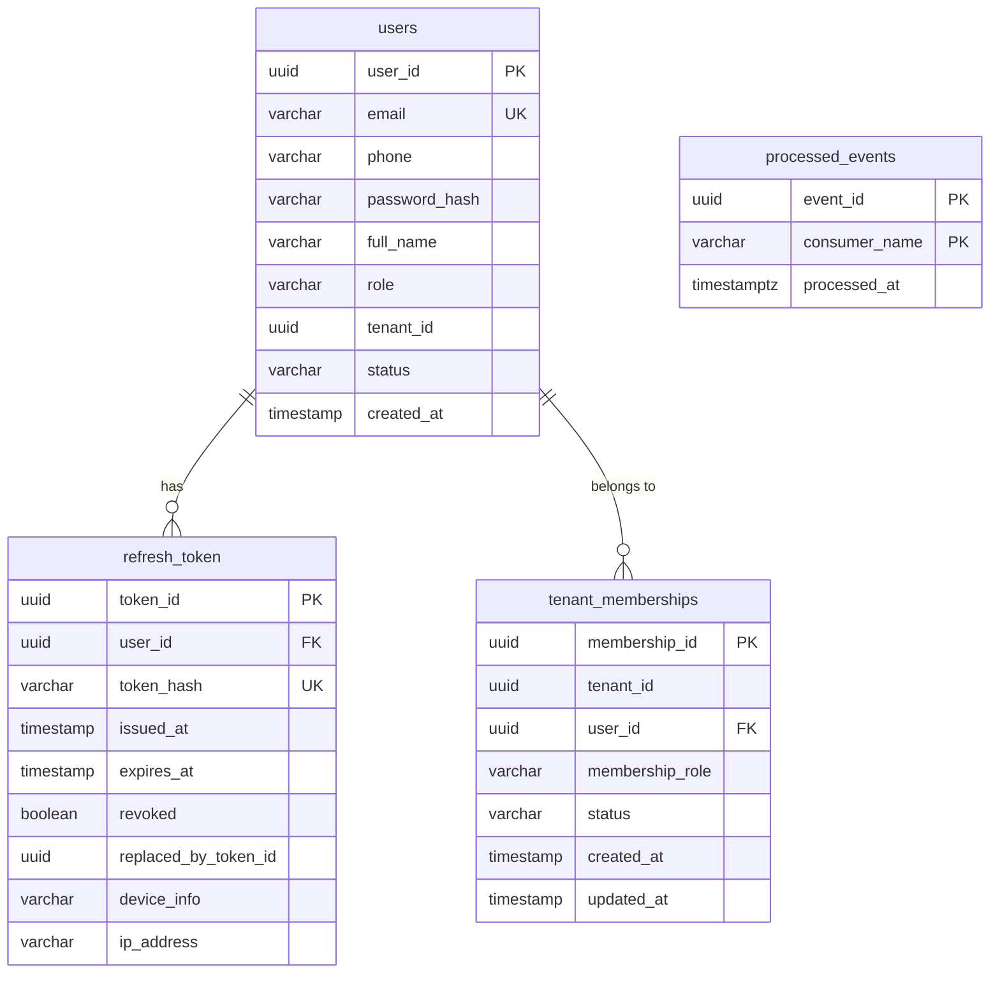
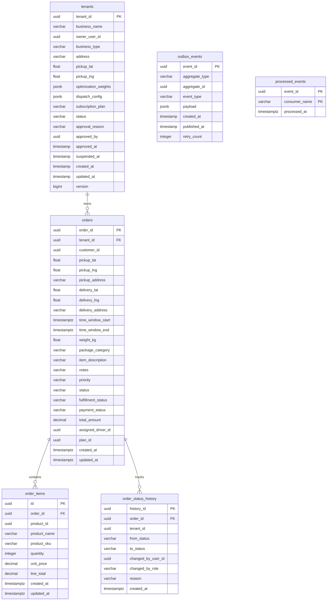
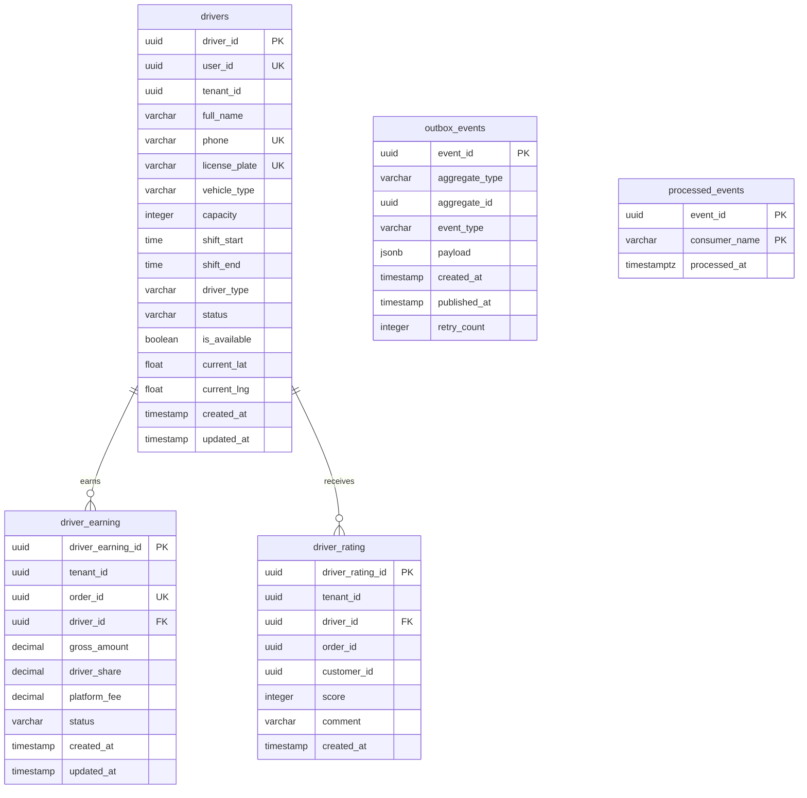
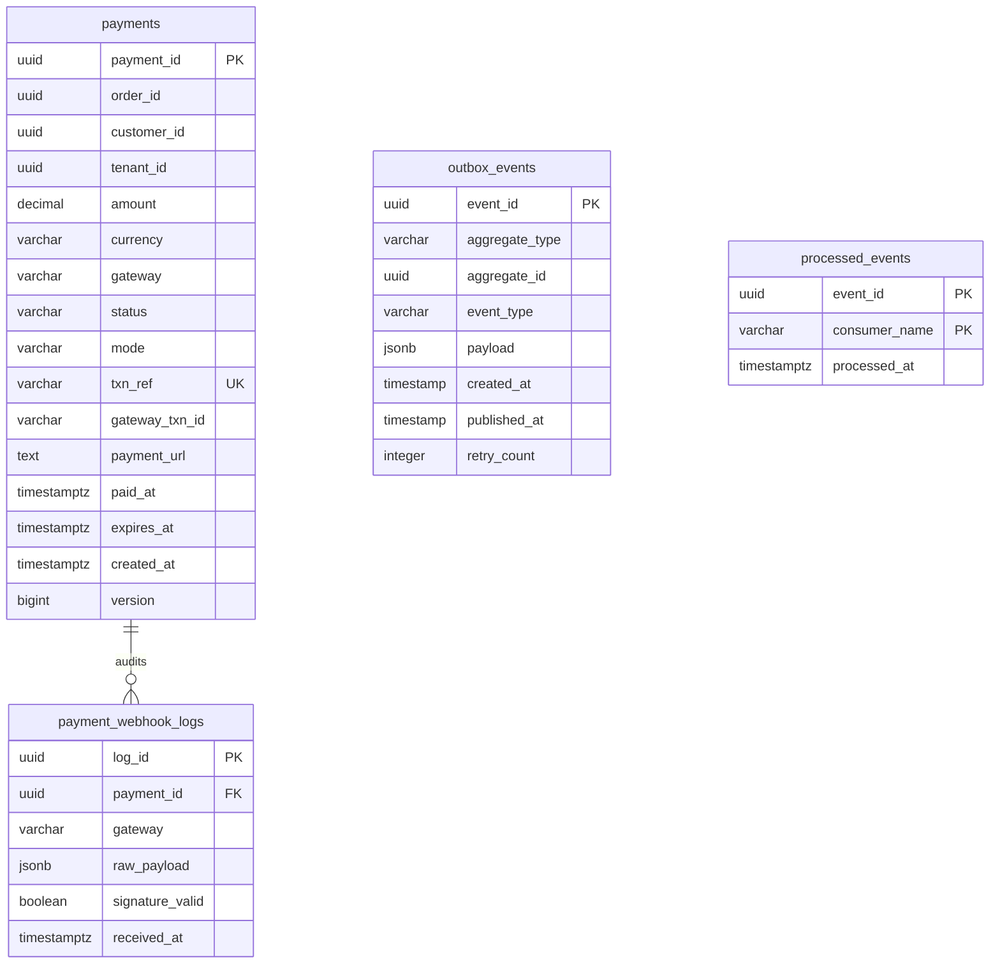
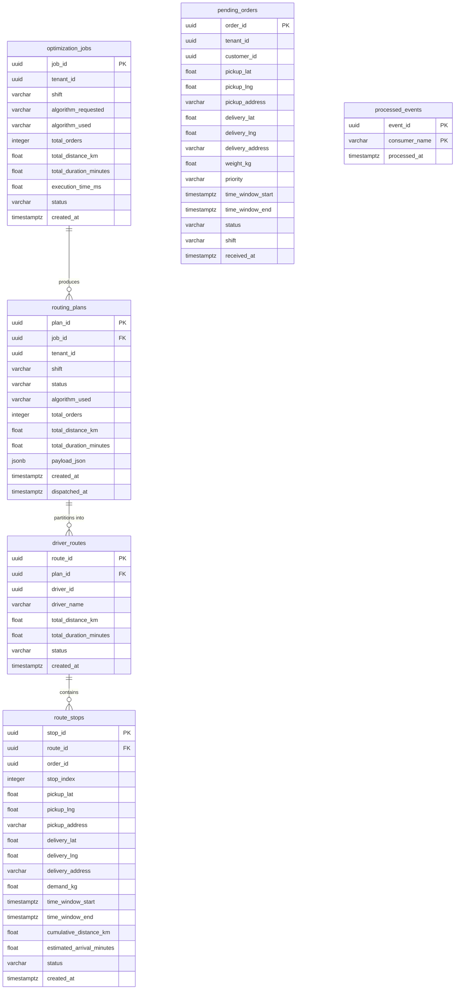
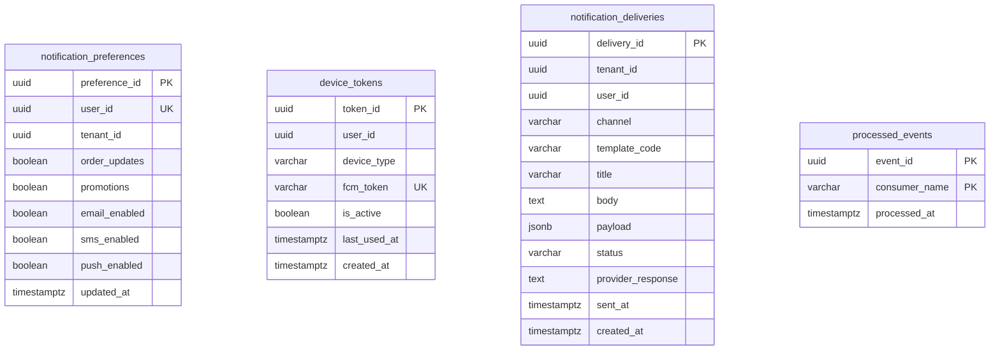

# Chi Tiết Thiết Kế Lược Đồ Dữ Liệu Mục Tiêu (Schema Design)

**Giai đoạn:** Phase 2 — Phân Tích & Thiết Kế Kiến Trúc  
**Ngày cập nhật:** 31/10/2026  
**Trạng thái:** HOÀN THIỆN ĐỂ PHÊ DUYỆT CUỐI CÙNG (FINALIZED FOR APPROVAL - REVISION 2)  
**Tiêu chuẩn hệ quản trị:** PostgreSQL 16  

---

## 1. Tổng Quan Kiến Trúc Cơ Sở Dữ Liệu Mục Tiêu

Tài liệu này định nghĩa chi tiết từng bảng, từng cột, kiểu dữ liệu, ràng buộc (constraints), chỉ mục (indexes), và các giá trị Enum cho **6 cơ sở dữ liệu vi dịch vụ độc lập** trong SwiftRoute:

1. **`auth_db`** (Auth Service) — Quản lý danh tính, phiên làm việc, phân quyền thành viên theo cửa hàng. *(CSDL tạo mới)*
2. **`order_db`** (Order Service) — Quản lý thông tin cửa hàng (Depot/Tenant), tiếp nhận đơn hàng, chi tiết món hàng (`order_items`), lịch sử trạng thái. *(CSDL tạo mới)*
3. **`driver_db`** (Driver Service) — Quản lý hồ sơ tài xế, phương tiện, ca làm việc, đối soát thu nhập và đánh giá chất lượng. *(CSDL tạo mới)*
4. **`payment_db`** (Payment Service) — Quản lý toàn bộ giao dịch thanh toán trực tuyến (VNPAY/MoMo) và đối soát thu hộ tiền mặt (COD). *(CSDL giữ nguyên tại chỗ, nâng cấp Flyway V2)*
5. **`routing_db`** (Routing Engine Service) — Quản lý tác vụ tối ưu hóa định tuyến, kế hoạch gom chuyến, thứ tự điểm dừng tối ưu. *(CSDL tạo mới di chuyển từ SQLite)*
6. **`notification_db`** (Notification Service) — Quản lý cấu hình nhận tin, token thiết bị di động (FCM), và nhật ký gửi thông báo. *(CSDL tạo mới với baseline schema cơ sở)*

### Các quy chuẩn kỹ thuật toàn hệ thống:
- **Khóa chính (Primary Key):** Luôn là `UUID` ngẫu nhiên chuẩn hóa bởi hàm `gen_random_uuid()` của PostgreSQL 16.
- **Thời gian (Timestamps):** Mọi mốc thời gian lưu chuẩn UTC (`TIMESTAMPTZ` hoặc `TIMESTAMP`). Chuyển đổi múi giờ hiển thị Việt Nam (UTC+7) được thực hiện ở tầng Client/Presentation.
- **Quy ước đặt tên:** Định danh cột và bảng theo chuẩn `snake_case`.
- **Ranh giới Microservices (Zero Cross-DB Foreign Keys):** Tuyệt đối không chứa khóa ngoại vật lý trỏ xuyên CSDL. Toàn bộ quan hệ liên dịch vụ đều là tham chiếu logic (`UUID`).
- **Chuẩn tiền tệ & Quy tắc làm tròn (VND Currency & Rounding Policy):**
  - Tiền tệ chuẩn là Đồng Việt Nam (`VND`), không có đơn vị tiền tệ thập phân trong giao dịch thực tế.
  - Kiểu dữ liệu trong CSDL: Sử dụng `NUMERIC(12, 0)` (hoặc `NUMERIC(12, 2)` với ràng buộc `CHECK (amount = round(amount, 0))`) cho toàn bộ các cột tiền tệ (`total_amount`, `unit_price`, `line_total`, `amount`).
  - Tầng Service thực hiện làm tròn số học tiêu chuẩn: `BigDecimal.setScale(0, RoundingMode.HALF_UP)` trước khi lưu trữ vào CSDL hoặc gửi sang cổng thanh toán.

---

## 2. Lược Đồ Dữ Liệu `auth_db` (Auth Service)

### 2.1. Biểu đồ Thực thể - Quan hệ (Mermaid ERD)



### 2.2. Chi tiết các bảng trong `auth_db`

#### Bảng `users`
- **Mục đích:** Lưu trữ hồ sơ người dùng, thông tin đăng nhập và vai trò mặc định.
- **Cấu trúc cột:**

| Tên Cột | Kiểu Dữ Liệu | Bắt Buộc | Giá Trị Mặc Định | Ràng Buộc / Ghi Chú |
| :--- | :--- | :--- | :--- | :--- |
| `user_id` | `UUID` | NOT NULL | `gen_random_uuid()` | **PRIMARY KEY** |
| `email` | `VARCHAR(255)` | NOT NULL | | **UNIQUE**, Email đăng nhập |
| `phone` | `VARCHAR(20)` | NULL | | Số điện thoại liên hệ |
| `password_hash` | `VARCHAR(255)` | NOT NULL | | BCrypt hash của mật khẩu |
| `full_name` | `VARCHAR(255)` | NULL | | Họ tên hiển thị của người dùng |
| `role` | `VARCHAR(20)` | NOT NULL | `'CUSTOMER'` | `CHECK (role IN ('ADMIN', 'OPS_STAFF', 'TENANT_OWNER', 'DRIVER', 'CUSTOMER'))` |
| `tenant_id` | `UUID` | NULL | | **Logical Ref** sang `order_db.tenants`. Đại diện cho `active_tenant_id` trong phiên làm việc hiện tại |
| `status` | `VARCHAR(20)` | NOT NULL | `'ACTIVE'` | `CHECK (status IN ('ACTIVE', 'INACTIVE', 'SUSPENDED'))` |
| `created_at` | `TIMESTAMP` | NOT NULL | `now()` | Thời điểm tạo tài khoản (UTC) |

- **Chỉ mục (Indexes):**
  - `idx_users_email`: `CREATE UNIQUE INDEX idx_users_email ON users(email);`
  - `idx_users_tenant_id`: `CREATE INDEX idx_users_tenant_id ON users(tenant_id);`

#### Bảng `refresh_token`
- **Mục đích:** Quản lý phiên đăng nhập mở rộng của người dùng trên Mobile App và Web Admin.
- **Cấu trúc cột:**

| Tên Cột | Kiểu Dữ Liệu | Bắt Buộc | Giá Trị Mặc Định | Ràng Buộc / Ghi Chú |
| :--- | :--- | :--- | :--- | :--- |
| `token_id` | `UUID` | NOT NULL | `gen_random_uuid()` | **PRIMARY KEY** |
| `user_id` | `UUID` | NOT NULL | | **FOREIGN KEY** trỏ tới `users(user_id)` ON DELETE CASCADE |
| `token_hash` | `VARCHAR(255)` | NOT NULL | | **UNIQUE**, SHA-256 hash của Refresh Token (không lưu plaintext) |
| `issued_at` | `TIMESTAMP` | NOT NULL | `now()` | Thời điểm cấp phát |
| `expires_at` | `TIMESTAMP` | NOT NULL | | Thời điểm hết hạn token |
| `revoked` | `BOOLEAN` | NOT NULL | `FALSE` | Trạng thái thu hồi token |
| `replaced_by_token_id` | `UUID` | NULL | | **FOREIGN KEY** trỏ tới `refresh_token(token_id)` (Hỗ trợ Token Rotation) |
| `device_info` | `VARCHAR(255)` | NULL | | Thiết bị đăng nhập (iOS, Android, Web...) |
| `ip_address` | `VARCHAR(45)` | NULL | | Địa chỉ IP đăng nhập |

- **Chỉ mục (Indexes):**
  - `idx_refresh_token_hash`: `CREATE UNIQUE INDEX idx_refresh_token_hash ON refresh_token(token_hash);`
  - `idx_refresh_token_user`: `CREATE INDEX idx_refresh_token_user ON refresh_token(user_id);`

#### Bảng `tenant_memberships`
- **Mục đích:** Lưu trữ quan hệ phân quyền nhiều - nhiều ($N - N$) giữa người dùng và các cửa hàng/doanh nghiệp.
- **Cấu trúc cột:**

| Tên Cột | Kiểu Dữ Liệu | Bắt Buộc | Giá Trị Mặc Định | Ràng Buộc / Ghi Chú |
| :--- | :--- | :--- | :--- | :--- |
| `membership_id` | `UUID` | NOT NULL | `gen_random_uuid()` | **PRIMARY KEY** |
| `tenant_id` | `UUID` | NOT NULL | | **Logical Ref** sang `order_db.tenants` |
| `user_id` | `UUID` | NOT NULL | | **FOREIGN KEY** trỏ tới `users(user_id)` ON DELETE CASCADE |
| `membership_role`| `VARCHAR(30)` | NOT NULL | `'STAFF'` | `CHECK (membership_role IN ('OWNER', 'STAFF', 'MANAGER', 'DRIVER'))` |
| `status` | `VARCHAR(20)` | NOT NULL | `'ACTIVE'` | `CHECK (status IN ('ACTIVE', 'INACTIVE', 'REVOKED'))` |
| `created_at` | `TIMESTAMP` | NOT NULL | `now()` | Thời điểm gán quyền |
| `updated_at` | `TIMESTAMP` | NOT NULL | `now()` | Thời điểm cập nhật quyền |

- **Ràng buộc duy nhất & Chỉ mục:**
  - `uq_tenant_user_membership`: `ALTER TABLE tenant_memberships ADD CONSTRAINT uq_tenant_user_membership UNIQUE (tenant_id, user_id);`
  - `idx_memberships_user`: `CREATE INDEX idx_memberships_user ON tenant_memberships(user_id);`
  - `idx_memberships_tenant`: `CREATE INDEX idx_memberships_tenant ON tenant_memberships(tenant_id);`

#### Bảng `processed_events`
- **Mục đích:** Đảm bảo tính Idempotency khi Auth Service tiêu thụ sự kiện từ RabbitMQ (`tenant.created`, `tenant.approved`).
- **Cấu trúc:** `(event_id UUID, consumer_name VARCHAR(100), processed_at TIMESTAMPTZ NOT NULL DEFAULT now())`, Primary Key `(event_id, consumer_name)`.

---

## 3. Lược Đồ Dữ Liệu `order_db` (Order Service)

### 3.1. Biểu đồ Thực thể - Quan hệ (Mermaid ERD)



### 3.2. Chi tiết các bảng trong `order_db`

#### Bảng `tenants`
- **Mục đích:** Quản lý cửa hàng/kho hàng (Depot/Merchant), cấu hình điều phối và tọa độ lấy hàng kho mặc định.
- **Cấu trúc cột:**

| Tên Cột | Kiểu Dữ Liệu | Bắt Buộc | Giá Trị Mặc Định | Ràng Buộc / Ghi Chú |
| :--- | :--- | :--- | :--- | :--- |
| `tenant_id` | `UUID` | NOT NULL | `gen_random_uuid()` | **PRIMARY KEY** |
| `business_name` | `VARCHAR(255)` | NOT NULL | | Tên cửa hàng / doanh nghiệp |
| `owner_user_id` | `UUID` | NOT NULL | | **Logical Ref** sang `auth_db.users` |
| `business_type` | `VARCHAR(50)` | NOT NULL | `'OTHER'` | `RESTAURANT`, `GROCERY`, `PHARMACY`, `RETAIL`, `LOGISTICS`, `OTHER` |
| `address` | `VARCHAR(500)` | NULL | | Địa chỉ kho / cửa hàng |
| `pickup_lat` | `DOUBLE PRECISION`| NULL | | Vĩ độ kho lấy hàng mặc định |
| `pickup_lng` | `DOUBLE PRECISION`| NULL | | Kinh độ kho lấy hàng mặc định |
| `optimization_weights` | `JSONB` | NOT NULL | `'{"distance": 0.5, "time": 0.5}'` | Trọng số tối ưu định tuyến |
| `dispatch_config` | `JSONB` | NOT NULL | `'{"auto_dispatch_enabled": true, ...}'` | Cấu hình tự động điều phối gom chuyến |
| `subscription_plan` | `VARCHAR(50)` | NOT NULL | `'FREE_TRIAL'` | `FREE_TRIAL`, `STARTER`, `PROFESSIONAL`, `ENTERPRISE` |
| `status` | `VARCHAR(20)` | NOT NULL | `'PENDING'` | `CHECK (status IN ('PENDING', 'ACTIVE', 'SUSPENDED', 'REJECTED'))` |
| `approval_reason` | `VARCHAR(500)` | NULL | | Lý do phê duyệt hoặc từ chối |
| `approved_by` | `UUID` | NULL | | **Logical Ref** sang `auth_db.users` (Admin phê duyệt) |
| `approved_at` | `TIMESTAMP` | NULL | | Thời điểm phê duyệt |
| `suspended_at` | `TIMESTAMP` | NULL | | Thời điểm tạm khóa |
| `created_at` | `TIMESTAMP` | NOT NULL | `now()` | Thời điểm đăng ký cửa hàng |
| `updated_at` | `TIMESTAMP` | NOT NULL | `now()` | Thời điểm cập nhật thông tin |
| `version` | `BIGINT` | NOT NULL | `0` | Khóa lạc quan (Optimistic Locking) |

- **Chỉ mục (Indexes):**
  - `idx_tenants_owner`: `CREATE INDEX idx_tenants_owner ON tenants(owner_user_id);`
  - `idx_tenants_status`: `CREATE INDEX idx_tenants_status ON tenants(status);`

#### Bảng `orders`
- **Mục đích:** Quản lý thông tin đơn hàng vận chuyển, snapshot tọa độ và vòng đời điều phối.
- **Cấu trúc cột:**

| Tên Cột | Kiểu Dữ Liệu | Bắt Buộc | Giá Trị Mặc Định | Ràng Buộc / Ghi Chú |
| :--- | :--- | :--- | :--- | :--- |
| `order_id` | `UUID` | NOT NULL | `gen_random_uuid()` | **PRIMARY KEY** |
| `tenant_id` | `UUID` | NOT NULL | | **FOREIGN KEY** trỏ tới `tenants(tenant_id)` |
| `customer_id` | `UUID` | NOT NULL | | **Logical Ref** sang `auth_db.users` |
| `pickup_lat` | `DOUBLE PRECISION`| NOT NULL | | Vĩ độ điểm lấy hàng |
| `pickup_lng` | `DOUBLE PRECISION`| NOT NULL | | Kinh độ điểm lấy hàng |
| `pickup_address` | `VARCHAR(500)` | NULL | | Địa chỉ điểm lấy hàng dạng văn bản |
| `delivery_lat` | `DOUBLE PRECISION`| NOT NULL | | Vĩ độ điểm giao hàng |
| `delivery_lng` | `DOUBLE PRECISION`| NOT NULL | | Kinh độ điểm giao hàng |
| `delivery_address`| `VARCHAR(500)` | NULL | | Địa chỉ giao hàng chi tiết |
| `time_window_start`| `TIMESTAMPTZ` | NOT NULL | | Khởi đầu khung giờ giao hàng (UTC) |
| `time_window_end`| `TIMESTAMPTZ` | NOT NULL | | Kết thúc khung giờ giao hàng (UTC) |
| `weight_kg` | `DOUBLE PRECISION`| NOT NULL | | Trọng lượng kiện hàng (kg) |
| `package_category`| `VARCHAR(30)` | NOT NULL | `'PARCEL'` | `FOOD`, `DOCUMENT`, `PARCEL`, `MEDICAL`, `FRAGILE` |
| `item_description`| `VARCHAR(255)` | NULL | | Mô tả hàng hóa cấp độ kiện hàng |
| `notes` | `VARCHAR(500)` | NULL | | Ghi chú dặn dò cho tài xế |
| `priority` | `VARCHAR(20)` | NOT NULL | `'NORMAL'` | `CHECK (priority IN ('NORMAL', 'HIGH', 'URGENT'))` |
| `status` | `VARCHAR(30)` | NOT NULL | `'PENDING_PAYMENT'`| **Cột tổng hợp tương thích ngược 100% với Frontend/Mobile** (`PENDING_PAYMENT`, `PAYMENT_FAILED`, `PAID`, `PLANNED`, `IN_TRANSIT`, `DELIVERED`, `FAILED`, `CANCELLED`) |
| `fulfillment_status`| `VARCHAR(30)`| NOT NULL | **`'DRAFT'`** | Vòng đời giao vận (`DRAFT`, `CONFIRMED`, `READY_FOR_PLANNING`, `PLANNED`, `IN_TRANSIT`, `DELIVERED`, `FAILED`, `CANCELLED`). **Tuyệt đối KHÔNG default là READY_FOR_PLANNING** |
| `payment_status` | `VARCHAR(30)` | NOT NULL | `'PENDING'` | Trạng thái thanh toán (`UNPAID`, `PENDING`, `PAID`, `FAILED`, `COD_PENDING`, `COLLECTED`, `PARTIALLY_COLLECTED`, `REFUNDED`) |
| `total_amount` | `NUMERIC(12,0)`| NOT NULL | `0` | Tổng giá trị đơn hàng (VND nguyên số), `CHECK (total_amount >= 0)` |
| `assigned_driver_id`| `UUID` | NULL | | **Logical Ref** sang `driver_db.drivers` |
| `plan_id` | `UUID` | NULL | | **Logical Ref** sang `routing_db.routing_plans` |
| `created_at` | `TIMESTAMPTZ` | NOT NULL | `now()` | Thời điểm tạo đơn |
| `updated_at` | `TIMESTAMPTZ` | NOT NULL | `now()` | Thời điểm cập nhật đơn |

- **Quy tắc chuyển đổi sang `READY_FOR_PLANNING`:**
  - Đơn hàng mới khởi tạo luôn mang `fulfillment_status = 'DRAFT'` và `payment_status = 'PENDING'`.
  - Đơn hàng **CHỈ** được chuyển sang `fulfillment_status = 'READY_FOR_PLANNING'` khi thỏa mãn một trong hai điều kiện:
    1. *Thanh toán trực tuyến (VNPAY/MoMo):* Nhận sự kiện `payment.completed` thành công từ Payment Service (`payment_status = 'PAID'`).
    2. *Thanh toán khi nhận hàng (COD):* Được chủ cửa hàng / nhân viên duyệt xác nhận đơn hàng (`fulfillment_status = 'CONFIRMED' -> 'READY_FOR_PLANNING'`, `payment_status = 'COD_PENDING'`).

- **Quy tắc tính toán tổng tiền đơn hàng:**
  $$\text{orders.total\_amount} = \sum (\text{order\_items.line\_total})$$
  với $\text{line\_total} = \text{round}(\text{quantity} \times \text{unit\_price}, 0)$. Các yếu tố phụ phí vận chuyển, voucher giảm giá và thuế VAT chưa có trong schema Phase này và được xếp vào phạm vi mở rộng trong tương lai.

- **Chỉ mục (Indexes):**
  - `idx_orders_tenant_status`: `CREATE INDEX idx_orders_tenant_status ON orders(tenant_id, status);`
  - `idx_orders_tenant_fulfillment`: `CREATE INDEX idx_orders_tenant_fulfillment ON orders(tenant_id, fulfillment_status);`
  - `idx_orders_customer`: `CREATE INDEX idx_orders_customer ON orders(customer_id);`
  - `idx_orders_driver`: `CREATE INDEX idx_orders_driver ON orders(assigned_driver_id) WHERE assigned_driver_id IS NOT NULL;`
  - `idx_orders_plan`: `CREATE INDEX idx_orders_plan ON orders(plan_id) WHERE plan_id IS NOT NULL;`

#### Bảng `order_items`
- **Mục đích:** Lưu trữ chi tiết từng sản phẩm/món hàng thuộc đơn hàng tại thời điểm đặt (Historical Product Snapshot).
- **Cấu trúc cột:**

| Tên Cột | Kiểu Dữ Liệu | Bắt Buộc | Giá Trị Mặc Định | Ràng Buộc / Ghi Chú |
| :--- | :--- | :--- | :--- | :--- |
| `id` | `UUID` | NOT NULL | `gen_random_uuid()` | **PRIMARY KEY** |
| `order_id` | `UUID` | NOT NULL | | **FOREIGN KEY** trỏ tới `orders(order_id)` ON DELETE CASCADE |
| `product_id` | `UUID` | NULL | | **Logical Ref** sang Product Service (khi phát triển). Không tạo FK vật lý |
| `product_name` | `VARCHAR(255)` | NOT NULL | | Snapshot tên sản phẩm tại thời điểm tạo đơn |
| `product_sku` | `VARCHAR(100)` | NULL | | Snapshot mã SKU sản phẩm |
| `quantity` | `INTEGER` | NOT NULL | | `CHECK (quantity > 0)` — Số lượng sản phẩm |
| `unit_price` | `NUMERIC(12,0)`| NOT NULL | | `CHECK (unit_price >= 0)` — Đơn giá snapshot tại thời điểm mua (VND) |
| `line_total` | `NUMERIC(12,0)`| NOT NULL | | `CHECK (line_total >= 0)` — Thành tiền (`quantity * unit_price`, VND) |
| `created_at` | `TIMESTAMPTZ` | NOT NULL | `now()` | Thời điểm tạo bản ghi |
| `updated_at` | `TIMESTAMPTZ` | NOT NULL | `now()` | Thời điểm cập nhật |

- **Thực thi cô lập Tenant (Tenant Scoping Enforcement):**
  - Bảng `order_items` không chứa cột `tenant_id` riêng biệt nhằm tránh dư thừa và bất nhất dữ liệu khi cập nhật.
  - Tầng Service của Order Service bắt buộc phải thực thi kiểm tra tenant qua quan hệ cha:
    ```sql
    SELECT oi.* FROM order_items oi
    JOIN orders o ON oi.order_id = o.order_id
    WHERE o.order_id = :orderId AND o.tenant_id = :tenantId;
    ```
- **Chỉ mục (Indexes):**
  - `idx_order_items_order_id`: `CREATE INDEX idx_order_items_order_id ON order_items(order_id);`
  - `idx_order_items_product_id`: `CREATE INDEX idx_order_items_product_id ON order_items(product_id) WHERE product_id IS NOT NULL;`

#### Bảng `order_status_history`
- **Mục đích:** Ghi vết kiểm toán (Audit Trail) lịch sử thay đổi trạng thái của đơn hàng.
- **Cấu trúc:** `(history_id PK, order_id FK, tenant_id, from_status, to_status, changed_by_user_id, changed_by_role, reason, created_at)`.
- **Chỉ mục:** `idx_order_history_order ON order_status_history(order_id, created_at DESC)`.

#### Bảng `outbox_events` (Cục bộ Order Service)
- **Mục đích:** Lưu trữ sự kiện nghiệp vụ phát sinh từ Order Service (`order.created.v1`, `order.status_changed.v1`, `tenant.created`, `tenant.approved`).
- **Cấu trúc:** `(event_id PK, aggregate_type, aggregate_id, event_type, payload JSONB, created_at, published_at, retry_count)`.
- **Chỉ mục:** `idx_order_outbox_unpublished ON outbox_events(created_at ASC) WHERE published_at IS NULL`.

#### Bảng `processed_events`
- **Mục đích:** Kiểm soát Idempotency phía nhận của Order Service khi nhận sự kiện thanh toán hoặc sự kiện giao vận.
- **Cấu trúc:** `(event_id PK, consumer_name PK, processed_at)`.

---

## 4. Lược Đồ Dữ Liệu `driver_db` (Driver Service)

### 4.1. Biểu đồ Thực thể - Quan hệ (Mermaid ERD)



### 4.2. Chi tiết các bảng trong `driver_db`

#### Bảng `drivers`
- **Mục đích:** Quản lý thông tin hồ sơ tài xế, phương tiện giao hàng và trạng thái sẵn sàng nhận chuyến.
- **Cấu trúc cột:**

| Tên Cột | Kiểu Dữ Liệu | Bắt Buộc | Giá Trị Mặc Định | Ràng Buộc / Ghi Chú |
| :--- | :--- | :--- | :--- | :--- |
| `driver_id` | `UUID` | NOT NULL | `gen_random_uuid()` | **PRIMARY KEY** |
| `user_id` | `UUID` | NULL | | **UNIQUE**, **Logical Ref** sang `auth_db.users` |
| `tenant_id` | `UUID` | NOT NULL | | **Tenant Discriminator (Single-Tenant)**, **Logical Ref** sang `order_db.tenants` |
| `full_name` | `VARCHAR(255)` | NOT NULL | | Họ tên tài xế |
| `phone` | `VARCHAR(20)` | NOT NULL | | **UNIQUE**, Số điện thoại tài xế |
| `license_plate` | `VARCHAR(20)` | NOT NULL | | **UNIQUE**, Biển số xe đăng ký |
| `vehicle_type` | `VARCHAR(30)` | NOT NULL | | `CHECK (vehicle_type IN ('MOTORCYCLE', 'VAN', 'TRUCK'))` |
| `capacity` | `INTEGER` | NULL | | Tải trọng tối đa của phương tiện (kg) |
| `shift_start` | `TIME` | NULL | | Giờ bắt đầu ca trực |
| `shift_end` | `TIME` | NULL | | Giờ kết thúc ca trực |
| `driver_type` | `VARCHAR(30)` | NOT NULL | | `CHECK (driver_type IN ('INTERNAL', 'CROWDSOURCED', 'THIRD_PARTY'))` |
| `status` | `VARCHAR(30)` | NOT NULL | `'ACTIVE'` | `CHECK (status IN ('ACTIVE', 'SUSPENDED', 'OFFLINE'))` |
| `is_available` | `BOOLEAN` | NOT NULL | `FALSE` | Trạng thái sẵn sàng nhận ca trong PostgreSQL (Durable Duty Status) |
| `current_lat` | `DOUBLE PRECISION`| NULL | | Vĩ độ mốc kiểm tra chốt ca/hoàn thành đơn (PostgreSQL checkpoint) |
| `current_lng` | `DOUBLE PRECISION`| NULL | | Kinh độ mốc kiểm tra chốt ca/hoàn thành đơn |
| `created_at` | `TIMESTAMP` | NOT NULL | `now()` | Thời điểm tạo hồ sơ tài xế |
| `updated_at` | `TIMESTAMP` | NOT NULL | `now()` | Thời điểm cập nhật |

- **Chỉ mục (Indexes):**
  - `idx_drivers_tenant_available`: `CREATE INDEX idx_drivers_tenant_available ON drivers(tenant_id, is_available);`
  - `idx_drivers_phone`: `CREATE UNIQUE INDEX idx_drivers_phone ON drivers(phone);`
  - `idx_drivers_license_plate`: `CREATE UNIQUE INDEX idx_drivers_license_plate ON drivers(license_plate);`

#### Bảng `driver_earning`
- **Mục đích:** Đối soát thu nhập của tài xế trên từng đơn hàng hoàn thành.
- **Cấu trúc:** `(driver_earning_id PK, tenant_id NOT NULL, order_id UK, driver_id FK, gross_amount NUMERIC(12,0), driver_share NUMERIC(12,0), platform_fee NUMERIC(12,0), status ('PENDING', 'SETTLED', 'CANCELLED'), created_at, updated_at)`.
- **Chỉ mục:** `idx_earning_driver_tenant ON driver_earning(driver_id, tenant_id)`.

#### Bảng `driver_rating`
- **Mục đích:** Lưu trữ đánh giá chất lượng phục vụ của khách hàng dành cho tài xế.
- **Cấu trúc:** `(driver_rating_id PK, tenant_id NOT NULL, driver_id FK, order_id, customer_id, score (1-5), comment, created_at)`.
- **Chỉ mục:** `idx_ratings_driver ON driver_rating(driver_id)`.

#### Bảng `outbox_events` (Cục bộ Driver Service)
- **Mục đích:** Xuất bản các sự kiện phát sinh từ Driver Service (`driver.availability_changed.v1`, `driver.delivery_reported.v1`, `driver.cod_collected.v1`).

#### Bảng `processed_events`
- **Mục đích:** Đảm bảo Idempotency phía nhận của Driver Service khi tiếp nhận `order.batch.dispatched`.

---

## 5. Lược Đồ Dữ Liệu `payment_db` (Payment Service)

### 5.1. Biểu đồ Thực thể - Quan hệ (Mermaid ERD)



### 5.2. Chi tiết các bảng trong `payment_db`

#### Bảng `payments`
- **Mục đích:** Quản lý toàn bộ giao dịch thanh toán trực tuyến (VNPAY/MoMo) và giao dịch thu hộ tiền mặt (COD). Payment Service là nơi sở hữu duy nhất mọi bản ghi tài chính của hệ thống.
- **Cấu trúc cột:**

| Tên Cột | Kiểu Dữ Liệu | Bắt Buộc | Giá Trị Mặc Định | Ràng Buộc / Ghi Chú |
| :--- | :--- | :--- | :--- | :--- |
| `payment_id` | `UUID` | NOT NULL | `gen_random_uuid()` | **PRIMARY KEY** |
| `order_id` | `UUID` | NOT NULL | | **Logical Ref** sang `order_db.orders` |
| `customer_id` | `UUID` | NOT NULL | | **Logical Ref** sang `auth_db.users` |
| `tenant_id` | `UUID` | **NOT NULL** | | **Tenant Discriminator**, bắt buộc trùng khớp với `orders.tenant_id` |
| `amount` | `NUMERIC(12,0)`| NOT NULL | | Số tiền thanh toán (VND nguyên số), `CHECK (amount >= 0)` |
| `currency` | `VARCHAR(3)` | NOT NULL | `'VND'` | Đơn vị tiền tệ chuẩn |
| `gateway` | `VARCHAR(20)` | NOT NULL | | Cổng thanh toán (`VNPAY`, `MOMO`, `COD`, `INTERNAL`) |
| `status` | `VARCHAR(25)` | NOT NULL | | `CHECK (status IN ('PENDING', 'SUCCESS', 'FAILED', 'CANCELLED', 'REFUNDED', 'COD_PENDING', 'COLLECTED', 'PARTIALLY_COLLECTED'))` |
| `mode` | `VARCHAR(20)` | NOT NULL | | Phương thức (`ONLINE`, `QR`, `COD`) |
| `txn_ref` | `VARCHAR(64)` | NOT NULL | | **UNIQUE**, Mã giao dịch đối soát nội bộ |
| `gateway_txn_id` | `VARCHAR(64)` | NULL | | Mã giao dịch do cổng thanh toán trả về |
| `payment_url` | `TEXT` | NULL | | Đường dẫn chuyển hướng thanh toán (VNPay PayUrl) |
| `paid_at` | `TIMESTAMPTZ` | NULL | | Thời điểm thanh toán/thu tiền thành công |
| `expires_at` | `TIMESTAMPTZ` | **NULL** | | Thời điểm URL hết hạn (Online: 15 phút, COD: NULL hoặc delivery window deadline) |
| `created_at` | `TIMESTAMPTZ` | NOT NULL | `now()` | Thời điểm khởi tạo giao dịch |
| `version` | `BIGINT` | NOT NULL | `0` | Khóa lạc quan chống race condition |

- **Vòng Đời Đối Soát Tiền Mặt COD (COD Collection Lifecycle Details):**
  1. *Khởi tạo:* Khi đơn hàng chọn COD, Payment Service tạo bản ghi `payments` với `gateway = 'COD'`, `mode = 'COD'`, `status = 'COD_PENDING'`, `expires_at = NULL`.
  2. *Bàn giao hàng vật lý:* Tài xế giao xong kiện hàng -> Driver Service phát sự kiện `order.delivered` / `driver.delivery_reported.v1`. Trạng thái thanh toán **VẪN LÀ `COD_PENDING`**.
  3. *Xác nhận thu tiền đủ:* Tài xế cầm đủ tiền và bấm xác nhận trên Mobile App -> Driver Service phát sự kiện `driver.cod_collected.v1` (`amount_collected = amount`). Payment Service cập nhật `status = 'COLLECTED'`, `paid_at = now()` và xuất bản `payment.completed`.
  4. *Xử lý thu tiền thiếu / một phần (Partial Collection):*
     - Nếu khách chỉ trả một phần hoặc trả lại một số món tại chỗ: Tài xế nhập số tiền thực thu `amount_collected < amount`.
     - Payment Service cập nhật `status = 'PARTIALLY_COLLECTED'`, ghi nhận lý do khiếu nại/chênh lệch vào audit log.
     - Đơn hàng được đưa vào danh sách cần đối soát xử lý của Ops Staff trên Web Admin, không tự ý đóng ca.
  5. *Đối soát cuối ca:* Tài xế nộp tiền mặt tại kho cho thủ quỹ, Ops Staff xác nhận thanh toán cuối cùng trên Web Admin.

- **Chỉ mục (Indexes):**
  - `idx_payments_order`: `CREATE INDEX idx_payments_order ON payments(order_id);`
  - `idx_payments_txn_ref`: `CREATE UNIQUE INDEX idx_payments_txn_ref ON payments(txn_ref);`
  - `idx_payments_tenant_status`: `CREATE INDEX idx_payments_tenant_status ON payments(tenant_id, status);`

#### Bảng `payment_webhook_logs`
- **Mục đích:** Lưu trữ bản ghi thô (raw payload) từ Webhook IPN để đối soát và chống gian lận.
- **Cấu trúc:** `(log_id PK, payment_id FK, gateway, raw_payload JSONB, signature_valid BOOLEAN, received_at TIMESTAMPTZ)`.
- **Chỉ mục:** `idx_webhook_payment ON payment_webhook_logs(payment_id)`.

#### Bảng `outbox_events` (Cục bộ Payment Service)
- **Mục đích:** Xuất bản sự kiện thanh toán thành công (`payment.completed`) sang RabbitMQ.

#### Bảng `processed_events`
- **Mục đích:** Đảm bảo Idempotency khi nhận các webhook hoặc sự kiện COD lặp lại từ mạng.

---

## 6. Lược Đồ Dữ Liệu `routing_db` (Routing Engine Service)

### 6.1. Biểu đồ Thực thể - Quan hệ (Mermaid ERD)



### 6.2. Chi tiết các bảng trong `routing_db`

#### Bảng `optimization_jobs`
- **Mục đích:** Lưu lịch sử các lần chạy thuật toán tối ưu hóa (Job execution history & benchmark).
- **Cấu trúc:** `(job_id PK, tenant_id, shift, algorithm_requested, algorithm_used, total_orders, total_distance_km, total_duration_minutes, execution_time_ms, status, created_at)`.
- **Chỉ mục:** `idx_opt_jobs_tenant ON optimization_jobs(tenant_id, created_at DESC)`.

#### Bảng `routing_plans`
- **Mục đích:** Lưu trữ các kế hoạch gom chuyến tổng thể cho một ca hoặc một đợt điều phối.
- **Cấu trúc cột:**

| Tên Cột | Kiểu Dữ Liệu | Bắt Buộc | Giá Trị Mặc Định | Ràng Buộc / Ghi Chú |
| :--- | :--- | :--- | :--- | :--- |
| `plan_id` | `UUID` | NOT NULL | `gen_random_uuid()` | **PRIMARY KEY** |
| `job_id` | `UUID` | NULL | | **FOREIGN KEY** trỏ tới `optimization_jobs(job_id)` ON DELETE SET NULL |
| `tenant_id` | `UUID` | NOT NULL | | **Tenant Discriminator** |
| `shift` | `VARCHAR(20)` | NOT NULL | | Ca giao hàng |
| `status` | `VARCHAR(30)` | NOT NULL | `'DRAFT'` | `CHECK (status IN ('DRAFT', 'APPROVED', 'DISPATCHED', 'COMPLETED', 'CANCELLED'))` |
| `algorithm_used` | `VARCHAR(50)` | NOT NULL | | Thuật toán tối ưu tạo ra plan (`held_karp`, `nearest_neighbor`, `genetic`) |
| `total_orders` | `INTEGER` | NOT NULL | | **Tổng số đơn hàng phân biệt** thực tế trong plan (phải khớp với count distinct của `route_stops`) |
| `total_distance_km`| `DOUBLE PRECISION`| NOT NULL | | Tổng quãng đường của tất cả tài xế |
| `total_duration_minutes`| `DOUBLE PRECISION`| NOT NULL | | Tổng thời gian di chuyển |
| `payload_json` | `JSONB` | NOT NULL | | **Bản chụp bất biến (Immutable Snapshot)** của kết quả thuật toán phục vụ nghiên cứu và kiểm toán |
| `created_at` | `TIMESTAMPTZ` | NOT NULL | `now()` | Thời điểm tạo kế hoạch |
| `dispatched_at` | `TIMESTAMPTZ` | NULL | | Thời điểm duyệt và phát hành điều phối |

- **Chỉ mục:** `idx_plans_tenant_status ON routing_plans(tenant_id, status)`.

#### Bảng `driver_routes`
- **Mục đích:** Tuyến đường phân bổ cho một tài xế cụ thể trong kế hoạch gom chuyến.
- **Ràng buộc:** Tài xế được gán (`driver_id`) bắt buộc phải thuộc cùng `tenant_id` với `routing_plans`.
- **Máy trạng thái:** `ASSIGNED` -> `IN_PROGRESS` -> `COMPLETED` (hoặc `FAILED`).
- **Cấu trúc:** `(route_id PK, plan_id FK, driver_id, driver_name, total_distance_km, total_duration_minutes, status, created_at)`.
- **Chỉ mục:** `idx_driver_routes_plan ON driver_routes(plan_id)`, `idx_driver_routes_driver ON driver_routes(driver_id)`.

#### Bảng `route_stops`
- **Mục đích:** Thứ tự các điểm dừng tối ưu được gán cho một tài xế trên lộ trình.
- **Ràng buộc toàn vẹn dữ liệu nghiêm ngặt:**
  - Thứ tự điểm dừng trong một tuyến là duy nhất: `CONSTRAINT uq_route_stop_index UNIQUE (route_id, stop_index)`.
  - Một đơn hàng chỉ được xuất hiện tại một điểm dừng duy nhất trong một kế hoạch gom chuyến: `CREATE UNIQUE INDEX idx_route_stops_plan_order ON route_stops(route_id, order_id)`.
- **Máy trạng thái điểm dừng:** `PENDING` -> `ARRIVED` -> `COMPLETED` (hoặc `FAILED`).
- **Nguồn dữ liệu hoạt động chính thức (Authoritative Source):** Mọi cập nhật trạng thái di chuyển thực tế đều ghi nhận vào bảng `route_stops`, không làm biến đổi cột snapshot `routing_plans.payload_json`.
- **Cấu trúc:** `(stop_id PK, route_id FK, order_id, stop_index, pickup_lat, pickup_lng, pickup_address, delivery_lat, delivery_lng, delivery_address, demand_kg, time_window_start, time_window_end, cumulative_distance_km, estimated_arrival_minutes, status, created_at)`.
- **Chỉ mục:** `idx_route_stops_route_index ON route_stops(route_id, stop_index ASC)`, `idx_route_stops_order ON route_stops(order_id)`.

#### Bảng `pending_orders`
- **Mục đích:** Lưu trữ bản chụp các đơn hàng đã thanh toán sẵn sàng gom chuyến để AutoDispatcher đánh giá.
- **Cấu trúc:** `(order_id PK, tenant_id, customer_id, pickup_lat, pickup_lng, pickup_address, delivery_lat, delivery_lng, delivery_address, weight_kg, priority, time_window_start, time_window_end, status ('PAID', 'OPTIMIZING'), shift, received_at)`.
- **Chỉ mục:** `idx_pending_orders_tenant_status ON pending_orders(tenant_id, status)`.

#### Bảng `processed_events`
- **Mục đích:** Ghi nhận Idempotency cho Routing Engine khi lắng nghe các sự kiện `order.status_changed.v1 (PAID)`.

---

## 7. Lược Đồ Dữ Liệu `notification_db` (Notification Service Baseline Schema)

Cơ sở dữ liệu này được khởi tạo schema cơ sở (baseline schema) trong Phase 3 để chuẩn bị sẵn sàng hạ tầng cho Notification Service.

### 7.1. Biểu đồ Thực thể - Quan hệ (Mermaid ERD)



### 7.2. Chi tiết các bảng trong `notification_db`

#### Bảng `notification_preferences`
- **Mục đích:** Quản lý cài đặt cho phép/tắt nhận các loại thông báo của người dùng.
- **Cấu trúc:** `(preference_id PK, user_id UK, tenant_id, order_updates BOOLEAN, promotions BOOLEAN, email_enabled BOOLEAN, sms_enabled BOOLEAN, push_enabled BOOLEAN, updated_at)`.
- **Chỉ mục:** `idx_notif_pref_user ON notification_preferences(user_id)`.

#### Bảng `device_tokens`
- **Mục đích:** Lưu trữ FCM token của các thiết bị di động (Flutter Mobile App) và trình duyệt để gửi push notification.
- **Cấu trúc:** `(token_id PK, user_id, device_type ('ANDROID', 'IOS', 'WEB'), fcm_token UK, is_active, last_used_at, created_at)`.
- **Chỉ mục:** `idx_device_tokens_fcm ON device_tokens(fcm_token)`, `idx_device_tokens_user ON device_tokens(user_id, is_active)`.

#### Bảng `notification_deliveries`
- **Mục đích:** Nhật ký (Audit Trail) các thông báo đã gửi qua từng kênh, phục vụ thống kê tỷ lệ gửi thành công và kiểm toán.
- **Cấu trúc:** `(delivery_id PK, tenant_id, user_id, channel ('PUSH', 'EMAIL', 'SMS', 'IN_APP'), template_code, title, body, payload JSONB, status ('PENDING', 'SENT', 'FAILED'), provider_response, sent_at, created_at)`.
- **Chỉ mục:** `idx_notif_deliveries_user ON notification_deliveries(user_id, created_at DESC)`.

#### Bảng `processed_events`
- **Mục đích:** Đảm bảo tính Idempotency khi Notification Service nhận các sự kiện phát ra từ hệ thống.
