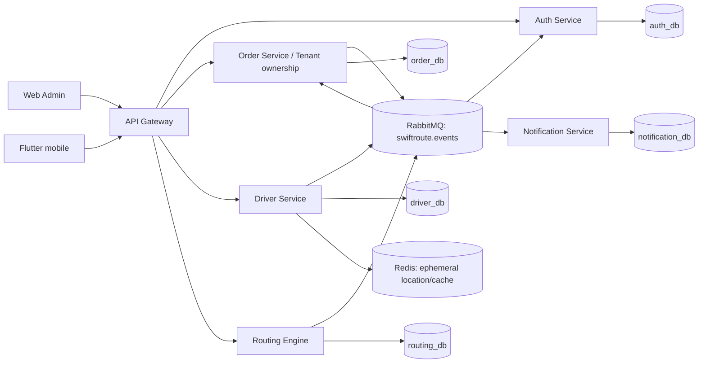

# System architecture

## Logical architecture

## Boundaries and rationale

| Component | Responsibility / reason |
|---|---|
| API Gateway | Single external edge for routing, JWT verification, CORS, rate limiting and trusted identity headers; it remains stateless. |
| Auth | Credentials, tokens and user/tenant memberships are security data with separate retention and access controls. |
| Order | Tenant onboarding and order lifecycle are transactional commercial records. Tenant stays here in the current system because this is where it is implemented. |
| Driver | Driver profile, vehicle, shift and availability change on an operational cadence independent of orders. |
| Routing | CPU/model-intensive optimisation has independent scaling and stores reproducible plan snapshots, not source orders. |
| Notification | Provider retries and delivery audit must not delay business commands. |

## Communication rules

Frontends call only gateway REST APIs. Services use synchronous REST only for immediate command validation/read needs and RabbitMQ for facts that must propagate. `swiftroute.events` is a durable topic exchange. Each service owns one database and DB role; no cross-service SQL, ORM joins or cross-database foreign key exists. A transactional outbox publishes committed facts and consumer inbox/`processed_events` makes at-least-once delivery idempotent.

## Deployment and observability

Current Compose only starts PostgreSQL, Redis, RabbitMQ, Gateway and Auth; Order/Driver/Routing/Notification are not yet deployed there. Target deployment runs each service as independently scalable container with one DSN secret/service role, RabbitMQ durable queues and health checks. Emit structured JSON logs containing `trace_id`, `correlation_id`, `tenant_id` (when permitted), service and error code; propagate W3C trace context across HTTP/events. Monitor request p95/error rate, outbox age, consumer lag, queue/DLQ depth, optimisation duration, database pool and migration status. Do not log tokens, passwords or raw notification device tokens.
