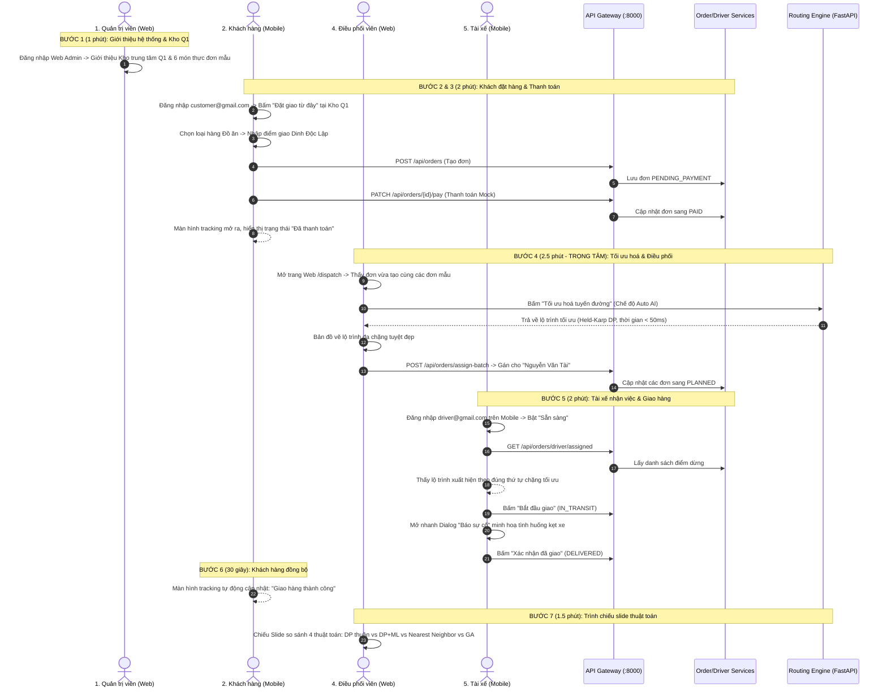

# SWIFTROUTE — KẾ HOẠCH TRIỂN KHAI CHI TIẾT
## Kế Hoạch Kết Nối Toàn Diện Hệ Thống & Kịch Bản Demo Bảo Vệ Đồ Án
> **Thời gian áp dụng:** Buổi Demo / Bảo vệ đồ án tốt nghiệp
> **Căn cứ tài liệu gốc:** `ke-hoach-demo.md`, `DEMO_EXECUTION_PLAN.md`, `ke-hoach-man-hinh-tai-xe.md`, `docs/KE_HOACH_LOAI_HANG_HOA.md`, `ke-hoach-trien-khai.md`.

---

## MỤC LỤC
1. [Nguyên Tắc Cốt Lõi & Chiến Lược Đóng Băng](#1-nguyên-tắc-cốt-lõi--chiến-lược-đóng-băng)
2. [Kiến Trúc Điều Phối & Cơ Chế Thuật Toán Tự Động Theo N](#2-kiến-trúc-điều-phối--cơ-chế-thuật-toán-tự-động-theo-n)
3. [Cơ Chế Mô Phỏng Kịch Bản What-If](#3-cơ-chế-mô-phỏng-kịch-bản-what-if)
4. [Cơ Chế Theo Dõi Thời Gian Thực: SSE & Polling Dự Phòng](#4-cơ-chế-theo-dõi-thời-gian-thực-sse--polling-dự-phòng)
5. [Kế Hoạch Chi Tiết Cho Từng Phân Hệ](#5-kế-hoạch-chi-tiết-cho-từng-phân-hệ)
   * 5.1. Backend Services & API Gateway
   * 5.2. Web Admin (Quản trị & Điều phối)
   * 5.3. Mobile App — Khách Hàng (Customer)
   * 5.4. Mobile App — Tài Xế (Driver)
6. [Kịch Bản Trình Diễn Live 7 Bước (Golden Demo Flow)](#6-kịch-bản-trình-diễn-live-7-bước-golden-demo-flow)
7. [Dữ Liệu Mẫu (Seed Data) & Môi Trường Thử Nghiệm](#7-dữ-liệu-mẫu-seed-data--môi-trường-thử-nghiệm)
8. [Kế Hoạch Phòng Ngừa Rủi Ro (Disaster Recovery)](#8-kế-hoạch-phòng-ngừa-rủi-ro-disaster-recovery)

---

## 1. NGUYÊN TẮC CỐT LÕI & CHIẾN LƯỢC ĐÓNG BĂNG

1. **Mục tiêu tối thượng**: Chạy thông suốt một luồng hoàn chỉnh từ **Khách đặt hàng** $\rightarrow$ **Vận hành tối ưu & điều phối** $\rightarrow$ **Tài xế nhận lộ trình & giao hàng** $\rightarrow$ **Khách theo dõi hoàn tất** trong khoảng thời gian **8 đến 10 phút**.
2. **Chiến lược "Làm thật — Seed sẵn — Giả lập — Cắt bỏ"** (Theo `ke-hoach-demo.md`):
   * 🔴 **Làm thật 100% (Live Demo)**: Đặt đơn đa điểm, thuật toán tối ưu lộ trình TSP, điều phối gán tài xế, app tài xế cập nhật trạng thái chặng, live tracking bản đồ.
   * 🟡 **Seed dữ liệu sẵn**: 1 Kho trung tâm Q1, 6 món/loại hàng mẫu, 1 khách hàng, 1 nhân viên, 3 tài xế và 8–10 đơn hàng mẫu quanh Quận 1, Quận 3.
   * 🔵 **Giả lập (Mock)**: Thanh toán trực tuyến VNPay qua nút thanh toán nhanh (`PATCH /api/orders/{id}/pay`), vị trí tài xế kết hợp nội suy mượt mà bám đường phố Goong Map.
   * ⚪ **Cắt bỏ / Chiếu slide**: Đăng ký OTP qua email, Chat nhắn tin trực tuyến, tài xế Pool nhận đơn tự do, data pipeline GCP (các phần này chỉ trình bày trong slide định hướng tương lai).

---

## 2. KIẾN TRÚC ĐIỀU PHỐI & CƠ CHẾ THUẬT TOÁN TỰ ĐỘNG THEO N

### 2.1. Triết lý thiết kế UX cho Doanh nghiệp (Tenant)
Doanh nghiệp và nhân viên điều phối **không cần và không nên bận tâm** phải chọn giữa *Held-Karp*, *Nearest Neighbor* hay *Genetic Algorithm*. Hệ thống cung cấp cơ chế **Tự động tối ưu AI (`auto`)**:

```
                       [ Danh sách N điểm giao ]
                                  │
                                  ▼
                     ┌─────────────────────────┐
                     │ Kiểm tra số lượng N:    │
                     └────────────┬────────────┘
                                  │
                 ┌────────────────┴────────────────┐
                 ▼ (N <= 14)                       ▼ (N > 14)
       ┌───────────────────┐             ┌───────────────────┐
       │   Held-Karp DP    │             │ Nearest Neighbor/ │
       │ (Bitmask DP O(n²2ⁿ))│             │   Genetic / ML    │
       │  Chính xác 100%   │             │  Tốc độ cao O(n²) │
       │  Thời gian < 0.1s │             │  Thời gian < 0.5s │
       └───────────────────┘             └───────────────────┘
```

* **Ngưỡng chuyển đổi**: `HELD_KARP_MAX_N = 14` (được cấu hình trong `services/routing-engine-service/service/optimizer_service.py`).
* **Hiển thị minh bạch**: Sau khi tối ưu, giao diện hiển thị badge:
  > *⚡ Đã tối ưu tự động bằng **Held-Karp DP** (N = 8 điểm, thời gian tính: 14ms, tối ưu tuyệt đối 100%)*.

### 2.2. Cơ chế lưu trữ kế hoạch & Điều phối xuống Database
Kế hoạch điều phối được lưu trữ theo quy trình 2 tầng:
1. **Lưu tại PostgreSQL (`order-service`)**:
   * Khi người điều phối bấm **"Xác nhận gán lộ trình"**, Web Admin gọi `POST /api/orders/assign-batch`.
   * Cập nhật bảng `orders`:
     * `assigned_driver_id = <UUID_DRIVER>`
     * `plan_id = <UUID_PLAN>`
     * `status = 'PLANNED'`
   * Ghi bản ghi vào `outbox_events` (`order.status_changed.v1`) để phát tán sự kiện.
2. **Lưu tại Routing Engine (SQLite Audit)**:
   * Bảng `routing_plans` lưu trọn vẹn JSON snapshot (thứ tự các chặng, thời gian từng chặng, metrics) để xem lại và so sánh.

---

## 3. CƠ CHẾ MÔ PHỎNG KỊCH BẢN WHAT-IF

### 3.1. Mục đích nghiệp vụ
Cho phép người điều phối thử nghiệm kịch bản giả định trước khi áp dụng thật:
* *"Nếu chiều nay có 1 tài xế xin nghỉ (chỉ còn 2 xe thay vì 3 xe), quãng đường và thời gian giao tăng thêm bao nhiêu %?"*
* *"Nếu chuyển trọng số từ Giao nhanh sang Tiết kiệm chi phí, giảm được bao nhiêu chi phí vận hành?"*

### 3.2. Cơ chế kỹ thuật (Stateless Dry-Run)
* **API**: `POST /api/routing/optimize/what-if`
* **Xử lý**:
  * Engine chạy song song 2 bài toán: **Kịch bản A (Thực tế hiện tại)** vs **Kịch bản B (Giả định)**.
  * **Tuyệt đối không ghi database**: Không đổi trạng thái đơn, không gán tài xế thật, không gửi thông báo.
* **Bảng so sánh đầu ra trên Web Admin**:

| Tiêu chí | Kịch bản Hiện tại (3 xe) | Giả định What-if (2 xe) | Chênh lệch ($\Delta\%$) |
| :--- | :---: | :---: | :---: |
| **Tổng quãng đường** | $42.5\text{ km}$ | $36.8\text{ km}$ | **$\downarrow 13.4\%$ (Tiết kiệm)** |
| **Thời gian hoàn thành ca**| $145\text{ phút}$ | $175\text{ phút}$ | **$\uparrow 20.7\%$ (Lâu hơn)** |
| **Đơn có rủi ro trễ hẹn**| 0 đơn | 1 đơn | Cảnh báo cần lưu ý |

---

## 4. CƠ CHẾ THEO DÕI THỜI GIAN THỰC: SSE & POLLING DỰ PHÒNG

1. **Kiến trúc Luận văn (SSE — Server-Sent Events)**:
   * Tài xế gửi tọa độ qua `PATCH /api/drivers/me/location`.
   * `driver-service` publish message qua RabbitMQ.
   * `order-service` mở kết nối `GET /api/orders/{orderId}/tracking/stream` (`text/event-stream`), push toạ độ thời gian thực về máy khách.
2. **Cơ chế Safe-Polling dự phòng cho buổi Demo**:
   * Nếu môi trường mạng WiFi trình chiếu không ổn định làm rớt stream SSE, app mobile tự động chuyển sang cơ chế Polling: gọi `GET /api/drivers/{driverId}/public` mỗi 3–5 giây.
   * Kết hợp với widget `GoongMapWidget` thực hiện **nội suy chuyển động mượt mà (Smooth Interpolation)** bám theo đường kính tuyến Goong Map, đảm bảo marker xe máy luôn lăn bánh uyển chuyển trên màn hình.

---

## 5. KẾ HOẠCH CHI TIẾT CHO TỪNG PHÂN HỆ

### 5.1. Backend Services & API Gateway (Port 8000)

| Service | Endpoint chính | Chức năng | Trạng thái |
| :--- | :--- | :--- | :---: |
| **api-gateway** (:8000) | `/*` | Xác thực JWT, chuyển tiếp header `X-User-Id`, `X-User-Role`, `X-Tenant-Id` | ✅ Đã cấu hình |
| **auth-service** (:8081) | `POST /api/auth/login`<br>`GET /api/auth/me` | Đăng nhập tài khoản, trả về JWT claim `_ROLE: DRIVER/CUSTOMER/ADMIN` | ✅ Đã kiểm tra |
| **order-service** (:8082) | `POST /api/orders`<br>`PATCH /api/orders/{id}/pay`<br>`POST /api/orders/assign-batch`<br>`GET /api/orders/driver/assigned`<br>`PATCH /api/orders/{id}/status` | Tạo đơn mới<br>Thanh toán giả lập demo (`PAID`)<br>Gán đơn cho tài xế (`PLANNED`)<br>Lấy danh sách đơn tài xế phụ trách<br>Cập nhật trạng thái (`IN_TRANSIT`, `DELIVERED`) | ✅ Đã sẵn sàng |
| **driver-service** (:8083)| `GET /api/drivers/me`<br>`PATCH /api/drivers/me/availability`<br>`PATCH /api/drivers/me/location`<br>`POST /api/drivers/me/delivery-events` | Xem hồ sơ tài xế<br>Bật/tắt trạng thái Sẵn sàng / Nghỉ<br>Cập nhật toạ độ GPS<br>Báo cáo sự cố khi giao hàng | ✅ Đã sẵn sàng |
| **routing-engine** (:8084)| `POST /api/v1/optimize/batch`<br>`POST /api/v1/plans/optimize-shift` | Tối ưu hóa lộ trình đa điểm (Held-Karp DP / Nearest Neighbor)<br>Lập kế hoạch ca làm việc | ✅ Đã sẵn sàng |

### 5.2. Web Admin (Next.js App Router — Cổng 3000)

* **Trang Đơn hàng (`/orders`)**: Xem danh sách toàn bộ đơn hàng, lọc theo trạng thái (`PAID`, `PLANNED`, `IN_TRANSIT`, `DELIVERED`).
* **Bàn điều phối (`/dispatch`)**:
  * Hiển thị các đơn hàng sẵn sàng điều phối (`PAID`).
  * Nút bấm **"Tối ưu hoá tuyến đường"** (tự động chạy thuật toán theo $n$).
  * Bản đồ trực quan hiển thị đường nối Depot $\rightarrow$ các điểm giao theo thứ tự tối ưu.
  * Thanh chỉ số: Quãng đường (km), Thời gian (phút), Thuật toán đã chạy.
  * Modal **"Điều phối tài xế"**: Chọn tài xế từ danh sách tài xế khả dụng và gửi lệnh gán batch.
* **Quản lý tài xế (`/drivers`)**: Xem danh sách 3 tài xế cơ hữu, biển số xe, loại xe và trạng thái.

### 5.3. Mobile App — Khách Hàng (Customer Role)

* **Màn hình C01 (Trang chủ)**:
  * Banner giao hàng nhanh.
  * Danh sách cửa hàng gần nhất: Thẻ **"Kho Hàng Trung Tâm Quận 1"** (0.0 km).
  * Nút cam **"Đặt giao từ đây"**.
* **Màn hình C02 (Tạo đơn hàng)**:
  * Điểm lấy hàng được điền sẵn: Kho Q1 (Bến Nghé, Quận 1).
  * Bộ chọn loại hàng `PackageCategory` (Đồ ăn, Tài liệu, Bưu kiện...).
  * Ô tìm kiếm điểm giao hàng (kết nối Goong Autocomplete).
  * Bản đồ Goong vẽ lộ trình và tính cước phí tự động.
* **Màn hình C03 (Thanh toán Mock)**:
  * Nút "Xác nhận tạo đơn" $\rightarrow$ Hệ thống tự động kích hoạt thanh toán demo (`PAID`).
* **Màn hình C04 (Live Tracking)**:
  * Bản đồ Goong Mapbox hiển thị điểm lấy hàng, điểm giao và vị trí xe máy.
  * Stepper tiến trình 4 mốc: *Chờ thanh toán* $\rightarrow$ *Đã phân công* $\rightarrow$ *Đang giao hàng* $\rightarrow$ *Đã giao thành công*.

### 5.4. Mobile App — Tài Xế (Driver Role)

* **Màn hình D02 (Trang chủ ca làm)**:
  * Thẻ trạng thái làm việc: Switch bật/tắt **"Sẵn sàng nhận đơn"** (Available).
  * Thẻ thống kê nhanh: Số đơn cần giao, thu nhập tạm tính.
  * Thẻ **Spotlight**: Nổi bật thông tin điểm dừng tiếp theo cần giao.
* **Màn hình D05 (Lộ trình trong ngày)**:
  * Danh sách các thẻ điểm dừng (`DriverStopCard`) sắp xếp đúng theo thứ tự chặng $1, 2, 3\dots$
  * Mỗi thẻ hiển thị: Tên khách, địa chỉ giao, khoảng cách, nhãn loại hàng.
* **Màn hình D06 (Chi tiết điểm giao & Hành động)**:
  * Nút **"Bắt đầu đến điểm này"** $\rightarrow$ Cập nhật đơn sang `IN_TRANSIT`.
  * Nút **"Xác nhận đã giao"** $\rightarrow$ Cập nhật đơn sang `DELIVERED`.
* **Màn hình D07 (Hộp thoại Báo sự cố)**:
  * Hộp thoại chọn loại sự cố: *Kẹt xe*, *Khách vắng mặt*, *Hỏng xe*, *Sai địa chỉ*.
  * Nút gửi báo cáo sự cố lên hệ thống.
* **Màn hình D09 (Tổng kết ca & Hồ sơ)**:
  * Xem số đơn hoàn thành, tổng quãng đường đã chạy và thù lao tích lũy trong ca.

---

## 6. KỊCH BẢN TRÌNH DIỄN LIVE 7 BƯỚC (GOLDEN DEMO FLOW)



---

## 7. DỮ LIỆU MẪU (SEED DATA) & MÔI TRƯỜNG THỬ NGHIỆM

### 7.1. Danh sách tài khoản thử nghiệm

| Vai trò | Email đăng nhập | Mật khẩu | Mục đích sử dụng |
| :--- | :--- | :---: | :--- |
| **Quản trị / Vận hành** | `admin@gmail.com` | `admin123` | Đăng nhập Web Admin quản lý và điều phối |
| **Khách hàng** | `customer@gmail.com` | `123456` | Đăng nhập Mobile App đặt đơn hàng |
| **Tài xế 1 (Chính)** | `driver@gmail.com` | `123456` | Đăng nhập Mobile App nhận lộ trình và giao |
| **Tài xế 2 (Phụ)** | `driver2@gmail.com` | `123456` | Tài xế dự phòng cho bài toán chia cụm |
| **Tài xế 3 (Phụ)** | `driver3@gmail.com` | `123456` | Tài xế dự phòng cho bài toán chia cụm |

### 7.2. Điểm Depot trung tâm (Tenant Kho Q1)
* **Tên**: Kho Hàng Trung Tâm Quận 1
* **Địa chỉ**: Bến Nghé, Quận 1, TP. Hồ Chí Minh
* **Tọa độ**: Vĩ độ `10.7769`, Kinh độ `106.7009`

---

## 8. KẾ HOẠCH PHÒNG NGỪA RỦI RO (DISASTER RECOVERY)

| Tình huống rủi ro | Khả năng xảy ra | Biện pháp xử lý ngay lập tức |
| :--- | :---: | :--- |
| **Mất mạng Internet lúc gọi Goong Map** | Thấp | Hệ thống đã có fallback tự vẽ đường chim bay (Interpolation) giữa điểm lấy và giao. |
| **Máy ảo Android bị lag khi mở 2 app** | Trung bình | Đăng nhập Khách hàng đặt đơn trước $\rightarrow$ Đăng xuất $\rightarrow$ Đăng nhập Tài xế đi giao trên cùng 1 máy ảo. |
| **Lỗi kết nối Socket / SSE** | Trung bình | App tự động chuyển sang Polling gọi `GET /api/drivers/{id}/public` mỗi 3s, không gián đoạn giao diện. |
| **Lỗi mạng cục bộ bất ngờ của máy chiếu** | Thấp | Toàn bộ hệ thống chạy 100% trên `localhost` bằng Docker Compose, hoàn toàn không phụ thuộc cloud lúc demo. |
| **Sự cố ngoài ý muốn (sập máy)** | Rất thấp | Có sẵn **video quay màn hình 8 phút** dự phòng sẵn trong USB/ổ cứng để trình chiếu ngay. |

---
*Tài liệu hoàn tất chuẩn bị cho buổi bảo vệ đồ án tốt nghiệp SwiftRoute.*

